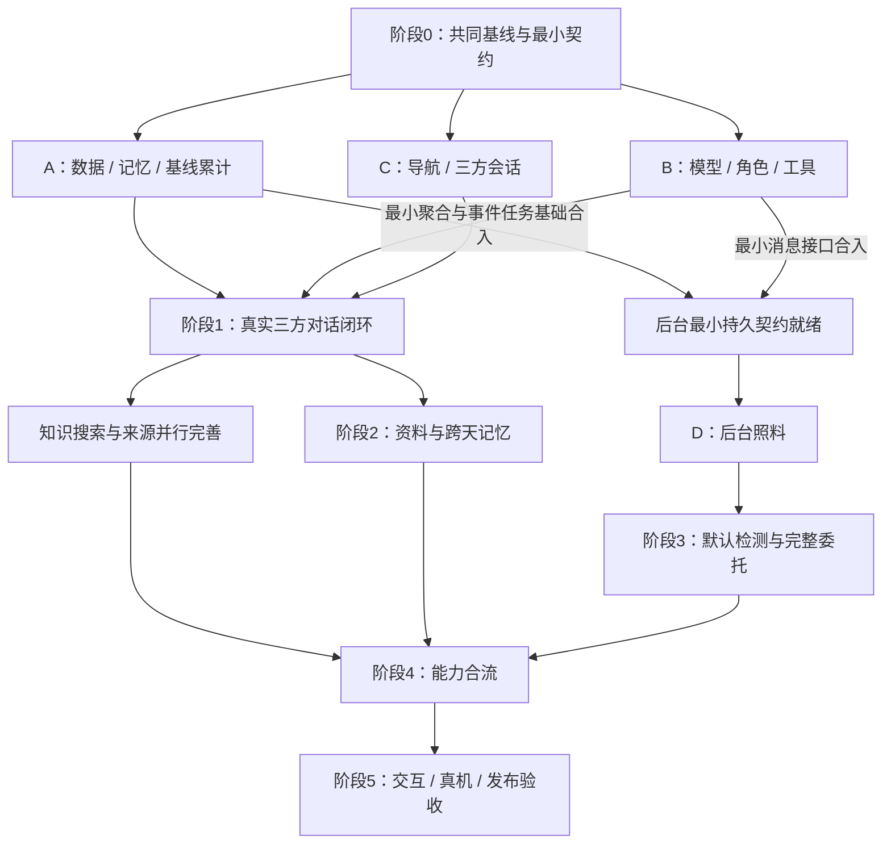

# PetSense Agent 实现路线与并行分工

日期：2026-11-12；细化更新：2026-11-13。状态：实施路线规划，尚未开始业务实现。

产品依据：[Agent 产品设计 V10](./agent-product-integration-design.md)。本路线确定阶段、先后依赖、并行边界与合流条件；具体接口字段、算法参数、模型提示词和运行实现，在各阶段启动时另行细化。

后续编写 spec 时，使用[实现工作包与依赖顺序](./agent-implementation-work-packages.md)：已拆为 P00–P20 共 21 个工作包，逐项列出前置交付、产出、验收和下游使用方。本路线维护六阶段与分工，工作包文档维护包级依赖，各 spec 再确定技术实现。

## 1. 总体顺序

**先跑通一条真实的伙伴体验，同时开始积累基线；再扩展共享记忆、知识工具和后台照料，最后合流验证。**

按六个阶段推进，阶段表示交付里程碑，不要求所有工作严格串行。每阶段都有可运行、可回归的结果，不把整个 V10 作为一张大任务一次做完。

| 阶段 | 主要产出 | 必须依赖 | 阶段完成的判断 |
| --- | --- | --- | --- |
| 0. 共同基线与最小契约 | 确认稿入库；消息/角色/主题、数据查询、记忆更新、事件/任务的最小约定；共享入口负责人 | 当前产品稿 | 后续各 worktree 能从同一提交、按同一约定工作 |
| 1. 第一条真实伙伴体验 | 新导航、三方消息流、角色路由、MiniMax 接入、读取一段真实数据、消息持久化；同期启动有效日累计 | 阶段 0 的共同骨架 | 能聊天、问真实数据、明确 @、拒绝无关请求；重新进入后消息仍在，学习进度可持续累计 |
| 2. 越聊越了解宠物 | 对话补资料、确认记忆、助手自定义、跨会话读取；完善任意时段查询、日汇总和基线存储 | 消息与最小持久基础 | 聊天提供的信息能在之后找到，两位角色和资料页使用同一版本 |
| 3. 后台持续照料 | 共用调度与恢复；默认检测、事实观察/定时回顾委托、进展与到期回信 | 可用聚合查询、持久状态与统一消息交付 | App 关闭后继续；服务重启可恢复；没有委托也能发现默认事件 |
| 4. 完整能力合流 | 联网知识与引用、成熟的日/周记忆、真实基线就绪后的个人变化、通知与主题续接 | 对应分支完成；个人比较需满足基线条件 | 一次照料问题能连贯使用知识、资料、观测、记忆与任务，结果回到同一主题 |
| 5. 体验打磨与发布验收 | 宠物情绪表达、角色配合、卡片/回信、上下钻、原生推送与原有功能回归 | 上述主链路已接通 | 用完整场景验证后具备分阶段发布条件 |

阶段 4 是各能力的合流节点，不表示搜索必须等阶段 3 完成才开发；联网工具可以从阶段 1–2 并行准备。动效也可提前做组件探索，但不等待整套视觉完成才联调。

## 2. 必须先做的基础

### 2.1 先建立共同 Git 基线

本轮核对时，产品设计稿仍是未跟踪文件。正式并行前，先把确认稿、本路线及工作包规划纳入共同 Git 基线；未提交的文档不会自动出现在新 worktree。

再合入最小共享骨架和约定，后续分支从该提交开始。只确定跨线需要共同理解的内容，不在准备阶段把全部业务字段和所有功能一次实现。

需要先统一的内容包括：

- 三方消息中的发言人、回合、主题、回复/提及与未读关系。
- 数据工具按宠物、时间范围和覆盖情况返回信息的基本语义。
- 资料/记忆候选如何确认、明确保存指令如何生效、写入后如何同步。
- 基线学习状态、默认检测事件与用户委托的区别。
- 前端消费的回复、确认、进展、结果与来源内容类型。

### 2.2 数据与持久状态先于复杂表现

先有最小消息、主题、记忆/设置存储，以及可查询的真实观测。数据模型和迁移由同一条线维护，随阶段增量扩展，不要求准备期完成全部长期记忆系统。

当前 `/observations` 的周/月响应部分摘要和事件仍按今日组织；需要统一历史查询，不能让不同分支各自修补一套口径。

位置语义由定位同学提供。接入后从成功解算/生成语义的位置建立区域历史；现有 UWB 富化发生在原始帧落库之后。区域未交付时先推进动作、声音与对话，不能让整个项目等待定位标签。

### 2.3 基线累计从早期启动

阶段 1 就开始保存可用观测和学习进度，让所需的 7 个有效日与其他开发并行。既有历史先检查可比性，可用部分直接计入。

动作、声音和区域分别学习；区域后接入就补学区域。个人比较是否开放按相应基线状态决定，不要求聊天、资料补充、知识查询或事实观察等到基线全部完成。

开发测试可用既有真实历史、真实回放和隔离实例验证过程；不能把构造数据累计成真实用户的“已学习七天”。

### 2.4 外部服务尽早验证，避免晚期卡住

阶段 0–1 列清 MiniMax 模型接入、图片能力、搜索提供方式和目标原生推送平台；拿到实际凭据时尽早做小范围连通验证。

缺模型或搜索凭据时可继续做契约、适配与隔离测试，但对应真实服务尚未连通就不能算该能力验收通过。当前只做规划，不要求此刻提供 key。

## 3. 每阶段的核心切片

### 阶段 1：先让用户真的和它们聊起来

以一个完整回合为目标：主人输入 → 范围与指向判断 → 读取本宠上下文或真实数据 → 爱宠/助手回应 → 消息保存 → App 展示。

首个场景覆盖普通陪伴、一个真实数据问题、明确 @ 和一个无关请求。界面同时完成今日/位置/伙伴/社区/我的导航与记录下沉；今日按已确认 dashboard 保留。

此阶段只需最小记忆读取和消息持久化，不先建设全部周汇总、复杂习惯或完整委托管理。早期 UI 可以使用真实回放或诚实空态开发，阶段交付必须连通真实服务，不能交付假数据伙伴页。

### 阶段 2：让聊天变成共同认识

优先完成一个可验证的闭环：“主人补充资料 → 明确指令/内联确认 → 正确存储 → 资料页刷新 → 两位角色之后都能读回”。

同时完成助手设定、来源与修订、相关历史检索、日汇总及学习进度。生日/体重等字段按实际需要扩展，不一开始做完整医疗档案。

知识工具线在此期间独立推进搜索、网页阅读、来源展示与话题范围；它不依赖观察任务执行器。

### 阶段 3：让后台持续工作

先实现共同的调度、持久检查点、重启恢复、事件合并与消息交付，再分开完成两种能力：

- 默认检测：设备质量规则，以及对应基线就绪后的个人变化；不要求主人先建委托。
- 用户委托：先做定时回顾和事实观察，再接个人比较；有起止、有确认、有状态、有结果。

先验收一件委托从确认到到期回信，再扩展模板。早期可先在 App 内形成可恢复的消息；关闭 App 后通知的目标在阶段 4–5 原生推送验收前补齐，不提前宣称完整通知链路已交付。

### 阶段 4：把能力连成一个伙伴

用一个综合场景合流：补充宠物资料 → 查询养宠知识 → 查看这只宠物近期变化 → 确认关注几天 → 收到回信 → 追问上次结果。

此时确认日/周经历可长期读取、个人比较使用实际就绪的基线、搜索引用真实可查、铃铛与伙伴定位到同一主题。知识回答与本宠事实分别处理，两个角色使用同一更新版本。

### 阶段 5：体验与交付

集中检查三方发言节奏、内联确认、任务交接、回信、主题展开和返回、输入草稿与通知定位；此时打磨主要动效，不将高精度算法研究作为体验交付前置。

覆盖断线、数据不足、模型/搜索失败、资料纠正、取消/修改、重复请求、重启与到期等完整场景。按目标平台进行真机推送与导航验收，并回归今日、位置、记录、设备、PetGIF 和社区原有流程。

## 4. worktree 并行边界

建议起步三条实现主线，接口与持久基础稳定后再开放第四条。每条线按阶段连续交付小改动，不为每个按钮或每张卡片各建一个长期分支。

| 主线 / 建议分支名 | 主要负责 | 起跑条件 | 主要依赖 |
| --- | --- | --- | --- |
| A 数据与记忆：`codex/agent-data-memory` | 统一查询、区域历史、资料扩展、消息/记忆/基线存储和迁移 | 阶段 0 后 | 定位语义交付只影响区域部分 |
| B Agent 与知识：`codex/agent-dialogue-tools` | MiniMax 适配、话题范围、三方路由、上下文、工具与搜索 | 共同消息/工具约定确定后，可与 A 同时开始 | A 提供的查询与持久接口 |
| C App 体验：`codex/agent-app` | 导航、记录下沉、三方消息、设定、确认/结果卡、主题详情与铃铛定位 | 回复/卡片约定确定后，可与 A/B 同时开始 | B 的消息服务，A 的资料/学习状态 |
| D 后台照料：`codex/agent-background-care` | 默认检测、委托、调度恢复、阶段/到期结果与通知交付 | 最小聚合、事件/任务及消息接口合入共同基线后 | A 的数据/基线，B 的解释与回信，C 的展示 |

这些是后续分工建议，本轮不创建 worktree。

### 4.1 并行波次

B/C 可以按契约先开发，但与 A 的最小真实服务接通后才完成阶段 1。D 以图中的最小持久契约为启动门槛，不要求等待阶段 2 的所有资料、设定和记忆体验做完；后者可以继续并行完善。

默认检测与用户委托可以在 D 内按独立模块分工；共同调度、事件/任务接口和消息交付由同一负责人统筹。若已有合适工作树可以复用，不因主线名字不同重建全部环境。

### 4.2 不能各自随意改的共享入口

| 共享位置 | 建议统一负责人 | 原因 |
| --- | --- | --- |
| 数据库模型及 Alembic 迁移链、模型导出入口 | A | 避免多条迁移头和不同分支定义同一字段 |
| `server/petsense/app.py` 中 blueprint 与后台启动接线 | 集成人 | A/B/D 都依赖，但应只接一次 |
| MQTT/观测与定位语义接入钩子 | A，和定位同学对齐 | 避免重复入库、重复学习或接在富化前 |
| Agent 消息/事件/工具结果的共享契约 | 指定一位契约维护人，A/B/C/D 共同评审 | 改一处会影响多线，变更须同步到共同基线 |
| App 导航、根布局、记录页面迁移 | C | 避免多个分支同时移动路由 |
| 依赖、锁文件、CI/运行配置 | 集成人统筹，领域负责人提出 | 避免重复加依赖、运行方式分叉 |

Agent 消息另设类型和服务层，不把聊天格式塞入既有遥测解析器。各线在自己的模块内工作；需要改共享入口时，由负责人先做小提交合入，其他分支更新后继续。

## 5. 合流和阶段门槛

1. 维护一条共同集成基线，各实现分支从同一已提交节点出发；每完成一个小切片就集成，不等四条线全写完。
2. 跨线契约和最小 schema 先合；然后数据/服务实现、客户端消费和后台能力按依赖合入。合入顺序不等于必须串行开发。
3. 每个阶段结束后，所有活跃分支更新到同一新基线，再继续下一批工作，及时解决接口变化。
4. 各 worktree 用独立开发数据库、临时 `PETSENSE_ROOT`、测试账号与服务端口。并行实例不能共用一个运行数据库或修改生产测试宠物资料。
5. 当前 main 相关路径通过 CI 后会触发后端部署或客户端 OTA。阶段改动要保持兼容、可独立发布；未完成能力用开关控制，接入顺序先兼容后端，再开放客户端入口。不要把“合并”当成与发布无关的动作。
6. 原生通知等新增原生能力单独安排构建和真机验收；Web/回放测试不能替代这一验收。

沿用项目检查：客户端改动执行 lint、typecheck、format:check、test 与 CI Web 构建；服务端改动执行 `python -m unittest discover -s server/tests`，跨域改动补相应回归。每个阶段通过相关检查后再扩大集成，不等到最后一次性测试全部变化。

## 6. 首版优先级和延后项

**必须先闭环：**真实三方消息、数据查询、消息/资料持久化、话题范围、早期基线累计。随后补齐共享长期记忆、搜索和一个完整后台委托，并验收默认检测不依赖用户委托。

**可并行但不应卡主链：**定位语义交付、搜索提供方适配、角色文案与少量动画、原生推送接入。它们各有合流门槛，不因为暂缺一项就停止其他开发。

**首版后再扩：**更多观察模板、复杂群体先验、独立多 Agent 自治、向量记忆框架、语音/媒体生成、精细定位/行为算法与智能家居控制。社区维持现状。

各阶段启动时再细化：接口字段与持久结构、学习有效日和变化规则、提示词/路由策略、后台运行方式、搜索与推送的具体接入。届时以该阶段已合入代码为基线讨论。

## 7. 本轮交付状态

本轮仅维护实现路线、细化工作包并同步产品稿入口，未创建 worktree、未开始业务实现、未修改生产服务。现行运行和开发约定未改变，因此不修改 `AGENTS.md` 的实现说明；实施中涉及关键路径和接口时同步维护。
