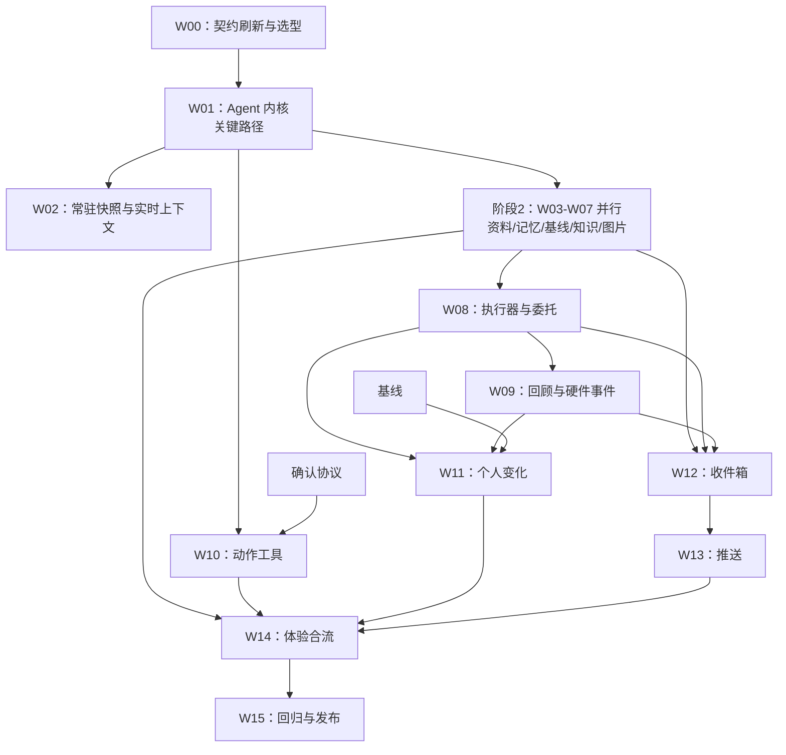

# PetSense Agent 实现路线与并行分工

日期：2026-11-12；2026-11-22 随[设计 V11](./agent-product-integration-design.md)（以 Agent 为设计对象）整体刷新。状态：实施路线规划；阶段 1 首切片已合入部署，验证边界见[实施记录](./agent-phase-one.md)。

本路线确定阶段、先后依赖、并行边界与合流条件；包级依赖与交付边界见[W 系列工作包](./agent-implementation-work-packages.md)（W00–W15），各 spec 再确定技术实现。V11 架构前提对路线的约束：**W01（Agent 内核）是关键路径**——统一运行循环、工具注册表与权限矩阵合入之前，不并行开发依赖内核的新能力；旧路由上的对话行为冻结，只修缺陷。

## 1. 总体顺序

**先让内核替换旧路由并接上实时上下文，再并行扩展工具与记忆，然后打开自主运行与动作能力，最后合流验证。**

| 阶段 | 主要产出 | 必须依赖 | 阶段完成的判断 |
| --- | --- | --- | --- |
| 0. 契约刷新与选型 | W00：契约按运行/轨迹/工具注册/权限矩阵/分级记忆刷新；选型入库；现状处置清单 | V11 设计稿确认 | 各线能从同一提交、按同一契约工作；旧路由删除清单明确 |
| 1. 内核与实时上下文 | W01+W02：删除前置路由；全部对话跑在统一循环；轨迹可回放；WS 直连替代轮询、前端栈迁移；常驻快照上线 | 阶段 0 | 既有对话场景行为不劣化；「它现在在干什么」能答且数值可溯源；越权调用被矩阵拦截；WS 断线重连不重复 |
| 2. 记忆与能力并行 | W03–W07：资料确认闭环、记忆分级写入、基线工具、联网知识、图片输入 | W01 | 聊天提供的信息被分级记住、可回滚、跨天可用；知识有来源；档案页与人格同版本 |
| 3. 自主运行与动作 | W08–W10：委托全生命周期、周期回顾与硬件事件、动作工具（录音/日记/社区草稿） | W08 执行器基础先行 | App 关闭后继续、重启可恢复；无委托也有回顾发现；动作经确认门真实执行 |
| 4. 能力合流 | W11–W13：个人变化、统一收件箱、原生推送 | 对应分支完成；个人比较需基线就绪 | 一次照料问题连贯使用知识、资料、观测、记忆、任务与动作，结果回到同一主题；真机推送通过 |
| 5. 体验与发布验收 | W14+W15：完整场景打磨、行为评测集回归、原功能回归 | 上述主链路已接通 | 用完整场景验证后具备分阶段发布条件 |

阶段是交付里程碑，不要求严格串行：阶段 2 的五包彼此并行；W06 受 MiniMax 搜索实测约束，可与外部验证并行推进；动效组件可提前探索。

## 2. 必须先做的基础

### 2.1 共同基线

阶段 0 的 P 系列契约已入库（`1a2af8d`）；阶段 1 首切片已合入 main 并部署（PR #14）。V11 重构后，W00 先把契约刷新到新语义（运行/轨迹/工具注册/权限矩阵/常驻快照/分级记忆），连同选型记录与旧 P→W 映射纳入 Git 基线，后续分支从该提交起步。

需要先统一的内容：

- 运行（Run）与轨迹的最小语义：触发形态、结构化判断元数据、工具调用记录、预算与失败状态。
- 工具注册表与权限矩阵的声明格式；确认门（明确指令/已确认提案）的生效路径。
- 常驻快照的内容边界与各来源的有效性口径（过期、离线、失效定位不算当前）。
- 分级记忆的级别划分与落库前校验字段。
- 前端消费的回复、确认卡、执行结果卡、回信与来源内容块类型。

### 2.2 数据与持久状态先于复杂表现

沿用：先有最小消息、快照、记忆/设置存储与可查询的真实观测；数据模型和迁移由同一条线维护，随阶段增量扩展。区域语义由定位同学提供，未交付时相应工具返回明确 unavailable，不阻塞动作/声音与对话。

### 2.3 基线累计从早期启动

版本化学习日已在阶段 1 随观测持续累计，重构不重置；W05 在其上补基线计算。开发测试可用既有真实历史、回放和隔离实例验证过程；不能把构造数据累计成真实用户的「已学习七天」。

### 2.4 外部服务尽早验证

MiniMax 搜索/网页阅读能力（W06 的硬前提）、Expo 推送凭据（W13）、区域语义（区域工具）分别确认负责人，拿到凭据尽早小范围连通验证。缺凭据可继续做契约、适配与隔离测试，但对应真实能力不能标为验收通过。

## 3. 每阶段的核心切片

### 阶段 1：让内核替换旧路由

以一次完整对话运行为目标：主人输入 → 常驻快照注入 → 循环内完成范围/意图/人格判断与工具调用 → 结构化交付 → WS 增量直达 App → 轨迹落库。首个场景覆盖：普通陪伴、实时状态问答（零工具）、历史数据问答（工具）、明确 @、无关请求拒答（模型生成）、越权调用拦截、断线重连降级轮询；客户端同步迁移到组件库 + zustand 前端栈（V11 §18）。`decide()` 与 intent 固定文案分支在此阶段删除。

### 阶段 2：让聊天变成共同认识

优先完成可验证闭环：主人讲述经历 → 自主写入（可回滚）→ 跨天找回；主人补充生日/体重 → 确认卡 → 档案页刷新 → 两位人格读到同一版本。知识线并行推进搜索与来源展示。

### 阶段 3：让后台持续工作并动起来

先合入执行器基础设施（调度、物化、游标、恢复、去重），再完成委托全生命周期与周期回顾；动作工具（录音/日记/社区草稿）经确认门接入。先验收一件委托从确认到到期回信、一次真实录音执行、一次日记幂等生成。

### 阶段 4：把能力连成一个伙伴

综合场景合流：问实时状态 → 补资料 → 图片交流 → 查知识 → 关注变化 → 确认委托 → 收到回信 → 动作 → 追问上次结果，全部在同一主题下连贯完成。

### 阶段 5：体验与交付

集中检查双人格节奏、确认卡、任务交接、回信、上下钻、返回、草稿与通知定位；覆盖断线、数据不足、模型/搜索失败、动作失败、资料纠正、取消/修改、重启与到期；真机推送与导航验收，回归今日、位置、记录、设备、PetGIF 和社区原有流程；行为评测场景集全量回归。

## 4. worktree 并行边界

建议四条实现主线；每条线按阶段连续交付小改动，不为每个按钮或每张卡片各建一个长期分支。

| 主线 / 建议分支名 | 主要负责 | 跑步条件 | 主要依赖 |
| --- | --- | --- | --- |
| A 数据与记忆：`codex/agent-data-memory` | PetMemory 分级写入、基线计算、pets 域扩展与迁移 | W00 后 | 区域语义只影响区域部分 |
| B 内核与知识：`codex/agent-dialogue-tools` | 运行循环、快照服务、工具注册表与权限矩阵、确认协议、搜索、图片 | W00 后即可启动内核（W01/W02） | A 提供的记忆/基线接口（阶段 2 起） |
| C App 体验：`codex/agent-app` | 会话与卡片容器（确认/执行/结果三态）、来源/主题层级、设定页、收件箱与通知定位 | W01 契约确定后 | B 的消息服务，A 的资料/学习状态 |
| D 自主运行与动作：`codex/agent-background-care` | 执行器、检查点/回顾/事件运行、动作工具服务端、推送 | W08 契约与消息接口合入后 | A 的数据/基线，B 的运行循环，C 的展示 |

这些是分工建议，本轮不创建 worktree；已有合适工作树可复用。

### 4.1 并行波次

W01 合入前不开发依赖内核的新能力；W10 只依赖 W01+W03，可与 W08 并行。

### 4.2 不能各自随意改的共享入口

| 共享位置 | 建议统一负责人 | 原因 |
| --- | --- | --- |
| 数据库模型及 Alembic 迁移链、模型导出入口 | A | 避免多条迁移头和不同分支定义同一字段 |
| `server/petsense/app.py` 中 blueprint 与后台启动接线 | 集成人 | 各线都依赖，但应只接一次 |
| MQTT/观测与定位语义接入钩子 | A，和定位同学对齐 | 避免重复入库、重复学习或接在富化前 |
| **工具注册表、权限矩阵与系统提示** | B（W01 负责人），A/C/D 共同评审 | 新增工具须先改契约再注册，改一处影响多线 |
| Agent 消息/事件/工具结果/轨迹的共享契约 | 指定一位契约维护人 | 变更须同步到共同基线 |
| App 导航、根布局、记录页面迁移 | C | 避免多个分支同时移动路由 |
| 依赖、锁文件、CI/运行配置 | 集成人统筹，领域负责人提出 | 避免重复加依赖、运行方式分叉 |

Agent 消息另设类型和服务层，不把聊天格式塞入既有遥测解析器。各线在自己的模块内工作；需要改共享入口时，由负责人先做小提交合入，其他分支更新后继续。

## 5. 合流和阶段门槛

1. 维护一条共同集成基线，各实现分支从同一已提交节点出发；每完成一个小切片就集成，不等四条线全写完。
2. 跨线契约和最小 schema 先合；然后数据/服务实现、客户端消费和后台能力按依赖合入。合入顺序不等于必须串行开发。
3. 每个阶段结束后，所有活跃分支更新到同一新基线，再继续下一批工作。
4. 各 worktree 用独立开发数据库、临时 `PETSENSE_ROOT`、测试账号与服务端口；并行实例不能共用一个运行数据库或修改生产测试宠物资料。
5. 当前 main 相关路径通过 CI 后会触发后端部署或客户端 OTA。阶段改动保持兼容、可独立发布；未完成能力用开关控制，先兼容后端再开放客户端入口。
6. 原生通知等新增原生能力单独安排构建和真机验收；Web/回放测试不能替代。
7. **行为回归是主要质量手段**：规则分支删除后，各包沉淀的行为评测场景集在隔离实例上随集成运行（V11 §12.4）。

沿用项目检查：客户端改动执行 lint、typecheck、format:check、test 与 CI Web 构建；服务端改动执行 `python -m unittest discover -s server/tests`，跨域改动补相应回归。

## 6. 首版优先级和延后项

**必须先闭环：**内核替换旧路由（W01）、常驻快照（W02）、资料确认与记忆分级写入（W03/W04）、一个完整委托（W08）、动作工具经确认门执行（W10）。随后基线比较（W05/W11）、搜索（W06）与收件箱/推送（W12/W13）。

**可并行但不应卡主链：**定位语义交付、搜索提供方适配、角色文案与少量动画、原生推送接入。

**首版后再扩：**更多动作工具（扩展 `control_device` 的 action 集）、向量记忆检索、语音/媒体生成、精细定位/行为算法、MCP 对外暴露工具、智能家居控制。社区维持现状。

各阶段启动时再细化：接口字段与持久结构、工具 schema 与提示词、预算数值、后台运行方式、搜索与推送的具体接入。届时以该阶段已合入代码为基线讨论。

## 7. 本轮交付状态

阶段 1 首切片（旧 P01–P06）已合入 main 并部署腾讯云。V11 重构的 W00、W01 已完成，分别见 [W00 spec](./agent-w00-spec.md) 和 [W01 spec](./agent-w01-spec.md)。

W02 已完成（2026-11-22）：iOS 发送、收包和轨迹回放经独立补验打通；复验暴露的离线电量转述、被拒查询无依据转述、模糊澄清不稳定三项已修复闭环（`f5b61f9`/`8d44f11`），行为评测最终 15/15；真项圈在线时段实机核对待设备上线。见 [W02 spec](./agent-w02-spec.md) §9.1–§9.3。W05 已实现（2026-11-22，分支待合入；spec 与实施记录见 [W05 spec](./agent-w05-spec.md)，行为评测与模拟器验收待部署后补）。下一包 W03。
