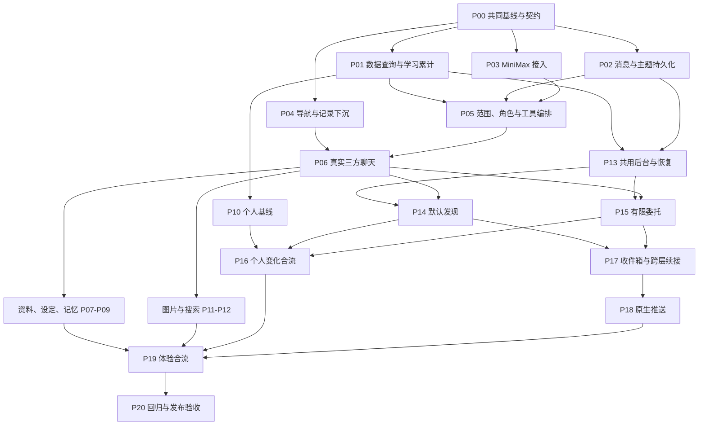

# PetSense Agent 实现工作包与依赖顺序

日期：2026-11-13。状态：开发规划，尚未开始业务实现。

产品依据：[Agent 产品设计 V10](./agent-product-integration-design.md)。阶段与并行分工依据：[实现路线](./agent-implementation-roadmap.md)。本文把路线细分为 **P00–P20 共 21 个工作包**，供后续逐份编写 spec；不是接口或数据库的最终技术设计。

## 1. 如何使用这份规划

每个工作包原则上对应一份 spec，以一个可联调、可验收的结果为边界。包内可继续拆服务端、客户端和测试任务，不为每个组件单独写一份互不关联的 spec。

本文的“前置依赖”指该包**完整验收必须使用的上游交付**。接口约定确定后，可以先开发适配和组件；只有连接真实服务、通过场景验收，才算交付完成。定义了接口、完成模型替身测试或展示了静态卡片，都不等于真实能力已交付。

顺序遵循以下原则：

1. 先统一跨端约定，再让数据、模型和 App 并行；先打通一轮真实对话，不等待完整记忆系统。
2. 从 P01 就保存可用于学习的真实数据和覆盖信息，七个有效日与其余开发并行累计；不是到 P10 才开始采集。
3. 先有可确认、可纠正的资料真值，再组织长期记忆；消息历史不是宠物档案，也不是任务执行器。
4. 默认异常发现和用户委托是两条业务链，共用后台执行与交付基础。先做不依赖个人基线的部分，再接个人变化。
5. 搜索、图片输入和原生推送尽早验证外部条件，按各自依赖推进；不都压到最后一个阶段。
6. 每个功能包同时交付必要的页面层级、返回和空态。最后的体验包负责整体打磨，不补建此前遗漏的关键交互。
7. 每次合入都要满足部署兼容要求。当前 main 相关变更会触发服务端部署或客户端 OTA，应先合兼容后端，再开放客户端；中间状态用功能开关或合批开放，不能到 P20 才处理发布顺序。

## 2. 总览：推荐实施批次

批次用于安排工作，不构成整批等待。例如 P13 的前置交付满足后就可以启动，不必等 P07–P12 全部结束。

| 批次 / 原阶段 | 工作包 | 本批交付的可见结果 | 可提前并行的部分 |
| --- | --- | --- | --- |
| 0 / 阶段 0 | P00 | 共同基线、最小契约、负责人及外部服务验证清单 | 模型、搜索、推送的连通准备 |
| 1 / 阶段 1 | P01、P02、P03、P04 → P05 → P06 | 真实三方聊天、真实数据问答、导航调整、消息恢复；开始累计学习证据 | P01–P04 并行；P06 可按已定契约先开发 |
| 2 / 阶段 2 | P07、P08、P09、P10 | 对话补资料、助手设定、跨会话记忆、分维度学习状态 | P08 与 P07 并行；P10 不必等待 P07/P09 |
| 2 的并行线 / 阶段 4 合流 | P11、P12 | 图片交流、联网知识与可查来源 | P05/P06 就绪后推进，不等待后台委托 |
| 3 / 阶段 3 | P13 → P14、P15 | 关闭 App 后仍执行的默认发现、事实观察和定时回顾 | P13 在 P01/P02 后可先做；P14/P15 分开实现 |
| 4 / 阶段 4 | P16、P17 → P18 | 个人变化、基线型委托、统一消息定位、原生通知 | P17 的路由/收件箱基础和 P18 的原生准备可提前 |
| 5 / 阶段 5 | P19 → P20 | 连贯的宠物体验及可发布版本 | 动效组件可提前探索；完整验收使用真实主链 |

### 2.1 关键依赖图

下图强调主要合流点；每包完整前置以第 3 节为准。

## 3. 工作包及交付边界

### P00：共同基线、跨端契约与外部条件

阶段 0 的具体约定与验证状态见 [P00 跨端最小契约](./agent-p00-contract.md)。联网搜索采用用户指定的 MiniMax 能力，其目标模型和生产接入方式仍需验证。

**前置：**确认产品稿与现有实现范围。

**交付：**

- 将确认的设计、路线及本规划纳入共同 Git 基线，再确定后续分支的起点；本轮规划不自动提交或推送。
- 定义消息/回合/主题/角色、提及与回复、流式结果、确认内容、来源定位、学习状态、事件与委托的最小约定和示例。此时只约定后续必须兼容的语义，不一次实现全部对象。
- 明确宠物主体、发生时间/入库时间、时区与时间窗口、数据缺失和版本的基本口径；指定迁移、消息契约、导航和后台启动的维护人。
- 列出 MiniMax 文字/图片、搜索与网页阅读、目标平台推送的接入条件。凭据就绪后尽早验证；分别记录已连通、未验证及替代路径，不把模型 key 视为搜索能力已开通。

**验收：**数据、Agent、App、后台四条线能基于同一份约定列出输入输出；未解决的外部条件有负责人。缺外部凭据不阻塞无关开发，但相应真实能力不能提前标为完成。

**交给后续：**全部工作包共用的契约、责任边界及开发基线。

### P01：统一观测查询与早期学习累计

**前置：**P00。与 P02、P03、P04 并行。

**交付：**

- 为动作、声音、可用体征和位置提供按宠物、任意时间范围查询的统一业务层，返回覆盖、缺口和来源；修正直接复用现有周/月响应会混入今日摘要的问题。
- 复用分钟聚合和事件，尽早保存学习所需的覆盖、特征/算法版本、粗时段及有效日进度；按初版规则累计，并能在 P10 规则完善后重算。检查既有历史的可比性，可用部分直接计入。
- 为服务端位置语义提供适配边界；语义交付后，在成功解算/生成标签之后保存区域停留和有效状态。不能从当前原始帧表推定已经存在最终语义。
- 提供统一的记录定位信息，供 Agent 来源卡与二级记录页使用。

**验收：**查询昨天、指定两小时和跨日范围得到对应数据，而非今日摘要；断流显示缺口；重复处理不重复累计。真实历史与回放可验证流程，测试记录不写成用户真实学习日。

**交给后续：**P05 的只读数据工具、P09 的汇总材料、P10 的学习证据，以及 P13–P16 的观察输入。

**条件交付：**动作/声音等可先验收；区域部分单列待接入项。区域未交付不阻塞其他维度，依赖区域的查询与委托暂不开放。

### P02：消息、回合与主题的最小持久基础

**前置：**P00。

**交付：**

- 新 Agent 域及最小数据库迁移；保存主人/爱宠/助手消息、回合、主题、回复和提及关系。
- 历史分页、指定消息定位、最小已读状态，以及发送重试所需的稳定标识；保存流式生成的最终状态和失败状态。
- 一个统一的消息写入/交付入口，后续互动回复、发现和回信复用；Agent 业务服务与现有遥测解析分开。

**验收：**退出重进、重启服务后仍能定位同一回合；同一发送请求重试不产生两条主人消息，失败不会伪装成完整回复。

**交给后续：**P05/P06 的对话基础及 P13/P17 的后台结果交付基础。此包不实现完整通知中心和推送。

### P03：MiniMax 模型适配与真实连通

**前置：**P00；真实服务验收需要实施时提供凭据。

**交付：**

- 可配置模型的服务端适配层，覆盖文本、流式输出、工具调用、超时/中断与错误；模型厂商接口与业务角色编排分开。
- 验证账户可用的图片输入方式，给 P11 留出真实适配入口；搜索单独验证，不隐含在模型适配里。
- 用可控调用验证结构化结果和工具往返，不在此包引入独立自治多 Agent 框架。

**验收：**真实模型完成文本流式响应和一次工具往返；错误可被上层正确识别。图片是否已验证单独记录，模型 ID 在实施 spec 中确定。

**交给后续：**P05 的模型能力与 P11 的多模态接入基础。

### P04：导航调整、记录下沉与返回约定

**前置：**P00；新增统计与时段 → 日 → 周的完整验收另依赖 P01。导航迁移可先独立于数据/模型接入实施。

**交付：**

- 底部导航调整为今日、位置、伙伴、社区、我的；记录迁至根 Stack，保留 `/records`，伙伴使用已约定的入口。
- 今日保持已确认 dashboard，活动/体征等摘要直接进入记录；位置继续以现有 UWB/GPS 为主，社区维持现状。
- 实现日期、指标、时段、来源及返回位置的路由状态；打通记录的时段 → 日 → 周上探。需要新统计的数据展示接 P01，不伪造聚合。
- 为伙伴/主题详情预留路由和状态恢复方式。P04 先合入时用入口开关，或与 P06 合批开放，不将空壳伙伴页作为可用功能发布。

**验收：**今日 → 记录 → 今日、直接打开记录、Tab 切换均正常；原位置和社区流程可用，记录不再占 Tab；已有深链仍可用。

**交给后续：**P06 的主入口，以及来源、主题、通知共用的导航与返回机制。

### P05：范围判断、角色路由与只读工具编排

**前置：**P01、P02、P03。

**交付：**

- 一个会话编排器与爱宠/照料助手两个角色响应器，共享同轮事实上下文；先读取现有档案、相关消息与真实观测，不等待完整长期记忆。
- 实现语义话题范围、显式称呼/@/回复优先、当前主题承接、角色纠正和最多两位有序回应。生成消息不触发角色无限互答。
- 接入当前/历史只读数据工具和来源；区分立即问答、知识需求、资料更新意图与持续委托意图。尚未实现的写入/委托只能说明能力状态，不能假称已保存或已启动。
- 输出 App 可消费的角色、正文、来源、状态与后续内容位置。

**验收：**普通陪伴、昨天的数据问答、明确 @、角色纠正均可运行；“疫苗程序”不误判为代码，“宠物商城代码”不因含宠物词而放行；无关请求不调用业务工具或写入宠物记忆。

**交给后续：**P06 的真实回复，以及资料、搜索、多模态和委托共用的编排入口。

### P06：第一条真实三方伙伴体验

**前置：**P02、P04、P05。组件可按 P00 契约提前开发。

**交付：**

- 一个共享消息流与单输入区，明确三方身份；发送、流式响应、历史加载、失败重试、@、回复某条消息和当前指向提示。
- 最小主题聚焦视图：从消息进入相关主题、继续讨论，再收起返回原会话；保留滚动、草稿和指向。查看已有内容不重复调用模型。
- 一条真实数据回复能展开来源并进入对应记录，再返回原消息；学习期使用真实状态或诚实空态。

**验收：**主人提问 → 查询真实数据 → 正确角色回应 → 重进仍可读回 → 下钻依据并返回完整走通；断线重试不重复发言。界面不散布多个“调用 AI”按钮。

**交给后续：**后续卡片、记忆、搜索和后台回信共同使用的真实会话容器。至此达到阶段 1 交付门槛。

### P07：对话补资料、确认与纠正

**前置：**P02、P05、P06。底层字段和写入服务可先开发。

**交付：**

- 在 pets 域扩展实际需要的生日/年龄、带发生日期的体重等资料，连同校验、迁移与原资料页面读写；不在聊天文本里维护唯一真值。
- 提取资料/经历候选，识别主体、时间、否定、假设与不确定性。明确“记住/更新为”且内容清楚时直接保存并回显；普通陈述用可合并的内联确认，不打断后续聊天。
- 保存来源、确认与修订关系，提供拒绝、改正及详情；写入成功后同步原资料页、共享上下文和两位角色。

**验收：**生日修正、模糊年龄、当日体重、其他宠物的描述、否定/假设均按约定处理；保存成功才显示成功；之后询问两位角色和查看档案得到同一版本。

**交给后续：**P09 的可信资料与主人经历，以及 P12 结合本宠资料回答时使用的真值。宠物拟人台词和外部知识不进入本宠事实。

### P08：助手设定与成员详情

**前置：**P05、P06。与 P07 并行。

**交付：**

- 群聊成员详情：宠物先进入现有档案，助手进入专属设定；均返回同一会话位置。已确认认识在 P07/P09 就绪后接入，不由本包独立提供完整记忆详情。
- 名字、头像、称呼、语气、详略、关注方向和主动表达程度的持久配置，以及自然语言修改入口。
- 设置与宠物事实分开；修改后下一轮采用新配置，仍遵守相同话题和工具边界。

**验收：**在页面和对话中修改同一设置，跨会话保持一致；改变人设不能开放无关任务，不能改写已观测事实。主动表达设置在 P14/P17 接入时实际生效。

**交给后续：**稳定角色配置与主动表达偏好。

### P09：长期记忆组织、汇总与检索

**前置：**P01、P07。消息基础由 P07 的依赖链提供。

**交付：**

- 组织已确认事实、主人经历、日/周经历、变化及回信；按主体、日期、主题与相关性检索，保留来源、版本、修订和支持统计快照。
- 从结构化日数据生成日/周汇总，支持按范围补算与修订；不只对上一版模型摘要反复压缩。明细过期后仍保留足以支持长期结论的汇总。
- 为编排器提供有界共享事实包；两个角色使用同一版本。从宠物成员详情进入已确认认识，记忆详情可查看来源和修订，日/周回顾可以上探或下钻依据。
- 定义发现/任务结果进入经历记忆的入口。自动日/周运行接 P13；P14/P15 产出真实结果后再验收结果回流。

**验收：**隔一段对话仍能找回主人确认的信息；指定日期汇总可核对、可重算；资料纠正后旧结论可追溯，历史粒度变粗时回答说明依据范围。

**交给后续：**长期上下文、生活回顾，以及 P15/P19 的“上次那件事”续接。此包先交付生成/检索能力，不以未接调度的函数宣称已自动运行。

### P10：个人基线计算与认识进度

**前置：**P01；完整 App 呈现另需 P06。无需等待 P07/P09。

**交付：**

- 动作、声音、区域各维度和粗时段的学习状态、有效日核验、初始七个有效日基线、参考范围和版本；复用 P01 已累计证据。
- 已有历史回填、缺失/中断、算法或区域版本变化时的对应重学，以及后续慢速参照更新；比较当天时使用此前参照。
- 伙伴学习卡、各维度覆盖详情和今日轻量状态共用一个服务端状态；未学习完成时照常提供陪伴、事实查询和非基线委托。
- 提供稳定的“能否比较/比较结果”业务接口。自动更新接 P13，个人变化业务接 P16。

**验收：**真实有效日不足时不能调用成熟个人比较；区域晚接入不重置动作学习；覆盖不足不被当作活动减少，测试加速时间不写成真实用户已学习。

**交给后续：**P16 的个人变化与基线型委托。有效日门槛和参照算法在此 spec 中细化，沿用产品稿初值核对，不视为已验证的宠物医学标准。

### P11：图片输入与共享多模态上下文

**前置：**P03、P05、P06；识别内容落为长期事实另依赖 P07。

**交付：**

- 相册/拍照输入、上传状态、失败重试、图片消息持久引用及历史查看；两个角色读取同一附件上下文。
- 宠物照片互动、养宠材料图片的理解，接入同一范围、路由和来源机制。
- 图片中的信息需要存档时进入 P07 的事实/经历确认流程；不把单张照片当作硬件持续观测。

**验收：**真实图片能完成一轮交流，重进仍可查看；图片失败不丢主人原话；长期保存遵循确认规则。此包不含语音合成或图像/视频生成。

**交给后续：**完整图文交流能力及 P19 的情绪表达场景。

### P12：联网搜索、阅读与知识来源

**前置：**P05、P06；结合新增本宠资料的场景接 P07。无需等待 P13/P15。

**交付：**

- 搜索与网页阅读的独立适配，明确何时搜索、读取支持结论的页面、提取引用与核对时间；模型接入和搜索连通分别验收。
- 在同一会话回答宠物知识、相关出行/环境/用品与产品问题；来源可展开、打开，再回到原消息。
- 处理无结果、来源冲突和读取失败；外部知识不自动写成本宠事实，后续追问按需重新核查时效信息。

**验收：**一次真实搜索能够形成可检查的答案和支持来源；无关主题不调用搜索，允许但没有执行工具的需求如实说明；结合本宠资料时能区分知识与该宠实际记录。

**交给后续：**不依赖任务系统的知识能力，以及 P19 的综合照料场景。

### P13：共用后台执行、持久检查点与结果交付

**前置：**P01、P02，P00 的事件/任务最小契约。可以早于阶段 2 全部完成。

**交付：**

- 有界后台运行入口、持久作业状态/游标、到期扫描、重启恢复、失败重试与稳定结果键；与现有服务启动和部署方式对齐。
- 一条“计算结构化结果 → 保存 → 形成消息 → 交付”的可恢复路径。模型表达失败时保留结果并可重试，不将模型成功当作任务状态唯一依据。
- 为检测、委托、日/周汇总和基线更新提供独立处理入口；P09/P10 就绪后接入相应自动作业。

**验收：**一个持久作业在关闭 App、重启服务和重复扫描后仍只形成一次有效结果；中断在保存与交付之间也能恢复。实际进程模型和运行方式在 spec 中确定并写入运行文档。

**交给后续：**P14/P15 共用的执行基础。系统作业不显示为主人创建的委托，也不为它们分别造一套调度器。

### P14：不依赖委托的默认发现

**前置：**P01、P05、P06、P13；主动表达偏好接 P08。

**交付：**

- 先做不依赖个人基线的设备/数据质量规则，必要体征规则只消费对应可用数据；把当前前端局部检测迁移/衔接到服务端持续发现，明确避免两侧重复提醒。
- 持久变化事件的创建、合并、持续更新与恢复；每次事件有稳定实例标识和证据，不以规则名代替事件实例。
- 伙伴中的事件提示、解释与详情，可追问发生时段并下钻记录。此时先有 App 内消息，统一铃铛和原生推送分别由 P17/P18 补齐。

**验收：**没有任何用户委托且 App 关闭时仍能产生事件；同一问题不会每分钟新建提醒；恢复与已读分别处理。个人“比平时”规则尚未接 P16 时保持关闭。

**交给后续：**P16 的个人变化扩展，以及 P17 的持久事件与通知来源。默认发现不创建一条假的用户委托。

### P15：可完成的委托——先事实观察与定时回顾

**前置：**P01、P05、P06、P13。长期结果回忆接 P09。

**交付：**

- 从自然语言提出有限计划，预览观察对象、起止、时区、时段、条件与回信安排；主人确认后持久启动，保留确认版本。
- 先完成一件定时回顾和一件明确条件的事实观察；支持进展、到期、数据不足结论，以及暂停/恢复/取消/修改的状态流转。
- 委托卡 → 委托簿 → 同一主题的计划/片段/回信 → 时段依据；返回保留会话状态。回信进入长期经历，追问不误建新委托。
- 暂停不自动延长截止时间，修改影响未来哪些窗口需明确；错过窗口和缺口进入最终结果，不补造已观察片段。

**验收：**未确认不启动；关闭 App 和重启后继续；重复确认/到期扫描不会多建任务或多发回信；有起止且到期有交付，即使结果是数据不足。P09 接入后能问回“上次那件事”。

**交给后续：**完整非基线委托能力。它包括定时任务和条件观察两类执行，不等同于仅发送一条闹钟，也不是无限执行的通用任务系统。

### P16：个人变化与基线型委托合流

**前置：**P10、P14、P15；对应宠物/维度/时段的真实基线必须就绪。

**交付：**

- 默认发现接入个人活动、声音、区域的粗粒度持续变化，沿用 P14 的事件生命周期，不另造提醒系统。
- 委托接入“比平时”等相对条件，沿用 P15 的确认、执行和回信；未就绪时提供事实观察方案，不能悄悄替换主人已确认的计划。
- 结果保留参照版本、已观察范围和支持统计，学习卡/变化卡/委托使用同一可用状态。

**验收：**只有对应维度和时段就绪才输出个人比较；区域尚未就绪不阻塞动作任务。比较结果可以追到当时参照，不随基线后来变化而悄悄改写旧回信。

**交给后续：**完整个人照料能力。开发可以用真实历史或隔离数据验证；若实际宠物证据未足，交付代码但该宠的能力仍保持学习状态，不伪称已开放。

### P17：统一收件箱、主题续接与跨层定位

**前置：**P02、P04、P06、P09、P14、P15；学习完成消息接 P10，个人变化消息接 P16。收件箱基础可先实现，业务类型逐一接入；回信上探日/周回顾使用 P09。

**交付：**

- 今日铃铛汇总已有设备告警、重要发现、委托回信和学习完成；今日最多保留一处重要预览。社区消息仍沿用现有流程。
- 今日预览、铃铛和伙伴引用同一事件/任务/消息；服务端维护已读与稳定目标，同一结果不因两位角色发言重复提醒。
- 完成主题 → 计划/变化/回信 → 时段记录，以及回信 → 日/周回顾的往返；前台进入、直接链接和重新打开 App 均定位正确。
- 延续 P04/P06 的草稿、滚动和来源恢复；默认仍进入今日，有未读不自动把用户带进聊天。设备告警打开设备/记录依据。

**验收：**任一入口打开同一内容，已读同步；已读不等于告警解除；打开历史回信不会重新生成。原有本地铃铛行为有明确迁移/适配，不把折叠状态直接当作服务端已读。

**交给后续：**P18 的通知目标和 P19 的完整上下探体验。

### P18：原生推送与关闭 App 后续接

**前置：**P17；平台、账户和原生依赖的准备在 P00 就启动。

**交付：**

- 推送注册、真实发送、失效状态处理及重要消息策略，连接服务端已持久化的结果。
- 前台、后台、冷启动分别处理展示和点击，使用 P17 的稳定目标定位同一事件或主题。
- 对新增原生依赖安排原生构建和目标设备验收；与 OTA 发布边界分开记录。

**验收：**目标真机在 App 关闭后收到一条真实发现/回信，点击进入正确内容；同一事件不重复推送。Web、模拟器或 App 内消息通过不替代此项。

**交给后续：**完整主动通知链路。可独立先验收一个目标平台；未覆盖平台明确记录，不视为全部原生端已通过。

### P19：完整场景与宠物体验打磨

**前置：**P07、P08、P09、P11、P12、P16、P17、P18；其余上游由这些包的依赖链覆盖。

**交付：**

- 打磨认识期、三方接话、交代纸条、持续观察、宠物承接回信与再次见面的节奏；角色和动作表达服务于已有状态，不创造假进展。
- 今日保留原 dashboard，只补区域名称/轻量氛围；伙伴的主要层级是会话、聚焦主题和依据，不堆成多个功能模块入口。
- 综合验证：补资料 → 图片交流 → 查知识 → 关注变化 → 确认有限委托 → 收到回信 → 下钻依据 → 之后找回结果。
- 完善等待/无数据/失败表达、键盘、长消息、可访问性与既有 PetGIF 的使用。

**验收：**完整场景可连续完成；两位角色不机械双答；情绪表达来自关系和真实经历，不把拟人感受写成观测事实。返回、主题和草稿不丢失。

**交给后续：**准备整体回归的候选版本。每包已有的基本交互是此包输入，不能到这里才补主要页面或状态。

### P20：整体回归、兼容发布与文档交付

**前置：**P19，所有拟开放能力的真实依赖均已验收。

**交付：**

- 数据库迁移与旧版本兼容检查；先部署兼容后端，再开放客户端入口，新增原生能力单独构建。对暂未满足条件的维度/平台保持相应状态和入口控制。
- 跨域回归：今日、位置、记录、设备、资料、PetGIF、社区；另覆盖断网、重复发送、资料纠正、数据中断、模型/搜索失败、任务修改/取消、重启、到期和推送续接。
- 按改动执行仓库要求的客户端 lint/typecheck/format/test、CI Web 构建及服务端 unittest；补充关键跨域场景，不重复做已充分验证且无变化的检查。
- 更新 AGENTS.md 与相应接口、运行、迁移和验收文档；交付已验证范围、剩余条件、发布/回退步骤和配置说明。

**验收：**候选版本有完整验证证据，各平台和数据条件明确，具备发布条件；部署、合并或上线按实际开发阶段的授权执行。规划本身不代表已经发布。

## 4. 阶段门槛：到哪一步算完成

| 门槛 | 必须交付 | 演示与验收重点 |
| --- | --- | --- |
| G0 共同起点 | P00 | 多条线能依据同一契约开始，不各造一份模型与消息格式 |
| G1 真实伙伴 | P01–P06 的非区域主链 | 能与两位角色交流、问真实数据、下钻记录并重进恢复；学习证据持续累计 |
| G2 共同认识 | P07–P10 | 主人确认的信息跨会话可用，资料页/两位角色一致；学习状态分维度真实呈现。此时不要求实际宠物已经凑齐七日 |
| G3 后台照料 | P13–P15，接通 P09/P10 的自动作业 | App 关闭后默认发现及事实/定时委托继续，重启可恢复；回信可追问，日/周汇总和学习状态能自动更新 |
| G4 能力合流 | P11、P12、P16–P18 | 知识有来源，个人比较按就绪条件开放，结果跨入口一致；目标真机通知及续接通过 |
| G5 可交付版本 | P19、P20 | 宠物体验、完整场景和原功能回归通过，文档与发布路径齐备 |

G2 是代码与状态能力的门槛，不强迫所有真实宠物同期完成学习。G4 的个人比较功能可先用可比真实历史验收；对证据仍不足的宠物继续学习。位置语义与每个目标平台均独立记录交付状态。

## 5. 并行分工、合入及交接

继续沿用路线中的四条主线，工作包不是 21 个长期分支。

| 主线 | 主要工作包/部分 | 需要提前交给别人的内容 |
| --- | --- | --- |
| A 数据与记忆 | P01、P02、P07、P09、P10；各包模型与迁移 | 查询和覆盖口径、消息仓储、资料写入、记忆检索、基线状态 |
| B Agent 与知识 | P03、P05、P08、P11、P12；P15 计划理解 | 模型适配、范围/角色路由、工具入口、统一回复与确认内容 |
| C App 体验 | P04、P06；其余包的界面、来源/主题层级；P17–P19 客户端 | 导航/返回约定、会话容器、确认/结果交互、通知定位 |
| D 后台照料 | P13–P16、P18 服务端；P17 交付/收件箱部分 | 执行器、事件/任务状态、结果交付、通知策略 |

由一位集成人负责合流，四线各有责任人；同一工作包可跨线，但 spec 只能有一个整体负责人，统一验收前后端结果。

推荐合入顺序是：**共同契约 → 最小迁移与服务入口 → 真实数据/模型/消息实现 → 客户端消费 → 后台业务 → 跨入口与原生能力。**不同包仍可并行开发，不能等四条分支全部完成才第一次联调。

这也是逐包的发布约束：兼容后端先于客户端开放，未完成能力用开关控制；新增原生依赖先交付原生构建。P20 复核整体发布，不替代每次合入的兼容检查。

数据库模型/Alembic 链由 A 统一维护；App 根路由由 C 维护；`app.py` 注册与启动、依赖锁文件、运行配置由集成人统筹。后台任务状态与消息交付协议由 A/B/D 共同确认，不在每个功能包重新定义。现有遥测解析器只处理遥测，Agent 消息另走业务服务。

每包交接应包含：接口/类型约定、迁移及兼容性、可运行验证场景、真实联调证据、未完成的条件项、下游如何调用。每个阶段结束，活跃分支同步到同一集成基线。隔离数据库、端口和账号等约定沿用实现路线；不要共用生产资料做写入验收。

## 6. 后续编写 spec 的顺序与固定内容

第一批先写 **P00，然后并行写 P01/P02/P03/P04**。P05/P06 使用第一批确认的契约继续写，先将 G1 做成可演示的共同基线。

第二批分为三组：P07/P08/P09 的资料记忆组、P10 的基线组、P11/P12 的多模态知识组。P09 在 P07 真值规则明确后细化；P10 不必等记忆组。P13 可以在 P01/P02 的持久和查询约定稳定后提前写，不等待第二批全部交付。

第三批按 **P13 → P14/P15 → P16** 编写后台业务 spec；P14/P15 共享执行基础，但各自说明业务状态。P17 的定位与已读约定从 P00 开始维护，业务合流 spec 在真实事件/任务稳定后完成；P18 的平台验证先行，完整实现接 P17。

最后依据已实现结果编写 P19/P20 的整体验收和发布安排。上游变化先更新共同契约，再更新下游 spec，不能让不同 spec 各自维护相互冲突的接口。

每份 spec 至少包含以下内容：

1. 对应工作包、目标场景、首版边界及明确不在本包实现的内容。
2. 前置交付的实际版本、未满足条件、上下游责任人。
3. 输入输出、来源和时间语义；持久对象、状态流转及既有域的修改。
4. 页面层级、用户操作、状态反馈、下钻/上探和返回恢复；没有 App 变更时说明调用方体验。
5. 错误、中断、重复请求、数据不足、修订及恢复行为。
6. 交付清单、关键场景验收、所需真实设备/服务与测试；区分隔离验证和实机验证。
7. 合入/部署依赖、兼容或开关、文档更新和下游交接。

具体表结构、接口路径、流协议、调度实现、算法阈值和提示词，在相应 spec 中确定。当前规划先固定“由谁交付什么、依赖谁、怎样证明完成”，避免提前锁死不必要的技术选择。

## 7. 当前交付状态

本轮仅细化开发规划并补充文档入口，未编写业务 spec、未创建 worktree、未实现或发布 Agent 功能。当前运行架构、接口和测试命令没有改变，因此无需更新 AGENTS.md 的实现说明；后续各实现包按实际变更维护。
