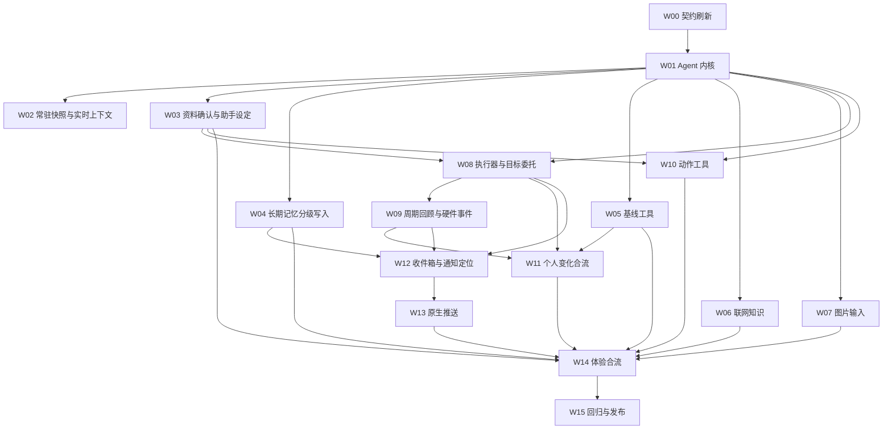

# PetSense Agent 实现工作包与依赖顺序（W 系列）

日期：2026-11-22。状态：开发规划；本文随[V11 架构重构](./agent-product-integration-design.md)整体重写，替代原 P00–P20 规划。阶段与并行分工另见[实现路线](./agent-implementation-roadmap.md)。

本文把 V11 细分为 **W00–W15 共 16 个工作包**，供后续逐份编写 spec；不是接口或数据库的最终技术设计。V11 选型（单 Agent 统一循环、自研运行时、无前置路由、常驻快照、分级记忆、内部 Function Calling、全量动作能力）是所有工作包的共同前提。

## 0. 与旧 P 系列的映射

阶段 1（原 P01–P06 的首条切片）已合入 main 并部署；旧 P 编号到此封存，历史文档中的 P 引用按下表对照：

| 旧包 | 新归属 |
| --- | --- |
| P00 契约 | W00（契约刷新） |
| P01 观测查询 | 已交付；W01 注册为工具 |
| P02 消息持久化 | 已交付；W01 扩展内容块与轨迹 |
| P03 MiniMax 适配 | 已交付；W01 演进为运行循环 |
| P04 导航与记录下沉 | 已交付 |
| P05 范围/角色/工具编排 | **W01 替代**（架构变更：删除前置路由，判断并入主循环） |
| P06 三方聊天 | 已交付；W01 调整为模型自选人格 |
| P07 对话补资料 + P08 助手设定 | W03 |
| P09 长期记忆 | W04 |
| P10 个人基线 | W05 |
| P11 图片输入 | W07 |
| P12 联网知识 | W06 |
| P13 后台基础 + P15 委托 | W08 |
| P14 默认发现 | W09 |
| P16 个人变化 | W11 |
| P17 收件箱 | W12 |
| P18 推送 | W13 |
| P19 体验合流 + P20 回归发布 | W14、W15 |
| （新增）实时上下文、动作工具 | W02、W10（V11 新增能力，无旧包对应） |

## 1. 如何使用这份规划

每个工作包对应一份 spec，以一个可联调、可验收的结果为边界；包内拆服务端、客户端和测试任务。前置依赖指完整验收必须使用的上游交付；接口约定确定后可先开发适配，真实联调通过才算交付。

顺序原则：

1. **先契约、先内核**：W00 刷新契约与选型后，W01 统一运行循环是一切能力的基础；W01 合入前不并行开发依赖内核的新能力（旧路由上的对话行为冻结，只修缺陷）。
2. **能力都以工具或运行形态接入**：新增能力不新增独立功能模块，而是注册工具、扩展运行形态或增加交付卡片；每份 spec 必须声明它注册了哪些工具、挂在内核哪个位置（「接入点声明」）。
3. **真值与确认协议先于依赖它的能力**：档案真值（W03）先于依赖确认写的场景；执行器基础（W08）先于回顾运行（W09）。
4. **行为回归替代规则分支**：判断进入模型后，固定评测场景集是主要回归手段，随包沉淀（V11 §12.4）。
5. **学习累计持续不中断**：版本化学习日随观测持续累计，重构不重置。
6. 外部依赖（MiniMax 搜索能力、推送凭据、区域语义）尽早实测，按各自依赖推进；实测不通过则停下来向负责人澄清，不自行换方案。
7. 每次合入满足部署兼容：先兼容后端，再开客户端入口；中间状态用开关控制。

## 2. 总览：实施批次

| 批次 | 工作包 | 可见结果 | 可并行部分 |
| --- | --- | --- | --- |
| 0 | W00 | 契约刷新、选型入库、现状处置清单 | 外部依赖实测准备 |
| 1 | W01 → W02 | 删除前置路由；全部对话跑在统一循环，轨迹可回放；WS 直连替代轮询、前端栈迁移；常驻快照上线，「它现在在干嘛」能答 | 轨迹调试工具与 W02 可在 W01 契约确定后并行 |
| 2 | W03、W04、W05、W06、W07 | 资料确认闭环、记忆分级写入、基线工具、联网知识、图片交流 | 五包并行，均只依赖 W01；W06 受搜索实测约束 |
| 3 | W08 → W09；W10 | 委托目标闭环、周期回顾与硬件事件、动作工具（录音/日记/社区草稿） | W10 只依赖 W01+W03，可与 W08 并行；W08 执行器基础先行合入，W09 复用 |
| 4 | W11、W12 → W13 | 个人变化合流、统一收件箱、原生推送 | W12 基础可提前；W13 平台准备提前 |
| 5 | W14 → W15 | 完整场景打磨与发布验收 | 动效组件提前探索 |

### 2.1 依赖图

说明：W04 的确认写部分联调依赖 W03 的确认协议服务，自主写部分只依赖 W01；W09 复用 W08 先行合入的执行器/worker 基础，业务上两包可并行开发。

## 3. 工作包及交付边界

### W00：契约刷新与选型基线

**前置：** V11 设计稿（含第 15 章选型）确认入库。

**交付：**

- 更新[P00 契约](./agent-p00-contract.md)：新增运行（Run）/运行轨迹/工具注册表/权限矩阵/常驻快照/分级记忆写入语义；委托与发现章节按语义化计划、检查点运行、回顾运行改写；传输语义定为 WebSocket 直连（断线降级轮询）；数据库目标定为 SQLite 唯一（新表可用 FTS5/JSON1）；前端栈选型（V11 §18）入库；主体与时间、数据覆盖等仍有效的语义保留。
- 选型记录随设计稿入库；旧 P→W 映射表纳入 Git 基线。
- 现状盘点：`server/petsense/agent/` 各模块的保留/删除/演进清单（V11 §14.1）确认为开发基线；冻结旧路由层的行为改动（只修缺陷）。
- 外部依赖实测启动：MiniMax 搜索/网页阅读能力、Expo 推送凭据、区域语义接入进度分别确认负责人与验证计划。

**验收：** 各线能基于同一契约列出输入输出；被 W01 删除的代码路径有明确清单与回归场景对照。

### W01：Agent 内核（替代旧 P05，全计划关键路径）

**前置：** W00。

**交付：**

- **统一运行循环**：将 `model.py` 适配层扩展为通用循环执行器——多轮推理/工具往返、结构化交付（回合对象 + scope/intent/speaker 结论元数据）、预算治理（工具轮数默认约 8、单工具超时、总时长与 token 上限、超限降级）、失败降级与表达重试。无独立分类调用。
- **删除前置路由**：移除 `model.decide()` 与 `routes.py` 的 intent 固定文案分支（out_of_scope/ambiguous/observe/write/search 五段）；范围、意图、角色、澄清决策由主循环结构化输出；未开放能力由 Agent 依据工具注册表的真实可用性如实表达。
- **工具注册表与权限矩阵**：工具声明（名称/描述/schema/权限级别/适用运行形态）与执行分离注册；权限校验先于执行；越权调用返回结构化拒绝并入轨迹。`query_observations` 注册为首个工具。
- **运行轨迹**：`AgentRun` 表 + 完整轨迹（消息序列、工具调用与结果摘要、判断结论与理由、预算消耗）；最小回放调试手段（脚本级即可）。
- **WS 直连读取通道**：面向 App 的 WebSocket 通道（按用户+宠物推送回合与流式增量，鉴权沿用 agent API 凭据），复用 `realtime.py` 的 flask-sock 基建与连接管理模式，替代轮询读取；断线以服务端已保存结果为准，保留轮询降级路径；写入沿用 turns POST + 稳定请求键。
- **客户端栈迁移**（V11 §18）：**先行 spike**——在 Expo Go（SDK 58/RN 0.88）跑通 expo-ai-elements 基础对话流（流式 markdown + renderItem 三人格），作为 go/no-go 门槛，不通过回退自建方案。通过后：组件 vendor 进 `components/agent/ai-kit/`（Uniwind/Reusables 前置引入，token 从 theme.ts 派生、图标替换 expo-symbols），消息列表与输入区容器自建，状态抽入 zustand store，键盘换 `react-native-keyboard-controller`，草稿/主题/滚动位置 AsyncStorage 持久化；既有交互行为不劣化。
- **双人格内嵌**：发言人格由模型在循环中选择（【爱宠】/【照料助手】标注沿用现结构）；一轮最多两位、不互答等约束进入人格指令与输出结构。
- 既有对话场景回归：数据问答、明确指向、范围拒绝（拒答改由模型生成）、失败保留原话、同键去重；沉淀首批行为评测场景。

**验收：** 阶段 1 全部对话场景在内核上行为不劣化；`decide` 与 intent 分支代码不存在；一次运行的完整判断与工具路径可从轨迹回放；越权工具调用被矩阵拒绝且入轨迹；WS 增量实时到达、断线重连不产生重复消息、未登录不可订阅、降级轮询可用；客户端迁移后发送/流式/历史/主题/草稿/失败重试行为不劣化。

**交给后续：** 所有工具包与运行形态包的唯一编排入口。

### W02：常驻快照与实时上下文

**前置：** W01。

**交付：**

- **快照组装服务**：按 V11 §4.1 组装有界快照（档案摘要、设备状态、当前动作与体征、当前位置、今日摘要、学习进度、活跃目标、助手设定），注入每次对话运行的工作记忆；各来源带时间戳与有效性。
- **`read_current_status` 工具**：快照深化版——最近 N 分钟动作序列、最近声音事件、最新 GPS/UWB 位置、设备详情。
- 数据边界：设备离线、定位失效、无有效读数等状态如实进入快照，Agent 据此如实回答；不把过期数据当作当前状态（沿用位置页语义）。
- App 无需新页面；验收靠对话场景与轨迹。

**验收：** 「它现在在干什么」「还有电吗」「今天走了多久」零工具或单工具内正确回答，数值可溯源到快照时间戳；设备离线/数据过期时如实说明；快照体积有界（spec 定上限）。

**交给后续：** 所有运行形态的初始上下文组装入口；W04/W05/W08 的状态项（记忆、基线、目标）就绪后并入快照。

### W03：资料确认与助手设定（旧 P07+P08）

**前置：** W01。

**交付：**

- **确认协议服务**：明确指令直写、候选内联确认卡、幂等确认操作；确认卡为消息内容块（可合并、可拒绝、可改正）。
- pets 域资料扩展（生日/年龄、带发生日期的体重等）及校验、迁移、原资料页读写；真值在 pets 域，不在聊天文本。
- `read_pet_profile` / `prepare_profile_update` 工具；假设、否定、其他主体、模糊时间不写入（模型结构化提案 + 落库前校验两层）。
- `CompanionSettings` 持久化与 `read_role_settings` / `prepare_role_settings` 工具；群聊成员详情与设定页；自然语言修改设定。
- 写入成功回显并同步快照/共享上下文与档案页。

**验收：** 生日修正、模糊年龄、当日体重、其他主体、假设均按约定处理；保存成功才显示成功；之后两位人格与档案页同一版本。

**交给后续：** 确认门服务的唯一实现（W08 计划确认、W10 设备控制确认复用）；档案真值供 W04/W06 引用。

### W04：长期记忆与分级写入（旧 P09）

**前置：** W01；确认写部分联调依赖 W03。

**交付：**

- `PetMemory` 统一存储（V11 §8.1 最小结构，SQLite 唯一目标，可用 FTS5/JSON1）与 `search_memories`（结构化条件 + summary 的 FTS5 trigram 关键词）/ `write_memory` 工具；**分级写入落地**：经历/事件/习惯候选/会话要点自主写（带来源、版本、可回滚），档案事实与长期偏好经确认协议（调 W03）。
- **认识卡蒸馏**（V11 §8.4）：按门槛（引用频次、覆盖时长、来源置信）从习惯候选/确认偏好/重要经历蒸馏有界认识卡注入常驻快照；晋升与淘汰决策连同理由入轨迹，可回退。
- **markdown 记忆报告导出**：PetMemory 定期渲染为人类可读报告存服务端运行目录；DB 为唯一真相，报告为视图。
- 自主写的回滚与审计入口：按来源消息定位、按版本回退。
- 结构化日/周汇总生成（代码组织事实、模型组织表达、来源引用），支持补算与修订；不只压缩上一版模型摘要。
- 收尾保存提醒（memory flush）进入提示约束；记多/记少边界沉淀为评测场景。
- 记忆详情与来源/修订查看；委托回信与变化主题进入经历记忆的入口（W08/W09 接入后联调）。

**验收：** 主人讲述的经历被自主记住且跨天可用、可回滚；假设/否定/他宠不写入；模糊关键词（「上次那件声音的事」）经 FTS5 召回；认识卡有界且可溯源到蒸馏轨迹；导出报告与库内容一致；隔段对话找回确认信息；指定日期汇总可核对；纠正后旧结论可追溯。

**交给后续：** W12 收件箱引用的主题与记忆对象；W14 回顾场景的记忆素材。

### W05：基线工具（旧 P10）

**前置：** W01；学习累计已在阶段 1 交付。

**交付：**

- `PetBaseline` 计算：各维度/粗时段 7 有效日门槛、参照范围、版本化、缺失/中断与版本变化重学、初始快照 + 28 天慢速更新、比较当天只用此前参照。
- `read_baseline` 工具与稳定的「能否比较/比较结果」业务接口；学习卡、维度详情与今日状态共用同一服务端结果（接入快照的学习进度项）。
- 已有历史回填核验（沿用版本可比性规则）。

**验收：** 有效日不足不能输出成熟个人比较；区域晚接入不重置动作学习；覆盖不足不当作活动减少；基线可复算。

**交给后续：** W11 个人变化的事实参照；W02 快照学习进度项的数据源。

### W06：联网知识（旧 P12）

**前置：** W01；**外部硬依赖：MiniMax 搜索/网页阅读能力实测**（P00 契约第 7 节未决项，spec 启动时先做连通与条款验证；不通过则停下来向负责人澄清替代方案）。

**交付：**

- `search_web` / `read_web_page` 工具与适配层；搜索时机由 Agent 判断（V11 沿 V10 §7.13 原则），结果带来源与核对时间。
- 会话内知识回答：结论、适用条件、可展开来源；追问同主题；无结果/冲突/读取失败处理。
- 外部知识不写入本宠事实；时效信息按需重核。

**验收：** 一次真实搜索形成可检查答案与来源；无关主题不调用搜索（轨迹可证）；结合本宠资料时区分知识与实际记录。

### W07：图片输入（旧 P11）

**前置：** W01；图片信息落资料接 W03。

**交付：**

- 相册/拍照输入、上传状态、失败重试、图片消息内容块持久引用；双人格共享附件上下文；查看用 `react-native-image-viewing` 灯箱（V11 §18.4）。
- 宠物照片互动与养宠材料图片理解走同一工具与来源机制；单张照片不当作持续观测。

**验收：** 真实图片完成一轮交流，重进可查看；失败不丢原话；存档走确认协议。不含语音与媒体生成。

### W08：执行器与目标委托（旧 P13+P15）

**前置：** W01、W03（计划确认卡复用确认协议）。

**交付：**

- **执行器基础设施**（先行合入，W09 复用）：有界后台 worker、检查点调度（时间驱动 + 数据到达）、窗口数据物化、持久游标、重启恢复、稳定结果键去重。
- `AgentTask` 持久化与 `read_task` / `propose_task_change` 工具；**语义化计划对象**由 Agent 生成（V11 §9.2：维度 + 条件语义描述 + 结构化近似 + 窗口 + 回信安排 + 结束条件），确认卡全文可改、有版本。
- **检查点运行形态**：目标语义 + 窗口数据 → 继续观察/值得提醒/回信；理由入轨迹；不擅改计划参数（修改走新版本确认）。
- 三类委托全生命周期（提案 → 确认 → 观察 → 提醒 → 到期回信 → 暂停/恢复/取消/修改）；委托簿与主题生命周期 UI；数据不足如实交付；基线未就绪时的确认卡降级选项（接 W05 后联调）。
- 回信进入长期经历（接 W04）。

**验收：** 未确认不启动；关闭 App、重启服务后继续且只交付一次；一次委托全程可从轨迹回放；到期必有交付（包括「数据不足」结论）；暂停不顺延。

### W09：周期回顾与硬件事件（旧 P14）

**前置：** W01；复用 W08 执行器基础设施；学习完成消息接 W05。

**交付：**

- **回顾运行形态**：每日/每周定时触发；输入统计工具 + 基线状态 + 活跃目标 + 已提醒主题；输出「值得知道」主题或明确无事；变化主题创建/合并/持续/恢复，稳定实例标识。
- **硬件事实规则**：低电、失联、长期无有效读数等确定性检测（沿用前端告警语义并明确迁移，避免两侧重复提醒）触发**事件运行**：Agent 决定是否打扰、如何表达、关联主题。
- 主动程度设定（W03）在此实际生效；伙伴内事件呈现与追问下钻。
- 个人比较在 W11 接入前保持关闭（学习期约束仍由基线工具保证）。

**验收：** 无任何用户委托且 App 关闭时仍能产生/合并主题；同一问题不重复提醒；设备事实与行为变化分开呈现；「为什么提醒我」可依据轨迹解释。

### W10：动作工具：设备控制、日记、社区草稿（V11 新增）

**前置：** W01、W03（设备控制复用确认门服务）。可与 W08 并行。

**交付：**

- `control_device` 工具（首版仅 `record_audio` 远程录音 1–10 秒）：**每次执行前确认卡**；设备在线校验、归属校验、防抖沿用 `telemetry/commands.py` 现有实现；执行结果反馈进入会话（「已让项圈录了 5 秒声音」）。
- `create_diary` 工具：触发/重新生成运动日记，幂等复用 `petgif/diary_jobs` 现有任务（按宠物/日期/样式）；返回任务引用，完成状态作为结果卡交付（用户也可在日记详情页手动重生成，沿用现有能力）。
- `draft_social_post` 工具：起草社区动态并保存草稿（social 域现有草稿能力），**不发布**；草稿卡进入会话，用户点击去发布页完成发布。
- 三类工具的权限级别、确认策略、失败表达（设备离线、日记任务失败、草稿保存失败）在 spec 中定义并进权限矩阵。

**验收：** 远程录音经确认真实执行且可听到反馈；日记生成复用幂等任务不重复建；草稿只存不发布；所有执行在轨迹中可查；无关请求不触发动作（轨迹可证）。

**交给后续：** 动作类交互卡模式（确认/执行/结果三态），供后续扩展更多动作工具参照。

### W11：个人变化合流（旧 P16）

**前置：** W05、W08、W09；对应宠物/维度/时段基线就绪。

**交付：**

- 回顾运行接入个人活动/声音/区域变化：`read_baseline` 参照 + Agent 显著性判断，沿用 W09 主题生命周期。
- 委托接入「比平时」相对条件；基线未就绪时确认卡明确给出降级选项，不静默替换。
- 结果保留参照版本与支持统计；旧回信不随基线更新改写。

**验收：** 仅对应维度就绪才输出个人比较；比较结果可追当时参照；真实证据不足的宠物交付代码但能力保持学习状态。

### W12：收件箱与通知定位（旧 P17）

**前置：** W04、W08、W09；学习完成消息接 W05。

**交付：**

- 今日铃铛汇总设备告警、变化主题、委托回信、学习完成；今日最多一处重要预览；社区沿用现状。
- 同一持久对象的多入口引用与已读同步；稳定深链目标（前台进入、直接链接、重开 App 均定位正确）。
- 主题 → 计划/回信 → 时段依据、回信 → 日/周回顾的往返；草稿/滚动/来源恢复沿用。

**验收：** 任一入口打开同一内容；已读同步且不等同告警解除；打开历史回信不重新生成；本地铃铛行为有明确迁移。

### W13：原生推送（旧 P18）

**前置：** W12；平台凭据与原生依赖准备自 W00 起持续。

**交付：**

- Expo Notifications 注册、真实发送、失效处理与重要消息策略；连接已持久化结果。
- 前台/后台/冷启动展示与点击定位（W12 稳定目标）；新增原生依赖的原生构建与真机验收。

**验收：** 目标真机关闭 App 收到真实发现/回信并正确进入；同一事件不重复推送；分平台记录，Web/模拟器不替代。

### W14：体验合流（旧 P19）

**前置：** W03–W07、W10、W11–W13。

**交付：**

- 完整场景串联打磨：问实时状态 → 补资料 → 图片交流 → 查知识 → 关注变化 → 确认委托 → 收到回信 → 下钻依据 → 动作（录音/日记/草稿）→ 之后找回。
- 双人格节奏（不机械双答）、学习期/等待/无数据/失败表达、键盘长消息可访问性、PetGIF 沿用；今日保持 dashboard 只补区域氛围。

**验收：** 完整场景连续完成；情绪表达来自真实经历与状态；返回、主题、草稿不丢失。

### W15：回归与发布（旧 P20）

**前置：** W14，所有拟开放能力的真实依赖已验收。

**交付：**

- 迁移与旧版本兼容检查；先兼容后端再开客户端；未满足条件的维度/平台保持状态与入口控制。
- 跨域回归（今日、位置、记录、设备、资料、PetGIF、社区）+ 断网、重复发送、纠正、中断、模型/搜索失败、任务修改/取消、重启、到期、动作工具失败、推送续接；**行为评测场景集全量回归**（V11 §12.4）。
- 仓库要求的全套检查（客户端 lint/typecheck/format/test 与 CI 构建、服务端 unittest）；更新 AGENTS.md 与接口、运行、迁移、验收文档；交付已验证范围、剩余条件与发布/回退步骤。

**验收：** 候选版本有完整验证证据，具备发布条件；规划本身不代表已发布。

### W16：多会话（2026-11-25 新增，未合并）

伙伴页改为可新建、彼此独立的会话，历史按会话隔离，会话列表在页内抽屉。见 [W16 spec](./agent-w16-spec.md)。应纳入 W15 的回归范围。

## 4. 阶段门槛

| 门槛 | 必须交付 | 演示与验收重点 |
| --- | --- | --- |
| G0 契约与选型 | W00 | 同一契约与选型记录下开工；旧路由删除清单明确 |
| G1 内核与实时 | W01、W02 | 全部既有对话场景跑在统一循环；判断与工具路径可回放；无前置路由代码；WS 增量与降级轮询可用；实时问题能答 |
| G2 记忆与能力 | W03–W07 | 资料确认闭环、记忆分级写入跨天、基线状态真实、知识有来源、图片交流 |
| G3 自主与动作 | W08、W09、W10 | 委托全生命周期与周期回顾在 App 关闭/服务重启后正确运行；动作工具经确认门真实执行 |
| G4 合流 | W11–W13 | 个人比较按就绪开放、跨入口一致、目标真机推送 |
| G5 可交付版本 | W14、W15 | 完整场景、原功能回归、评测集回归与文档齐备 |

## 5. 并行分工与共享入口

| 主线 | 主要工作包 | 提前交给别人的内容 |
| --- | --- | --- |
| A 数据与记忆 | W04、W05；W03 的 pets 域扩展与迁移 | 记忆存储/分级写入、基线状态、资料真值 |
| B 内核与知识 | W01、W02、W03 确认协议、W06、W07 | 运行循环、快照服务、工具注册表与权限矩阵、确认协议、搜索/图片 |
| C App 体验 | 各包客户端；W12、W14 | 会话与卡片容器（确认/执行/结果三态）、来源/主题层级、通知定位 |
| D 自主运行与动作 | W08、W09、W10、W11 服务端；W13 | 执行器基础设施、检查点/回顾/事件运行、动作工具服务端、推送 |

共享入口：数据库模型与 Alembic 链由 A 线统一维护（记忆相关新表以 SQLite 为唯一目标，V11 选型）；`app.py` 注册与后台启动由集成人统筹；**工具注册表与权限矩阵由 B 线（W01 负责人）维护，新增工具须先更新契约再注册**；App 根路由由 C 线维护。合入顺序：契约 → 内核 → 快照 → 工具/记忆 → 客户端消费 → 自主运行 → 跨入口与原生。每次合入的兼容检查沿用仓库部署约定。

## 6. 编写 spec 的顺序与固定内容

第一批：**W00 → W01**（关键路径，尽快让内核替换旧路由），随后 W02。

第二批：W03–W07 五包并行编写（均只依赖 W01，W04 部分联调依赖 W03）；W06 的 spec 以搜索实测结论为前提，先外部验证再定稿。

第三批：W08（执行器基础与委托）、W10（动作工具，可与 W08 并行）、W09；W11 在 W05/W08/W09 契约稳定后编写。最后 W12–W15 依据已实现结果编写。

每份 spec 至少包含：

1. 工作包、目标场景、首版边界与明确不做的内容。
2. 前置交付的实际版本、未满足条件、上下游责任人。
3. **接入点声明**：本包注册哪些工具/运行形态/交付卡片/快照项，挂在内核哪个位置，权限级别是什么。
4. 输入输出、来源与时间语义；持久对象、状态流转及既有域修改。
5. 页面层级、操作、状态反馈、下钻/上探与返回恢复；无 App 变更时说明调用方体验。
6. 错误、中断、重复请求、数据不足、修订及恢复行为；**本包沉淀的行为评测场景集条目**。
7. 合入/部署依赖、兼容或开关、文档更新与下游交接。

具体表结构、接口字段、提示词、预算数值、调度实现在相应 spec 中确定；工具 schema 与权限矩阵变更须先改契约再改实现。

## 7. 当前交付状态（2026-11-22）

阶段 1（旧 P01–P06 首切片）已合入 main 并部署腾讯云，实施与验证边界见[实施记录](./agent-phase-one.md）。按 V11 架构归类：

- **已完成处置**：MiniMax 适配层已演进为 Responses API 循环执行器（W01）；`decide()` 与 intent 固定文案分支已删除（W01）；三字段共享上下文已替换为氛围快照 + `read_current_status` 工具（W02）。
- **保留并演进**：`agent_turns` 持久化与去重、观测统一查询（已注册为工具）、版本化学习累计（→W05 证据）、App 伙伴会话（已迁 zustand + WS 直连）。
- **未开始**：W03 起的新能力包。

W00 已完成（2026-11-22，spec 见 [agent-w00-spec.md](./agent-w00-spec.md)：现状处置基线逐条核实、MiniMax 搜索实测——内建 `web_search` 可用但须走 Responses/Anthropic API（Chat Completions 不支持），W06 按此适配；契约/选型/映射此前已随 V11 重构入库）。W01 已完成（统一循环/注册表矩阵/轨迹/WS 直连/前端栈迁移，行为评测 E1–E10 全过，见 [agent-w01-spec.md](./agent-w01-spec.md)）。W02 已完成：复验三项问题修复闭环后行为评测 15/15（详见 [W02 spec §9.1–§9.3](./agent-w02-spec.md)），待真项圈在线时段实机核对。

W03 已完成（spec 与验收见 [agent-w03-spec.md](./agent-w03-spec.md)：档案确认协议双路径、助手设定页、生日/体重；审计修复 3c3191c 后集成分支核验，E6 新断言真实模型子集复跑通过）。W04 已完成（[agent-w04-spec.md](./agent-w04-spec.md)：长期记忆三工具、认识卡、日/周汇总与报告导出；2026-11-23 集成核查补日汇总检索/报告泄露控制）。W05 已实现并合入集成（62d5ede，[W05 spec §9](./agent-w05-spec.md)：个人基线物化、`read_baseline`、baseline 端点、学习卡真实状态、回填核验工具）。W07 已完成（[agent-w07-spec.md](./agent-w07-spec.md) §10.1：图片上传/鉴权回读/灯箱/照片非实时约束）。

W06 已实现并合入集成（2026-11-23 合入 3895ec1，spec 与验收状态见 [agent-w06-spec.md](./agent-w06-spec.md) §10.1：内建 `web_search` 按轮挂载 + 确定性限次、`read_web_page` pin-IP 防护 fetcher、网页来源卡、`PETSENSE_SEARCH_DISABLED` 两阶段发布开关；服务端单测与客户端检查全过）。行为评测（E35–E38 三轮稳定 + E7 关闭态回归）、§8 模拟器验收均已过（spec §10.2/§10.4）；**2026-11-23 生产放行已执行**（负责人确认不等 OTA、D6 以限次兜底，drop-in 移除并重启，生产搜索已开启，spec §10.4）。行为评测号段：W06 用 E35–E38，避开 W03/04/05。

行为评测号段：W03 E16–E21＋E6、W05 E22–E26、W04 E27–E34、W06 E35–E38＋E7（开关关时）、W07 E39–E41。