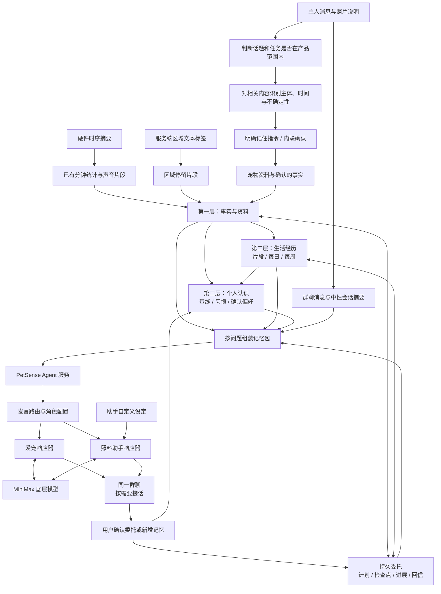

# PetSense Agent 产品设计 V10：照料助手定位、知识与话题范围

日期：2026-11-12。状态：产品与实施设计稿，尚未实现。

代码核对基线：本地提交 `0a29ba7` 与当前工作区。本文替代 V9；实施状态以代码为准，文中交互文案均为设计示例。

## 1. 设计结论与本轮约定

**伙伴是主人、爱宠、照料助手共处的三方群聊；硬件观测与主人讲述共同形成共享上下文。产品呈现两个可定向交流的角色，工程采用统一编排、两个角色响应器和一份共享长期记忆，底层使用 MiniMax 模型。**

本轮按用户八项意见收敛：

1. 社区保持现状，本稿不增加 AI 发帖、分享或内容生产流程。
2. 导航为今日、位置、伙伴、社区、我的；自然语言入口集中在中间第三个 Tab“伙伴”。今日维持 dashboard，记录按需下探，其他页面不增加“问 AI”“解释这段”等入口。
3. “帮我留意一下”是核心能力，必须有计划、确认、持续观察和结果交付。
4. 冷启动学习个人基线是必需阶段；学习期与成熟期有不同能力。
5. 服务端建立简洁、可追溯的长期记忆，支撑跨天对话、观察委托和习惯学习。
6. 以区域级、分钟级和趋势性的感知设计体验，优先做有表现力的交互，不以精细识别为产品前置。
7. 隐私、安全专项不纳入本轮设计。
8. 采用 MiniMax 多模态模型；实施时由用户提供 API key。

今日继续采用 V6 的宠物 Hero、体征、活动摘要和铃铛结构，保留区域氛围背景。导航仍为今日、位置、伙伴、社区、我的；本轮不再改造今日。

V9 重点：从“一个助手切换口吻”进一步明确为有各自身份的爱宠和照料助手；支持自动路由、显式指向、聊天补充资料、助手自定义，以及共享记忆的提取、确认和修订。

V10 增补：照料助手是最了解本宠上下文、能查询外部知识并辅助养宠决策的角色。通用的是理解、搜索、阅读、比较和计划能力，任务范围围绕宠物与养宠生活；明显无关的编程、投资等请求不承接。第 3.9 节定义产品话题范围，第 7.12–7.13 节定义判定与联网工具流程。

继续沿用此前确认的两项约定：

- 照料助手掌握已接入的本宠档案、观测与主人讲述，解释数据、补充资料、查知识、比较方案、确认委托和交付分析；未知信息通过询问或检索补充。爱宠负责亲近、陪伴和关系延续。二者共享相关上下文，按各自角色回应。
- 可以主动发现并提醒；新增用户照护记录、偏好记忆或执行委托由用户确认。已确认委托按约定自动观察、生成进展和回信。

本稿包含默认后台异常/变化检测，不要求先建立用户委托。“异常”指数据质量问题、规则事件或相对个人日常的明显变化，不等于疾病判断；用户指定的委托是额外关注。生活背景缺失不阻塞主要功能。

## 2. 现有数据与设计分工

| 输入 | 当前基础 | 首版使用方式 |
| --- | --- | --- |
| 动作 | standing / sitting / lying down / walking，附模型信息 | 走动与静止的粗分布、日内节奏、持续片段 |
| 声音 | bark / howl / whine / other 等结果，whine 为实验性 | 声音片段、集中时段和日间变化 |
| 室内位置 | 硬件上传测距，服务端已解算地图坐标 | 接入定位同学后续提供的区域文本标签，保存粗粒度区域停留 |
| GNSS | 已有固件与服务端字段，实机闭环仍待验证 | 有实际有效记录时作为室外生活片段来源，不阻塞室内首版 |
| 体征 | 心率、血氧、传感器温度、环境温度字段 | 有可用读数时加入辅助回顾；没有读数时其他体验照常运行 |
| 设备状态 | 在线、电量、时钟、采集与 SD 信息 | 解释观测中断，呈现委托实际观察进度 |
| 宠物与形象 | 已有档案、照片、预设/个人 PetGIF | 稳定角色、现有动作动画与个性化称呼 |
| 主人讲述与群聊 | 新增的主要上下文来源 | 提供生日、体重、偏好、生活事件、对观测的纠正，以及当前感受与交流意图 |
| 照料助手设定 | 新增的角色配置 | 控制名字、称呼、语气、详略和主动表达风格，与宠物事实分开保存 |
| 外部知识与联网结果 | 新增的搜索、网页阅读与来源引用 | 补充养宠知识、用品/服务与带宠出行信息；记录来源和核对时间，不自动变成本宠事实 |

定位语义的生成由相关同学负责；本方案负责消费标签并形成历史。时间戳、有效状态、区域历史和分钟对齐作为服务端软件工作推进。

输入最少需要宠物/设备标识、测量时间、动作/声音结果、区域标签及有效状态。区域建议同时带稳定 ID 和版本，避免区域改名后历史断开。位置与其他数据按分钟聚合；短缺口、边界切换采用简单持续确认，不追求细粒度行为还原。

当前 edge 常规链路目标每秒上传一条摘要，不包含完整原始 IMU 或连续录音。现有 `Reading` 是数量受限的原始帧环冲；`TelemetryMinute` 和 `TelemetryEvent` 有 90 天保留策略。Agent 的长期认识应建立在分钟、片段与汇总之上。

## 3. 页面职责与伙伴能做的事

### 3.1 导航与纵向层级

底部导航：**今日 / 位置 / 伙伴 / 社区 / 我的**。伙伴位于中间第三个 Tab，作为唯一自然语言交互主场；记录退出一级导航。

今日按 V6 的清晰数据摘要组织；伙伴以对话承接使用需求。层级用于展开分析、回顾和任务细节，不要求所有页面采用同一种视觉结构。

| 深度 | 默认看什么 | 向下展开什么 | 向上返回什么 |
| --- | --- | --- | --- |
| 总览 | 今日状态，或伙伴中的当前交流 | 数据记录、一次分析、一个委托 | 今日 dashboard 或伙伴会话 |
| 主题 | 一次异常提示、一次回顾、一次委托 | 具体时段、观察轨迹、简洁比较 | 原分析或任务主题 |
| 依据 | 对应时段的动作、声音、区域与覆盖 | 必要的记录细节 | 同一封回信、同一片段和原滚动位置 |

时间范围也能上探：时段 → 当日 → 本周。上探是在同一主题里扩大视野，保留被选中的时段；不是重新回到一个没有上下文的首页。横向 Tab 切换领域，纵向展开改变理解深度。

普通点击、明确返回和系统返回均可完成核心路径。动效帮助理解对象的展开与收起，不把功能只藏在手势里，也不要求复杂拖动才能查看数据。

默认尽量控制在总览与主题两层，需要依据才打开第三层；这些是内容深度，不要求每次经过全部中间页。通知可以直达某封回信，单个委托可以直接聚焦，无需先打开委托簿。同一时刻只展开一层详情，避免连续叠加抽屉。

### 3.2 今日：恢复 V6 的 dashboard

恢复宠物 Hero、状态条、健康体征、今日活动摘要、原运动日记入口等结构，保留清楚的模块边界和已有数据查看习惯。

```text
日期                                       铃铛

                 宠物 Hero
          当前动作 · 区域 · 项圈状态

健康体征
[当前有效读数 / 今日趋势摘要]

今日记录                         查看详情 ›
[走动 / 静止 / 已观测时长 / 时间带]

值得知道的一件事（有内容时）
[异常提示 / 学习进度 / 委托进展 / 最新回信]

保留现有运动日记入口等内容

今日     位置     伙伴     社区     我的
```

点击宠物继续播放已有互动动画。区域名称与轻量氛围背景可以保留，优先在 Hero 附近使用，营造“它现在待在哪里”的感觉；不把整个页面改成新的故事封面。

点击今日记录、体征或声音摘要直接进入对应记录，不增加半屏生活故事作为必经步骤。今日没有常驻聊天输入框；需要交流时使用伙伴 Tab。

“值得知道的一件事”最多突出一个内容，引用伙伴中的同一主题。点击打开已有分析或进展，不创建新请求；无内容时不强行显示占位卡。铃铛继续承担通知与告警汇总。

### 3.3 伙伴：三方群聊，共用一个输入区

伙伴的交互形态是“主人 + 爱宠 + 照料助手”的三方群聊，支持文字、图片和结构化卡片。三个成员出现在同一条消息流里，爱宠和助手有各自头像、名字和稳定身份；主人无需切换两个独立聊天。

| 能力 | 用户怎么使用 | 系统实际做什么 |
| --- | --- | --- |
| 宠物数据问答 | “它下午主要在哪儿？”“昨天走动多吗？” | 即时查询当前或历史数据，解释已有记录；不创建持续任务 |
| 主动异常发现与追问 | 无需先提问；收到变化提示后问“什么时候开始的？” | 后台检测先产生事件，伙伴展示依据、解释变化并承接后续问题 |
| 持续观察委托 | “未来三天下午帮我留意叫声” | 确认后保存观察计划，按时段与条件检查，提醒并交付结果 |
| 历史记忆与生活回顾 | “上次那件事结果怎样？”“总结这周” | 找回经历、旧结果和个人认识，生成即时回顾；定时送达才需委托 |
| 宠物陪伴与多模态交流 | 聊天、发宠物照片、延续共同经历 | 用宠物身份回应，结合实际观测与确认记忆交流，不需要先创建任务 |
| 对话补充资料与记忆 | “它生日是九月十日”“今天去了公园”“以后叫你小禾” | 提取资料、经历或角色设置，按明确指令或轻量确认更新对应存储 |
| 养宠知识查询与决策辅助 | “查查带猫乘机要求”“比较适合它的胸背”“解释这份宠物用品说明” | 按需要联网、阅读来源、比较信息，结合本宠资料回答；不是无限话题的通用助手 |

记忆是这些能力的共同基础，日记/回信是交付形式，不各占一个主模块。界面不铺功能按钮，所有需求仍从同一个输入区自然表达；默认展示最近交流，事件、记忆确认和计划需要时才作为卡片出现。

伙伴默认打开三方共享会话。主人的消息靠右，爱宠与照料助手靠左，明确标注名字和头像；不只靠颜色区分发言人。页头显示成员，点击头像可进入角色详情。

正在观察的任务只在标题附近体现为“正在留意两件事”这样的轻量状态。点击后展开委托簿；选择一件事，下钻到这个主题的生命周期：交代 → 已确认的计划 → 观察片段 → 给主人的回信。

```text
伙伴                   你 · Marni · 小禾

你：Marni，今天给你拍了张照片。
Marni：这张也要放进我们的小回忆里吗？

你：小禾，它的生日其实是 2023 年 9 月 10 日。
小禾：收到，生日记为 2023 年 9 月 10 日？
      [记下来] [改一下]

[ 说给大家听……                         +  @ ]

点击某件事后：
伙伴  ›  下午声音
  你的交代
  我们约好的观察计划
  已攒下的片段与回信时间
  到期的一封回信

[ 继续说这件事……                         +  @ ]
```

主题模式仍是同一群聊的聚焦视图，三方身份保留，消息关联原来的主题或任务。输入区显示当前主题与显式指向，用户可收起主题回到群聊；不能因切换层级把追问误认成新委托。

从委托簿可以查看“正在关注”和“已经回信”的事项；点击事项默认定位最近进展或最新回信，完整生命周期按需展开。从过去回信上探可看这一周共同关注过什么。默认显示少量相关内容，需要时再展开，避免主场变成任务管理表。

回信在会话中先露出宠物的一句话和简短结论；展开回信才展示生活节奏和区域分布，点击其中时段再看依据。切换 Tab、收起主题、查看记录后，保留输入草稿、选中主题和消息位置。

### 3.4 位置与记录：跟随生活对象深入

位置在第二个 Tab，继续以 UWB/GPS 地图为主。有区域语义和历史后，点击实际区域可以展开停留片段，再选择一个时段查看该段记录；这些是数据查看，不增加自然语言入口。

完整记录使用共享的 `/records` 二级路由，保留日/周/月、趋势、声音时间线与运动日记。今日记录卡与体征摘要是主要入口；伙伴中的异常分析、回顾和委托结果也可进入同一页，带入对应日期、指标和时间范围。

记录在视图内支持时段 → 日 → 周的范围上探，选择的片段作为定位线索保留。选择周内某一天再下钻，避免依靠多个互不关联的筛选器重找范围。现有数据不足以支撑的聚合需按第 8 章补齐。

从总览可以直接进入二级记录；从主题详情进入时，它是更深一层的依据。记录离开时返回原来源，恢复相同片段或消息，不统一跳回今日顶部。

实施时将记录移出 `(tabs)`，保持 `/records`；新伙伴暂定路径 `/agent`，列为第三个 Tab，位置列为第二个 Tab。这些是设计规划，尚未移动代码。

### 3.5 铃铛与跨层级返回

今日右上角保留铃铛，汇总已有告警和 Agent 的重要变化、委托回信、学习完成。普通聊天和每分钟片段不持续刷通知。

| 内容 | 打开位置 | 再下钻与返回 |
| --- | --- | --- |
| 委托进展或回信 | 伙伴内的对应主题与消息 | 回信 → 时段依据 → 原回信 |
| 学习完成 | 伙伴内的个人节奏卡 | 节奏卡 → 对应日或时段 → 原节奏卡 |
| 设备告警 | 设备状态或对应记录 | 详情关闭后回到来源 |
| 今日活动或体征摘要 | 对应指标/时段记录 | 记录返回今日原位置 |

今日预览、伙伴主题与铃铛引用同一事件，已读同步；告警是否解除另行反映。社区消息流程保持现状。默认打开 App 仍进入今日，不因有未读自动切换主场。

### 3.6 情绪价值：被接住、被记住、按时回应

宠物是情感中心，照料助手是一起照顾它的同伴。两位角色共享事实和共同经历，主人可以对其中一位说话，也可以同时向两位表达；默认由最合适的一位接话。

| 时刻 | 交互表达 | 情绪价值 |
| --- | --- | --- |
| 第一次开始学习 | 七个有效日逐步形成生活拼图，文案“慢慢认识它的日常” | 认识过程也值得期待，不是等待系统解锁 |
| 用户交代一件事 | 口语收成一张小纸条；确认后回应“好，这件事记下了，今晚给你回信” | 交代被认真接住 |
| 任务持续运行 | 只积累真实片段，下一次回信时间清楚可见 | 不用反复打开检查是否还记得 |
| 到期完成 | 简短宠物动作承接，一封回信展开，再出现助手结果 | 得到回应与陪伴，不只是冷硬的“任务完成” |
| 再次回到伙伴 | 接续上次主题，提起有依据的共同经历 | 关系跨天延续 |
| 数据中断 | 主画面柔和收静，说明“项圈暂时没同步，先看看最近的记录” | 解释情况，不责备主人、不给陪伴打分 |

宠物可以说“这几天下午的小片段，我帮你攒好啦”；助手负责说明观察到的时段和区域。温暖来自语气、节奏与持续兑现承诺，不从少量数据编造孤独、饥饿或疾病经历。

今日的 Fancy 以宠物、区域氛围和轻量互动为主；伙伴的 Fancy 贯穿认识、聊天、发现变化、交接和回信。分析或回顾可以展开时段依据，层级变化保留主题位置，不要求今日也套用同样的叙事画面。

### 3.7 谁来接话：自动路由与明确指向

| 对话情况 | 默认发言者 | 是否需要另一位补充 |
| --- | --- | --- |
| 和爱宠打招呼、表达感受、发照片互动 | 爱宠 | 通常不需要 |
| 查询数据、分析异常、修改资料、交代观察 | 照料助手 | 有情绪承接价值时，爱宠可简短接一句 |
| 明确称呼、`@` 或回复某位的消息 | 被指向的角色优先 | 需要另一位处理计划时自然交接，并说明由谁接手 |
| 简单问爱宠“你今天在哪儿玩呀” | 爱宠可以使用共享的区域事实回答 | 不必为了简单事实每次切到助手 |
| 同时给两位不同内容，如分享照片并要求建计划 | 按意图分别回应 | 同一轮最多两位，每位有自己的内容 |
| “我是在问 Marni” | 立即修正到爱宠 | 不让用户重发原问题 |

路由优先级：明确指向/回复对象 → 当前主题与对话承接 → 内容意图。默认不要求选择角色；输入 `@` 时仅提供爱宠与照料助手两个对象，针对当前消息生效。

默认一轮一位主要发言者，另一位仅在确实有补充价值时出现。角色生成的消息不再自动触发角色互答；避免每轮双回复、彼此附和或两个机器人替主人聊下去。

异常提示和委托计划主要由照料助手发出；爱宠的补充属于同一事件的一部分，不另发一条系统通知。主人之后可以回复任一角色继续交流。

### 3.8 照料助手自定义与群聊成员详情

点击群聊顶部的助手头像，下探到“照料助手设定”，首版支持名字、头像、对主人的称呼、语气、回答详略、优先关注主题和主动表达程度。也能在群聊说“以后叫你小禾，回答简短一点”，展示设置结果或必要确认后写入同一配置。

可提供少量风格预设和一段自定义描述，如“温柔、简洁，多留意日常活动”；不把用户填写的角色描述当作宠物真实资料，也不让它改写实际观测和任务规则。助手设定是稳定配置，宠物档案和生活记忆分别保存。

宠物头像进入当前宠物资料和已确认的认识；助手头像进入助手设定，二级页面返回同一群聊位置。首版不提供添加更多机器人或任意扩展成员。

对话中的记忆提示采用小型内联卡，不用打断聊天的弹窗。“刚才了解了生日和体重，要记下来吗？”可以合并确认；未确认也能继续聊天。主人明确说“记住/更新为……”且对象、内容清晰时，按一次明确确认处理，保存后展示结果和修改入口，不重复询问同一意图。

### 3.9 照料助手定位与话题范围

定位：**了解这只宠物的专属照料 Agent，同时能为养宠问题调用搜索、阅读、图像理解、比较、总结与计划工具。** 了解来自已接入的信息和持续记忆；不知道的内容会问或查，不以角色设定假装全知。

产品采用语义话题范围，不靠是否出现“宠物”两个字决定回答。判断实际目的和交付物，并结合当前对话：

| 话题范围 | 允许的请求举例 | 处理原则 |
| --- | --- | --- |
| 宠物知识与照料 | 饮食、行为、训练、运动、健康常识、就医准备、宠物资料解读 | 助手回答；需要新资料、具体来源或不确定时联网核查 |
| 本宠管理与理解 | 数据问答、资料补充、异常追问、历史回顾、观察委托 | 读取内部工具和记忆，按既有确认规则写入或执行 |
| 养宠用品与服务 | 比较用品、查医院/寄养/洗护信息、整理咨询问题 | 搜索与比较；话题允许不等于已具备预约、支付等执行能力 |
| 与宠物直接相关的生活决策 | 带宠出行、运输要求、外出天气、家庭环境与宠物植物问题 | 根据照料目的允许；只处理相关部分 |
| 陪伴与养宠创作 | 寒暄、主人的日常感受、宠物照片互动、取名、宠物小记或照料说明草稿 | 自然接住，不因缺少宠物关键词机械拒答 |
| PetSense 使用支持 | 绑定、定位、读数、项圈连接和 App 使用说明 | 解释操作或查询帮助资料；代码开发不在此范围 |

明确不承接软件开发、代码调试/执行、无关投资分析、工作作业与其他无关专业任务。即使请求叫“宠物商城后端”或“宠物币分析”，仍按实际任务判断；“疫苗程序”是照料知识，不因“程序”一词误拒。

目标不清时只问一个必要问题，例如无上下文的“查一下周末天气”可问是否用于带宠外出；若刚在谈遛狗，则直接按该目的查询。混合请求分别处理允许部分，不因其中一项无关而拒绝全部。

简短拒答保持照料助手的语气，例如：“代码开发超出了我的照料范围。如果你是在挑宠物设备，我可以帮你查规格和比较适用场景。”不输出规则术语或一排新的功能入口；没有自然相关方向时简短结束即可。

此范围适用于两位角色；@爱宠或修改助手人设不会把产品变成不限领域的代理。自定义仍用于名字、风格、称呼和关注重点。范围规则与角色表达是不同层。

## 4. 必需的冷启动：认识它的日常

### 4.1 从 Apple 借鉴什么

Apple 的 Vitals 要佩戴睡眠 7 晚才能建立个人典型范围。[官方说明](https://support.apple.com/zh-cn/120142)。Apple 的 Training Load 将最近 7 天的训练强度与时长和此前 28 天比较。[官方指南](https://support.apple.com/en-lamr/guide/watch/apde4c07a6cf/watchos)。

本项目借鉴“先学习个人典型范围，再判断相对变化”和“短期对照较长个人历史”的产品方式。下述 7 个有效日、有效时长、学习画面与更新规则均是 PetSense 自行设计，不是 Apple 对宠物或本硬件的验证结果，也不复制人体生理或训练负荷算法。

### 4.2 首版学习规则

- 所有宠物进入“认识它”阶段，初始生活基线需要 **7 个有效观测日**；不要求连续，漏一天不清零。
- 学习主要包括动作分布、声音节奏和区域停留。按上午、下午、晚间、夜间等粗时段组织。
- 首版有效日建议门槛：某类数据当日累计可用 6 小时，并覆盖至少两个日内时段。它是可调工程初值；只对已覆盖时段建立认识，不外推全天。
- 动作、声音、区域分别记录覆盖和学习进度。缺少有效体征不会阻塞生活基线；区域晚接入时只补学区域，不清空已学动作。
- 各时段至少有 7 个可比观测日后才启用该时段的“比平时”判断。伙伴中的学习卡展示核心学习日和各维度详情，今日简短状态引用同一进度，避免总进度代表所有时段均已了解。
- 旧用户先校验既有历史是否可比，满足条件可直接计入；必需的是基线证据，不要求安装 Agent 后再等一遍。

学习期可用：宠物陪伴、当天事实回顾、明确条件的观察、定时回信。学习期不输出“比平时异常”的结论；可以明确展示两段已观测事实，但不伪装为成熟个人比较。

### 4.3 学习完成后的日常范围

按特征和时段计算个人中位数、分位范围与有效覆盖；用持续多个窗口的明显变化产生主题。产品表达使用“大致如常、比平时少一些、比平时更集中”等级。

保留第一版基线快照，之后使用最近 28 个自然日中的有效历史形成慢速更新参照。比较今天时参照只使用此前数据；已发现的持续偏移先保留为变化主题，避免被快速吸收。模型或区域定义变化时重学对应维度。

品种、年龄资料用于一般知识和解释，不替代必需的个人学习。首版不建设复杂的群体先验系统，也不要求主人补充生活背景。

## 5. 核心能力：“帮我留意一下”

委托是**有期限、有条件、有结果的持久化观察任务**，是伙伴五类能力中的一类。它的工程实现使用定时调度、数据到达后的条件判断和任务状态保存；“委托”是面向主人的产品表达，不代表一个会无限自主行动的模型。

定时回顾确实就是定时任务；条件观察会在观察窗口内持续检查新数据，达到约定条件才提醒，到期仍交付结果。个人变化观察再加入基线比较。若只是问“今天下午怎样”，立即查询回答即可，不创建任务。

日/周记忆整理和默认异常检测也会使用后台调度，但它们属于系统能力，不自动出现在用户委托簿里。委托簿只承载主人明确确认交代的事项。

### 5.1 三种可完成的委托

| 类型 | 用户示例 | 底层机制 | 学习期能否执行 | 最终交付 |
| --- | --- | --- | --- | --- |
| 事实观察 | “接下来两小时留意一下叫声” | 新数据/分钟检查 + 条件判断 + 截止时间 | 能 | 发生时段、片段分布、主要区域、是否持续 |
| 个人变化 | “未来几天下午，叫声比平时多时告诉我” | 持续观察 + 个人基线比较 | 相关基线准备好后 | 对个人参照的变化、持续情况和每日比较 |
| 定时回顾 | “今晚告诉我它今天怎么过的” | 到指定时间查询汇总并生成回顾 | 能 | 一份动作、区域、声音组成的生活回信 |

可关注声音、走动/静止和区域停留，少量体征任务按实际读数能力开放。首版不默认接设备控制或智能家居。

“这周”默认解析为从确认开始到本周日结束，“接下来几天”默认三天；日内窗口默认上午 06:00–12:00、下午 12:00–18:00、晚间 18:00–24:00、夜间 00:00–06:00。所有实际日期与时间在确认卡上显示，用户可直接修改。计划保存时区，首版沿用 Asia/Shanghai，服务端以 UTC 保存时间。过去日期的问题优先即时查询，不误建未来观察任务。

### 5.2 一张委托卡完成确认

输入：“帮我留意这三天下午的叫声。”

助手整理为：

```text
关注：下午声音片段
时间：未来三个下午，12:00–18:00
方式：观察片段和所在区域；明显集中时提醒
回信：每天 18:00 一次，最后一天汇总
比较：你的个人下午基线 / 仅观察事实

[就这样，帮我留意]   [改一下]
```

示例时段由该请求的默认下午窗口产生，具体起止日期需要展开可见。“明显集中”的执行规则由服务端模板解析为参数，依据入口可见；LLM 不在运行中临时改变阈值。

只有目标、期限或交付物确实缺失且无法从默认值确定时才问一个问题，不用长问卷。基线未完成时，卡片明确给出“现在开始事实观察，相关基线就绪后按约定进入比较”或“等待基线后开始”，用户确认其中一种；不能静默降级。

### 5.3 运行、修改与回信

1. **提案。** 口语变成结构化关注内容、时间窗口、比较方式、提醒节奏和结果形式。
2. **确认。** 用户确认后创建持久任务；确认前不执行。
3. **持续观察。** 服务端随数据和定时检查推进，App 关闭也继续。卡片显示实际已观察的窗口和下一次回信时间，不显示虚构百分比。
4. **阶段更新。** 普通片段安静积累，达到约定条件才更新同一主题并提醒；同一变化不反复新建事项。
5. **结果回信。** 到期无论有无明显变化都给结果；缺数据时汇报实际覆盖与已观察片段，不无限延长等待。
6. **接续。** 用户可追问、暂停、取消、修改或再观察几天。实质修改形成新计划版本；确认后生效，不重复创建相同任务。

用户可见状态采用“约好了”“正在留意”“回信到了”“已暂停”“已结束”，分别对应待开始、观察中、已完成、暂停和取消等内部状态。等待基线、数据不足和执行失败以简短原因说明；保留已经观察到的内容，避免只给一个冷硬的失败标签。

暂停不自动顺延截止时间；恢复时从当前时刻继续，错过窗口标为未观察，原截止时间仍交付已有结果。需要延长时给出新结束时间并确认。取消则结束后续检查和定时回信，保留已产生的进展。到期仍未建立所需基线时，交付事实部分并说明未能完成个人比较。

### 5.4 一个主题跨天延续

一次委托的提案、确认、阶段发现、用户补充、结果与后续追问关联到同一任务。到期生成的结果进入经历记忆；“上次那个下午声音的事”能找回原计划和结果。

承诺同时有结果形式与截止时间，避免将“持续监测”设计为永远不能完成的开放循环。重复提醒或每晚回信也有明确结束日期，首版不做无限期任务。

## 6. 从硬件、主人对话到共享长期记忆

### 6.1 三层记忆，加一份持久委托状态



| 层次 | 保存什么 | 谁生成 | 解决什么问题 |
| --- | --- | --- | --- |
| 事实与资料 | 硬件分钟观测、区域片段、宠物档案、主人确认的事实及各自来源 | 采集统计与资料服务 | “实际观测到了什么”“主人告诉过我们什么” |
| 生活经历 | 重要片段、主人讲述的生活事件、日/周汇总、委托回信 | 代码组织事实，MiniMax组织表达，用户确认讲述 | “昨天怎么过的”“上次去了哪里” |
| 个人认识 | 数值基线、近期习惯、确认偏好、关系称呼与共同回忆 | 基线代码、定期归纳、用户确认 | “它通常怎样”“你记得我交代的事吗” |

硬件是来源之一，主人讲述同样可以提供有价值的信息，但保留“主人提供”与“设备观测”的区别。委托单独持久化；群聊消息和中性摘要支撑连续交流，三层记忆支持跨天检索和认识，角色设定单独保存。

### 6.2 写入流程

1. 已有遥测接入继续校验去重、生成分钟统计和声音片段；定位语义产出后保存区域片段。
2. 每分钟从新增聚合计算任务进度和候选生活片段；每个特征携带有效覆盖，缺失不补零。
3. 片段触发、用户提问、委托回信时，才调用 MiniMax 生成表达。相同片段使用稳定 ID 更新，不重复写入。
4. 每天结束后，代码先生成结构化日汇总；MiniMax依据汇总写短文，并附同一批来源引用。
5. 每周从每日结构化统计生成周汇总，再生成周叙述。不能只把七篇 AI 日记重新总结，避免反复压缩后脱离事实。
6. 每日更新对应维度的基线；积累足够后生成习惯候选，如“近期下午较常在客厅区域”。习惯保留适用时间、覆盖和版本，后续统计可替代它。
7. 主人明确提供的偏好或生活回忆，以确认卡保存；与算法归纳的习惯标注为不同来源。

每次主人发消息后，先做话题/意图判断，再从相关部分提取资料/记忆候选；检查主体、事实类型、时间、否定/假设和是否明确要求保存，按第 6.7 节处理。候选可用于当前交流，不能提前当作已确认的永久档案。无关请求与拒答可保留在消息流，不提取为宠物事实或长期偏好。

首版可让同次模型结构化输出附带候选，不必每轮再启动一个独立记忆 Agent。业务服务负责检查字段、单位、时间与写入状态；保存成功后，角色才能明确说“已经记住/更新好了”。

自动观测、会话摘要和基线按流程形成；用户正式档案、照料记录与长期偏好遵守确认约定，明确的自然语言保存指令也算确认。委托结果自动保存属于已确认任务的交付。普通闲聊无需每次弹“要不要记住”，同轮可合并候选，不阻塞主对话。

### 6.3 每条记忆的最小结构

- `id / pet_id / kind`：标识及类型，类型如 change_event、owner_event、body_record、episode、daily、weekly、habit、preference、task_result。
- `start_at / end_at / generated_at`：事件发生范围和生成时间。
- `facts`：结构化汇总，包含动作、声音、区域、有效覆盖等相关项。
- `summary`：可选文字表达，供助手和宠物改写使用。
- `source_refs / support_snapshot`：来源时段或事件 ID，以及支撑结论所需的最小统计快照。
- `source_type / version / supersedes_id`：来自传感器统计、用户确认或模型表达，以及修订关系。
- `subject / confirmation / certainty`：信息属于谁、是否已确认、是明确陈述还是保留猜测，避免把朋友的宠物或一句假设写入当前宠物档案。

个人基线保存数值、样本日、适用时段、计算版本和状态；不只保存“它很活跃”这样的文字。

### 6.4 保存多久

| 内容 | 首版保留建议 |
| --- | --- |
| 原始 Reading | 延续当前环冲，不作为长期记忆依赖 |
| 分钟数据、声音及区域明细 | 90 天；区域为新增，与现有统计策略一致 |
| 结构化日汇总与日记文字 | 1 年 |
| 周汇总、重要生活片段、委托结果 | 长期保留；至少保存支持统计快照 |
| 当前基线、历史版本、确认偏好 | 保留当前有效项及关联结果需要的版本 |

在明细裁剪前生成汇总。90 天后仍可解释“当时主要观察到了什么”，但不能声称还可逐秒重放；超过日汇总保留期的细问按实际周粒度回答。若某周有数据缺日，周摘要明确覆盖范围，不估算填满。

### 6.5 怎么给 Agent 读取

每次请求按问题构造一份共享事实包：宠物档案、当前阶段、主人刚说的内容及确认状态、相关实时窗口、活跃委托、相关基线、指定日期汇总，以及少量相关经历和偏好。按需增加标明来源与核对日期的外部知识，再加入发言对象和角色配置。

爱宠与照料助手检索同一个存储，使用同一事实版本；它们可以根据意图取不同细节，但不能拥有互相矛盾的两份宠物档案。“共享”不是给两个角色每轮复制完整原始历史，而是共享事实来源和当前主题。

检索先使用宠物、日期、类型、区域和任务 ID 等数据库条件。例如“上次下午声音”先定位相关任务，再取结果和必要日汇总；需要更多细节时调用工具追加读取。首版不引入向量库或独立记忆框架。

长上下文模型可以容纳更多内容，但不负责替数据库保存历史。每次发完整聊天记录也不能替代时序查询和持久委托。

### 6.6 修订与遗忘

用户纠正“那天项圈在充电”时，将更正关联到具体时段；相关日汇总、习惯、基线和委托结果标记需重算。保留前后版本，使后续回信知道结论已经更新。

若明细已经裁剪，只重算可由保留统计快照支持的部分；其余结论标明已被更正或无法重算，不重新生成不存在的观测。

区域命名或分类模型变更后按版本判断哪些历史可比。习惯按近期统计更新，过时习惯不永久放入每次上下文。陪伴口吻生成的“我很开心”等表达不回写为传感器事实。

### 6.7 对话怎样变成宠物资料和长期记忆

处理链路：**主人消息 → 识别主体与意图 → 提取候选 → 检查已有资料/冲突 → 明确指令或内联确认 → 更新对应存储 → 共享上下文刷新。**

| 对话内容 | 形成什么 | 保存方式 |
| --- | --- | --- |
| “记住，它生日是 2023 年 9 月 10 日” | 当前宠物的生日 | 明确保存指令，校验后写档案，展示结果与修改入口 |
| “它其实已经三岁了” | 年龄候选及陈述日期 | 内联确认；仅有年龄不反推一个精确生日 |
| “今天称了九斤，帮我记一下” | 当日体重记录，换算为 4.5 kg，保留原始表述 | 明确保存指令，按日期追加，不只覆盖一个无时间的数值 |
| “今天带它去公园了” | 主人讲述的生活经历 | 当前对话可用，作为长期经历保存时轻量确认 |
| “它好像不喜欢鸡肉” | 带不确定性的主人观察 | 保留“可能”和来源，不变成过敏或确诊事实 |
| “假如它三岁，应该怎么办” | 假设讨论 | 不更新年龄 |
| “朋友家的狗五岁了” | 其他主体的信息 | 不写当前宠物档案 |
| “以后叫你小禾，回答简短一点” | 助手名字与表达偏好 | 更新角色配置，回显结果；不进入宠物身体资料 |
| 爱宠生成“我今天特别开心” | 角色表达 | 保存在消息流，不作为主人或硬件提供的事实 |

正式档案中的常用结构化字段由宠物业务数据库保存；经历、注意事项和共同回忆进入 `PetMemory`；身体记录带发生日期；助手设定进入独立配置。群聊摘要可以自动组织“主人曾提到……”，但未确认内容仍带状态，不能悄悄变成正式档案。

已有 `Pet` 和资料 PATCH 当前支持名字、物种、品种、头像等有限字段。生日、年龄、体重等是拟扩展字段/记录，实施时需补模型与校验；不能认为现在已经能通过现有接口写入。更新后由统一资料服务通知 dashboard、档案页和共享记忆刷新，避免群聊与“我的”各有一份不同资料。

有冲突时先展示原值与拟更新值。明确纠正建立新版本并替代对应旧认识；不确定或时间不同的陈述可以同时保留。主人说“在公园”而设备保留旧客厅标签时，先看发生时间与新鲜度，保留来源，不互相硬覆盖。

原始消息、中性摘要、正式事实分别保存来源关系。两位角色看到更新后的同一事实版本；旧消息不改写，但后续检索采用新值和修订说明。主人的文字资料可丰富理解，不代替硬件基线所需的有效观测日。

## 7. Agent 设计：共享内核与两个角色响应器

### 7.1 两个角色，还是两个独立 Agent

术语统一为：**PetSense Agent 使用 MiniMax 作为底层模型。** MiniMax 是模型供应方；Agent 服务、数据工具、记忆、异常检测、调度执行和 App 交互均由本项目实现。

推荐首版：**一个群聊编排服务 + 两个角色响应器 + 共享记忆与执行服务。** 产品上，爱宠和照料助手都是稳定、可被称呼和定向回复的成员；工程上，二者不各自复制一套档案、任务与长期记忆。

两个独立 Agent 也可以实现，但会多出发言协调、重复查询、记忆同步和重复执行等工作。当前角色差异主要在交流目标和表达，统一编排更容易保持一致。后续若助手需要复杂专门工作，可以将响应器拆成独立执行节点，仍复用共享上下文和统一任务服务。

两个响应器可使用同一个 MiniMax 模型，通过不同角色指令实现：

- **爱宠响应器**：围绕亲近、陪伴、共同经历和自己的称呼表达；可读取共享事实回答简单生活问题，不能把拟人表达变成事实。
- **照料助手响应器**：按用户自定义的名字、语气与关注方向工作；负责数据解释、资料整理、异常追问和观察计划。
- 照料助手还会围绕本宠情况查询养宠知识、阅读外部资料和比较方案；使用第 3.9 节的话题范围。爱宠可自然承接简单知识互动，复杂检索与来源解释主要由助手完成。

每轮由群聊编排服务选择主要发言者，必要时安排另一位补充；以同一事实快照组织一组消息。可一次模型调用返回两个标注发言人的结果，也可按需分别生成，产品不依赖双模型架构。默认只生成需要发言的角色，不要求每轮调用两次模型。

MiniMax 提供语言/图像理解、工具选择、候选计划与表达能力。群聊路由、长期记忆、资料更新、默认异常检测和任务执行仍由 PetSense 实现。

### 7.2 模型、业务服务与 App 的职责

| 组成 | 谁实现/提供 | 实际职责 | App 表现 |
| --- | --- | --- | --- |
| MiniMax 模型 | MiniMax | 理解文字/图片，选择工具，整理候选计划与回复 | 理解口语、自然对话、宠物与助手表达 |
| 群聊编排服务 | 本项目 | 识别指向与主题，选择角色，组装共享上下文，分发工具与消息 | 三方群聊自然接话，不抢答、不重复 |
| 两个角色响应器 | 本项目配置，MiniMax 生成内容 | 各自的角色指令、表达目标和助手自定义设定 | 爱宠有亲近感，助手有稳定风格和照料职责 |
| 查询、资料与记忆服务 | 本项目 | 提供观测、档案、基线、经历，提取并保存确认信息 | 聊天能补资料，两个角色都记得 |
| 默认异常检测引擎 | 本项目 | 规则与个人基线检测，合并变化事件，维护发生/恢复状态 | 不必先开口，也能收到值得关注的提示 |
| 委托执行器 | 本项目 | 按已确认计划调度，检查条件，保存进度，到期交付 | 交代的事持续进行，App 关闭也能完成 |
| App 展示与交互 | 本项目 | 对话、卡片、通知、详情与返回状态 | 今日看状态，伙伴聊与办事，记录看依据 |

首版在当前 Flask 服务与数据库基础上实现这些模块，不增加任意多角色或复杂 Agent 框架。第 6 章说明记忆，第 8 章说明持久对象和运行方式。

### 7.3 默认异常检测：不依赖主人先建委托

**方案中包含异常检测，而且它是默认后台能力。当前代码只有客户端前台固定阈值、无效读数/电量/失联等规则告警；服务端个人基线检测和对应 Agent 解释仍待实施，不能算成已经上线。** 当前基础见 `app/src/services/alert-engine.ts` 与 `app/src/hooks/use-alerts.ts`。

| 检测范围 | 示例 | 何时可用 |
| --- | --- | --- |
| 设备与数据质量事件 | 低电量、长时间未同步、体征长期无有效值 | 不要求个人行为基线；与宠物行为变化分别展示 |
| 个人行为/空间变化 | 可比时段的声音片段更集中、走动比例持续下降、区域停留分布变化 | 对应动作/声音/区域基线就绪后 |
| 条件性体征事件 | 有效体征持续越过经过审查的规则条件 | 对应测量可用时；沿用传感器温度等实际语义 |

最小流程：

1. 服务端从新增分钟统计、声音事件和区域片段读取特征，先区分无数据与实际观测。
2. 检查固定规则或对应个人参照；以粗粒度变化和持续多窗口为目标，不要求精确行为识别。
3. 形成一个变化事件，记录时间、依据、比较范围与当前状态；相同事件持续更新，恢复后结束，不反复创建通知。
4. PetSense Agent 服务读取事件和相关记忆，调用 MiniMax 组织简洁解释；铃铛提醒，今日展示一条摘要，伙伴承接分析与追问。
5. 主人若希望额外关注，可以再确认一个有期限的委托。没有委托，默认检测也继续运行。

基线未完成时，设备规则和事实回顾仍可用，不对未学习的维度输出“偏离平时”。LLM 可以说明变化发生在哪些时段、与哪些历史不同，不能凭语言输出替代检测结果。疾病或情绪原因不由这些变化直接确定。

### 7.4 什么会触发一次对话/解释运行

| 触发 | 进入 Agent 前已有的内容 | Agent 的交付 |
| --- | --- | --- |
| 用户发消息或照片 | 当前宠物、指向/回复对象、主题、近期对话和消息内容 | 合适角色的回应、资料候选、必要问题或计划 |
| 默认检测产生的变化事件 | 检测引擎给出的事实、比较对象、事件状态及主题 | 主动异常提示、事实解释及后续追问入口 |
| 委托阶段结束/到期 | 任务计划、已观察窗口、统计及缺口 | 阶段回信或最终回信 |
| 基线维度就绪 | 新基线版本及支持的时段 | 认识它的节奏卡、相应能力更新 |
| 日/周回顾 | 结构化日/周统计和相关经历 | 生活小记和更长期的回顾 |

不是每条硬件帧都触发模型。服务端先形成分钟事实和片段；普通更新仅推进进度，达到汇总点、计划条件或重要事件时才组织表达。同一变化合并进已有主题，避免每次运行生成一个新的事项。

主动通知是否满足已约定的条件由执行器判定；模型负责如何讲清楚、用哪种身份呈现，不在运行中私自改提醒规则或延长任务。

### 7.5 一次运行怎样完成

1. **判断范围、指向与意图。** 先按第 7.12 节判断请求是否属于养宠、本宠管理、相关生活或陪伴，拆分混合请求；再确定称呼、@、回复对象和主题，区分陪伴、知识查询、资料、新委托等意图。无关请求直接简短拒答，不先搜索。
2. **组装共享记忆。** 读取当前宠物、主人当前陈述、学习阶段、相关任务和历史；补入对应角色指令与设定。同轮两位发言使用一致的事实版本。
3. **按需调用工具。** MiniMax 提出所需的工具调用，PetSense Agent 服务执行事实、区域、基线或记忆查询，再把结果交回模型；结果包含数值、时间范围、有效覆盖和证据标识。缺少某项时返回明确的不可用原因。
4. **选择下一步。** 已有事实足够则由合适角色回应；资料更新或角色设置按第 6.7 节形成候选或执行明确指令；委托形成提案；确实缺项才问必要问题。资料/记忆提取不阻塞主对话。
5. **形成结构化交付。** 模型产生表达、引用和计划字段，服务端检查日期、来源与模板参数；数值和图形数据来自工具结果，不由模型补写。
6. **保存并呈现。** 给每条角色回复标注发言人，按一次群聊回合排序保存；确认的资料或配置刷新共享版本。角色消息不会再次自动触发互答。模型超时只重试表达，不重启已确认执行。

单次运行有工具次数与超时上限，避免持续生成。长时间等待来自持久任务，模型无需在后台维持一段永不结束的对话。

### 7.6 首版工具与计划

| 工具 | 读取或生成什么 | 常见用途 |
| --- | --- | --- |
| `read_observations(range, granularity)` | 动作、声音、体征和各自覆盖 | 解释今天午后，比较指定已观测窗口 |
| `read_regions(range)` | 当前区域或历史停留片段 | 找到声音集中时段对应的区域 |
| `read_baseline(feature, slot)` | 学习状态、个人范围和版本 | 判断是否能够使用“比平时” |
| `search_memories(filters)` | 指定日期、主题、任务的经历及确认偏好 | 找回上次回信，回答这一周的变化 |
| `read_task(task_id)` | 计划、进展、已观察窗口和结果 | 理解“这件事还在看吗”“再延长两天” |
| `propose_task_change(...)` | 新委托或修改提案 | 将口语整理成可确认计划，不立即执行 |
| `prepare_memory_update(...)` | 提取的主体、字段/经历、来源与确认状态 | 对话补充资料或记忆；明确指令/确认后由业务服务写入 |
| `read_role_settings / prepare_role_settings(...)` | 助手配置与拟更新项 | 读取“简短温柔”等设定，处理自然语言修改 |
| `search_web(query, purpose)` | 与已判断主题相关的搜索结果、来源与日期 | 核查养宠知识、用品/服务、带宠出行等外部信息 |
| `read_web_page(source_ref)` | 搜索所得或用户给出的相关页面正文 | 阅读关键依据，提取适用条件并引用来源 |

这些是内部领域工具，不把现有 HTTP 响应原样当作完整上下文。尤其跨日观测必须通过统一查询，不能误用只含今日摘要的周/月响应。

一份可执行计划至少包含：关注特征、起止日期与时区、每日窗口、事实/个人比较方式、必要基线条件、规则模板及参数、提醒节奏、回信时间和形式、计划版本。

服务端将它转换为第 5 章的计划纸条。用户确认该版本后，执行器才保存并运行。已确认的关注内容、结束时间和提醒方式若发生实质修改，生成新版本确认；普通追问只读取进度，不重建任务。

### 7.7 持续执行与记忆闭环

执行器按新增分钟事实更新观察窗口与检查点，关联区域片段，必要时读已确定的基线版本。它独立于会话页面和模型调用运行。

每个阶段先形成一份结构化结果：观察到的时间范围、统计分布、变化、缺口及参照版本，再将其交给 Agent。模型结合过去回信和当前结果组织表达，避免每天重复第一天的介绍。

回信作为经历记忆保存，任务状态保存于独立任务对象；重要主题可以进入周回顾。习惯由多日统计更新，不因为模型说了一次“它喜欢客厅”就成为永久认识。

```mermaid
sequenceDiagram
    participant U as 主人
    participant A as 伙伴 App
    participant G as PetSense Agent 服务
    participant M as MiniMax 模型
    participant Q as 查询与长期记忆
    participant T as 持久观察执行器
    U->>A: 帮我留意未来三天下午的叫声
    A->>G: 消息与当前主题
    G->>M: 请求、学习阶段与相关上下文
    M-->>G: 查询工具请求
    G->>Q: 查声音能力、个人基线和相关经历
    Q-->>G: 事实与可用比较方式
    G->>M: 工具结果
    M-->>G: 候选计划和表达
    G-->>A: 计划纸条
    U->>A: 确认
    A->>T: 确认计划版本
    loop 每个约定观察窗口
        T->>Q: 聚合新增事实并保存进度
    end
    T->>G: 阶段或到期结构化结果
    G->>Q: 读取上次回信
    Q-->>G: 相关记忆
    G->>M: 本次事实与上次结果
    M-->>G: 回信文字
    G->>Q: 保存本次事实与表达
    G-->>A: 一封回信及其主题/依据引用
    A-->>U: 通知、今日预览、伙伴回信
```



### 7.8 同一内容怎样长成 App 的不同层级

Agent 输出一个群聊回合对象：`turn_id`、主要/可选补充发言者、`event_id / topic_id / task_id`、共享事实版本和有序消息列表。每条消息带 `speaker_id`、`reply_to`、内容类型、短摘要、完整文字、事实/记忆引用及允许的当前操作。

发言人稳定标识为主人、爱宠、照料助手，显示名字取角色配置；助手改名不新增一个成员。主人消息还保存显式提及和回复对象，供路由和资料来源判断。模型角色表达、主人陈述、工具事实在存储中可区分，不把所有文本压成无发言人标记的摘要。

对象同时给出关联生活片段、记录范围与父主题；App 使用固定的详情组件和导航规则解释这些关联。LLM 不临时生成一套页面或决定一个不可返回的跳转路径。

| 内容对象 | 今日表层 | 伙伴中的主题层 | 依据层 |
| --- | --- | --- | --- |
| 陪伴回复 | 通常不展示 | 宠物回应，接续会话 | 不强求数据入口 |
| 联网知识回答 | 通常不展示 | 助手结论、适用条件与来源 | 对应网页及核对日期 |
| 数据回顾 | 仅必要时显示一条摘要 | 直接答复或可展开的日/周回顾 | 对应时段和区域 |
| 异常提示 | 一条重要变化摘要与铃铛 | 变化分析及其后续追问 | 实际观测、比较对象与事件状态 |
| 委托提案 | 不展示待确认方案 | 可修改、可确认的计划纸条 | 计划范围和观察条件 |
| 委托进展 | 有需要时一条事项摘要 | 同一任务积累的观察轨道 | 已观察窗口和片段 |
| 结果回信 | 一句结果预览 | 宠物引言与助手结论，展开图文 | 相应时段记录与参照 |
| 认识更新 | 简短学习状态 | 个人节奏卡和生活拼图 | 支持该认识的历史片段 |
| 资料/记忆更新 | 默认不展示 | 小型确认或已保存结果，附修改入口 | 对应资料项、来源消息和历史版本 |
| 角色设置更新 | 不展示 | 设置回显，使用新名字与风格 | 同一助手成员详情 |

因此下钻只是展开同一对象已有内容或读取细节，不必每点一层都重新调用模型。上探能从一个片段看到它所属的当天、某件委托或这一周，服务端继续使用相同的主题与来源标识。

App 的草稿、选中主题、片段位置和父页面由前端保存；记忆包中的经历和任务由服务端保存。前者让交互返回原处，后者让重新打开 App 仍记得事情，两者不互相替代。

### 7.9 前后端怎样接起来

实施时新增独立 Agent 服务接口，不把聊天对象混进每秒遥测解析。最小接口职责如下，具体路径为规划：

- `POST /api/app/agent/messages`：发送文字、附件引用、主题、可选指向和回复消息，返回回合/消息标识。
- `GET /api/app/agent/feed?after=...`：读取增量消息、卡片状态及已读信息。首版可用轻量轮询获取后台更新，模型流式结果以增量内容呈现，完整卡片准备好后再展示。
- `POST /api/app/agent/tasks/.../confirm`：确认具体提案版本；修改、暂停与取消使用同一任务服务。
- `GET /api/app/agent/topics/...`：恢复主题、委托生命周期、回信和对应详情引用。
- `GET/PATCH /api/app/agent/assistant-settings`：读取或更新照料助手角色设定；群聊自然语言修改走同一配置服务。
- 资料/记忆候选的确认或明确写入指令由同一业务更新服务处理；宠物档案沿用 pets 域，新增字段先扩展模型和校验，完成后通知共享上下文刷新。

前台消息、后台生成和系统通知最终指向同一个已保存对象。设备遥测仍驱动原 dashboard；Agent 事件驱动伙伴和生活片段，今日只引用需要展示的摘要。

### 7.10 完整产品示例

主人在中间的伙伴 Tab 说“帮我留意未来三天下午的叫声”。Agent 查询相关基线与历史，生成小纸条；确认时宠物轻轻回应，助手把约定日期和回信时间写清楚。

接下来不用保持会话打开。今日仍是宠物状态总览，必要时露出一句“下午的小片段正在积累”；伙伴里的这件委托逐渐攒下真实观察片段。

到期，铃铛提示有回信。打开伙伴先看到“这几天下午的小故事，帮你攒好啦”，再展开助手总结、声音节奏和主要区域；点某个时段下钻记录，收起后仍是同一封信。主人说“再帮我看两天”，Agent 找到原委托，提出延长版本，确认后接着运行。

这里的情绪价值由理解、记忆、持续行动和兑现回信共同形成；页面上的每个变化都能对应系统里的主题、事实或任务进度。

### 7.11 三方共享上下文的完整对话示例

1. 主人发照片：“Marni，今天公园这张拍得好看吗？”爱宠接话；助手不必加入。公园经历作为当前聊天背景，若要正式记成长期经历则按同一规则处理。
2. 主人补充：“对了，它生日是 2023 年 9 月 10 日，今天称了九斤。”助手识别资料候选，合并成一张生日/体重确认卡；当前交流可以继续。
3. 主人点“记下来”。统一资料服务写生日与当日体重记录，更新共享版本；助手回显结果，宠物下一次聊天也能使用同一资料。
4. 主人说：“以后叫你小禾，回答简短一点。”明确设置指令更新配置，小禾后续使用新风格，不改变宠物资料。
5. 主人问：“那它最近下午是不是动得少？”小禾结合硬件观测、可用个人基线和已确认的主人背景回答；公园经历是主人讲述，不能替代长期活动统计。
6. 主人说：“那再帮我留意三天。”小禾从同一主题生成计划；确认后后台执行。爱宠可以在回信时简短承接，不在每一步都重复输出。

这套交互让主人不必区分“现在是在填档案还是聊天”，同时资料、经历、设定和任务在后台各自有清楚的保存位置。

### 7.12 话题白名单的工程实现

不维护一张宠物关键词表，而维护少量可配置主题、意图和工具映射。范围判断先于角色生成、搜索和记忆写入：

1. 读取用户本轮消息、明确指向、当前主题与必要的近期上下文。不能只看孤立句子，忽略“刚才在谈带宠旅行”。
2. 模型输出结构化范围：`core`（本宠/照料）、`adjacent`（直接相关生活决策）、`social`（陪伴寒暄）、`ambiguous`（目的待明确）或 `out_of_scope`（明确无关）；同时标注意图，如 query、knowledge、compare、memory_update、task、product_help、software_development。
3. 服务端按主题和意图映射可用工具。前三类可正常处理；模糊时只补一个必要问题；无关或明确排除的交付物直接拒答。代码开发即使被标成宠物主题，也因交付物不符合范围而不承接。
4. 混合请求输出分段决策。例如“查附近宠物医院，再写个爬虫”，查询医院，简短说明不提供代码开发，不将请求整体丢弃。
5. 角色路由决定谁接话；范围结论对两个角色一致。角色设置只改变表达，不改变可承担的主题与工具。

调用时保存 `scope / intent / allowed_tools / needs_clarification / reason_code` 等内部字段，便于调试；用户界面只显示自然回复。简短拒答不需要查询硬件、联网搜索或调用两个角色共同表态。

需要区分“话题不在范围”与“功能尚未接入”。例如查寄养信息属于范围，直接预约或付款若无对应执行能力，就说明目前可查询比较，不能冒充已经预约；不能将它误判为养宠话题被禁止。

| 请求 | 判定 | 行为 |
| --- | --- | --- |
| “帮我查带猫坐高铁的要求” | 核心/相关生活 | 搜索并阅读对应运输方当前说明 |
| “周末适不适合带 Marni 出门” | 相关生活 | 结合上下文查询天气等需要的信息 |
| “说说幼犬疫苗程序” | 养宠知识 | 不因“程序”误判为编程，必要时查来源 |
| “写个给它记录饮食的 Python 程序” | 宠物目的，但代码交付不在范围 | 拒绝代码，可帮助整理照料记录内容 |
| “项圈怎么绑定/连接不上” | 产品使用 | 查询使用说明和已有设备状态 |
| “给我改项圈固件代码” | 软件开发 | 不提供开发或调试 |
| “我今天好累，想和你们聊聊” | 陪伴 | 自然回应，不强行要求宠物关键词 |
| “帮我分析股票” | 无关专业任务 | 简短说明照料范围，不发起搜索 |

### 7.13 联网知识能力及其记忆边界

助手可以运用通用的搜索、阅读、总结、翻译、比较与计划能力，任务目的围绕宠物。联网按需要触发：用户明确要求查/核实、需要当前规则/服务/价格/资料、要求来源或模型不确定时先检索；稳定的简单概念可直接解释。

最小流程：范围通过 → 判断需要什么外部信息 → 搜索 → 阅读关键来源 → 结合本宠已知情况 → 回答并给来源。优先使用对应机构、运输方、制造商或专业资料等直接来源，避免只凭搜索标题生成结论。

App 中由照料助手显示“我查一下相关资料”，结果仍在原群聊：一段简短结论、适用条件与少量可展开来源。没有新增独立搜索 Tab 或每个模块的搜索按钮。后续追问继续同一主题。

外部知识与本宠事实分开：搜索得到的普遍知识不能自动写成这只宠物的病史、偏好或经历。检索片段可以短期缓存；来源、页面日期与核对时间跟随回答保存。之后问当前价格或最新规则时重新核对，不将旧回答永久当作最新资料。

联网搜索使用用户指定的 MiniMax 能力。本项目在服务端设置搜索/网页阅读适配层；目标模型、账户可用能力、生产接入方式及来源阅读仍需实际验证，不能只因提供模型 key 就宣称搜索已经接通。详见 [P00 外部依赖](./agent-p00-contract.md)。

首版不提供编程/代码执行工具。搜索结果或用户给出的网页也按原养宠目的阅读，不因为页面内容提到别的任务就扩大产品话题范围。

## 8. 简洁的服务端实现

继续使用 Flask、SQLAlchemy 和当前数据库，新增 `server/petsense/agent/` 域，注册 blueprint。实施首版建议新增六类持久对象，并扩展现有宠物资料：

| 对象 | 内容 |
| --- | --- |
| RegionEpisode | 稳定区域停留的开始、结束、版本与覆盖 |
| PetMemory | 统一承载变化事件、主人讲述、日/周汇总、习惯、偏好与回信，含主体、确认/不确定性及来源 |
| PetBaseline | 特征、时段、学习进度、典型范围和版本 |
| AgentTask | 确认计划、状态、下一次检查、处理游标、结果和重启恢复信息 |
| AgentMessage | 群聊消息、发言人、回复/提及、回合与主题、确认卡、事件及已读状态 |
| CompanionSettings | 当前宠物对应的照料助手名字、形象、称呼、风格和主动表达设定，与宠物事实分开 |

宠物生日、体重等结构化资料通过 pets 域扩展；身体记录保留发生日期。初期体重记录等可用带类型的事实记录承载，后续需求成熟再独立分表，不在角色设定或聊天文本里维护唯一真值。

复用 `TelemetryMinute` 与 `TelemetryEvent`，补充声音有效覆盖等所需聚合字段。不要直接把现有 `/observations` 的 week/month 响应当作完整周统计：当前其中部分摘要和声音事件仍按今日组织，需要内部统一查询。

默认检测事件首版可使用 `PetMemory.kind=change_event` 保存来源键、发生/更新时间、恢复状态与支持统计，`AgentMessage` 引用相同事件标识；不要求新建用户 `AgentTask` 才能持久化或提醒。由此区分系统默认发现与主人额外委托。

一个有界后台 worker 可调度默认检测、委托观察、日/周汇总、学习更新和到期回信。按持久游标扫描新分钟数据，更新事件和到期任务；每次处理使用稳定键，避免重复提醒或回信。服务重启后从数据库恢复，不依赖 App 保活。

定位接入点需要放在成功解算/生成语义之后；当前 UWB 坐标富化发生在原始 `store()` 之后，不能假设读取原始表就会得到语义结果。

模型负责理解、选工具、组织计划和表达；统计、时间规则、任务状态、基线与结果事实由代码处理。无需将每秒传感器帧交给模型。

## 9. MiniMax 的角色与多模态使用

模型供应方固定为 MiniMax。2026-11-12 核对的官方文档列出 `MiniMax-M3.1-Flash` 与 `MiniMax-M3` 多模态语言模型，支持图像/视频输入、工具调用与流式回复。[模型概览](https://platform.minimax.cn/docs/guides/models-intro)、[对话接口](https://platform.minimax.cn/docs/api-reference/text-chat-openai)。

首版以 `MiniMax-M3.1-Flash` 作为对话和任务理解候选，具体模型 ID 按实施时账户能力确认并配置。API key 实施时提供，本稿不依赖现在拿到 key。

模型输入包括结构化生活数据、长期记忆包、话题/意图结论、允许的工具、当前请求与附加照片；按需加入联网来源。用户图片可以提供当前交流背景，不能被当作设备持续观察。

模型输出统一承载主要/补充发言人、有序角色消息、引用、记忆候选和可确认计划；流式显示主要回复，结构完整后展示卡片，需要时再补充第二位。共享事实与各自角色指令共同进入上下文，资料或设置写入成功后回显结果。

多模态第一版重点是文字与图片输入、丰富的图文回信和宠物动画。语音合成可后续接 MiniMax 的独立语音能力；图片/视频生成也属于独立能力，不假定一个语言模型同时提供所有媒体生成。已有 PetGIF 展示按现有条件使用。

## 10. 首版交付顺序

以[实现路线与并行分工](./agent-implementation-roadmap.md)作为阶段、依赖与 worktree 分工的维护入口，替代此前将首版合在三大批中的安排。

后续逐份编写 spec 的顺序、每部分交付和验收见[实现工作包与依赖顺序](./agent-implementation-work-packages.md)，细分为 P00–P20 共 21 个工作包。

| 阶段 | 里程碑 |
| --- | --- |
| 0 | 共同 Git 基线、最小契约与共享入口负责人 |
| 1 | 第一条真实三方对话闭环，同时启动有效观测与基线累计 |
| 2 | 对话补资料、共享长期记忆与助手设定；知识工具并行完善 |
| 3 | 共用后台基础、默认检测、事实观察和定时回顾委托 |
| 4 | 知识、跨天记忆、个人基线比较、委托与通知在同一主题合流 |
| 5 | 宠物情绪表达、层级交互、原生推送和发布回归验收 |

阶段是交付节点，不代表必须串行开发。起步以数据/记忆、Agent/知识、客户端三条主线并行，持久与消息接口稳定后加入后台照料线。每阶段按可运行的小切片集成，具体技术细节在启动该阶段时另行设计。

首版不等待完整记忆系统或全部动效才打通对话，也不等待 App 全做完才累计七个有效日。社区维持现状；语音、多媒体生成、复杂群体先验和更多任务模板后续扩展。

## 11. 验收重点

1. 底部导航为今日、位置、伙伴、社区、我的；今日恢复 V6 dashboard 结构并保留区域氛围，伙伴是唯一自然语言输入区，记录按需下探。
2. 基线学习是必需状态，完成前不输出成熟的“比平时”判断；不同维度和缺失日处理符合约定。
3. 没有喂食、离家等生活背景时，仍能完成聊天、生活回顾和事实委托。
4. 一件委托能从提案、确认持续到到期回信，关闭 App 或重启服务不丢状态，不重复执行。
5. 可以回答昨天、上周、上次委托的问题，能找到相应汇总、基线版本和来源统计。
6. 明细裁剪后保留长期汇总；时间粒度变粗时按实际记录回答。
7. 回信、记忆和习惯来自实际观测及确认内容；界面使用真实数据，回放和示意文案不写入用户真实生活。
8. 社区行为保持现状；PetGIF 预设与个人形象仍按已有能力使用。
9. 返回路径覆盖“今日 → 记录 → 今日”“伙伴 → 记录依据 → 原消息”“通知 → 指定委托”；保留日期、滚动位置、输入草稿和任务状态，记录也能直接打开后正常返回。
10. 伙伴 Tab、今日预览和铃铛使用同一消息状态；已读同步，告警解除独立，设备告警不被一律导向聊天。
11. 覆盖“伙伴会话 → 分析/委托主题 → 时段依据”及“时段 → 日 → 周”的往返；今日数据摘要可直接进入记录，不强制经过故事层。
12. 用完整宠物场景验收交接、等待、回信、再次见面和数据中断；界面不只是新增数张任务卡，核心操作可点击完成。
13. Agent 验收覆盖工具查询、基线未就绪、待确认提案、执行器恢复、主题续接和同一内容的多层呈现；查看已生成片段不反复触发模型运行。
14. 未建用户委托时也能检测并提醒默认规则/个人变化；普通数据问答和历史总结不误建任务，检测事件与委托任务可以分别追问。
15. 群聊明确显示主人、爱宠、照料助手；显式指向优先，默认一个主要回应者，同轮最多两位，生成消息不触发无限互答。
16. 对话补资料覆盖明确指令、待确认陈述、假设、否定、其他主体、模糊年龄/日期和信息冲突；角色拟人台词不写成宠物事实。
17. 更新生日、当日体重、确认经历或助手设定后，两位角色及原有档案页面使用同一版本；历史消息、来源和修订关系可追溯。
18. 话题范围覆盖宠物知识、本宠管理、相关生活、陪伴和产品使用；正确处理“疫苗程序”“宠物商城代码”“带宠查天气”、无上下文问题及混合请求，避免关键词误判。
19. 无关请求不调用搜索/本宠工具，不写入宠物事实；@爱宠和助手人设修改不改变范围，允许话题但尚无执行工具时按能力不足说明。
20. 联网回答能展示支持结论的来源与核对时间；外部知识不自动变成本宠事实，当前规则/价格的追问按需要重新核查。

## 12. 参考与文档状态

- [Apple：生命体征与个人典型范围](https://support.apple.com/zh-cn/120142)
- [Apple：训练负荷的短长窗口比较](https://support.apple.com/en-lamr/guide/watch/apde4c07a6cf/watchos)
- [MiniMax 模型概览](https://platform.minimax.cn/docs/guides/models-intro)
- [MiniMax 对话接口](https://platform.minimax.cn/docs/api-reference/text-chat-openai)
- [MiniMax 搜索工具与接入说明](https://platform.minimax.io/docs/guides/token-plan-mcp-guide)
- [实现路线与并行分工](./agent-implementation-roadmap.md)
- [实现工作包与依赖顺序](./agent-implementation-work-packages.md)
- [初步架构设计](./Agent%20系统设计/初步架构设计.md)
- [系统设计 2.0](./Agent%20系统设计/系统设计%202.0.md)
- [现有今日页设计](./superpowers/specs/2026-10-28-today-page-redesign-design.md)
- [现有 PetGIF 能力](./superpowers/specs/2026-10-26-preset-ai-experience-design.md)

本次重写设计稿，未实现上述功能。未改变现行运行架构、接口、部署或测试命令，因此无需修改 `AGENTS.md` 的实现说明；后续实施时同步更新。旧 Agent 稿目录按仓库约定仅本地保留，本稿位于可纳入 Git 的 `docs/` 根目录，当前尚未提交。
