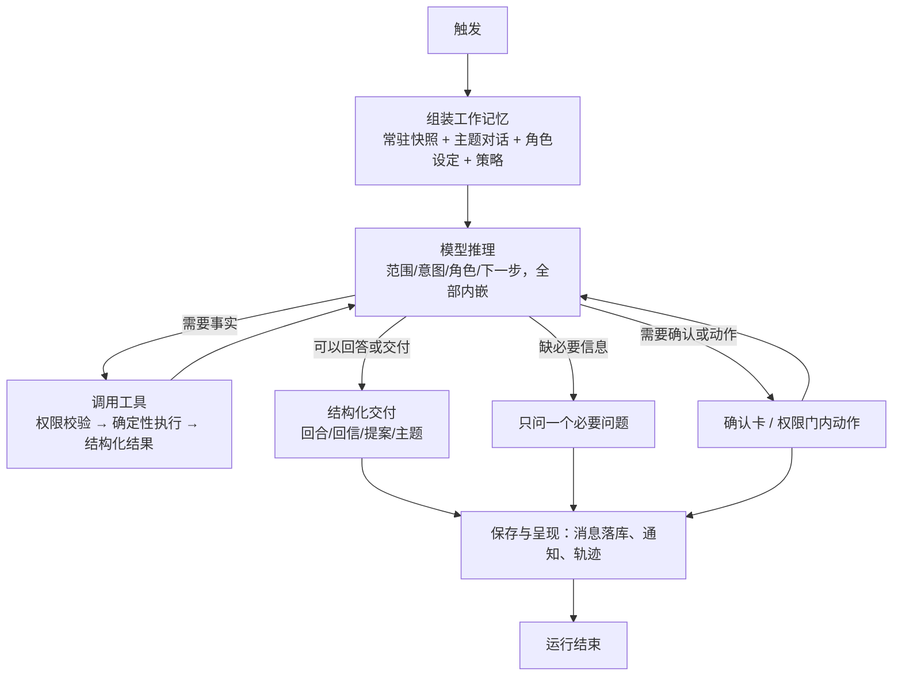

# PetSense Agent 产品设计 V11：以 Agent 为设计对象

日期：2026-11-22。状态：架构重构设计稿；实施以[W 系列工作包](./agent-implementation-work-packages.md)为准，阶段 1 已实现代码的处置见第 14 章。

代码核对基线：main `f3c5f4b` 与已合入的 `server/petsense/agent/`（阶段 1，PR #14）。本文替代 V10；V10 中仍然成立的产品形态结论（导航、三方群聊、委托交互、冷启动学习、情绪价值）在第 13 章收敛重述，机制章节全部按 Agent 视角重写。

## 1. 为什么重构

V10 的工程形态是「编排服务 + 规则路由 + 下游功能」：一个独立的范围/意图/角色分类步骤先行判断，再按分类结果把请求路由到固定流程。已实现的阶段 1 代码正是这个形态：

- `model.decide()` 先做一次独立的分类调用，输出 scope / speaker / intent 三元组；
- `routes.py` 按 intent 走硬编码分支：`out_of_scope`、`ambiguous`、`observe`、`write`、`search` 各返回一段固定文案，模型根本没有机会回应这些请求；
- 主对话只挂一个只读工具 `query_observations`，限 2 轮 4 次调用；
- 注入的共享上下文只有宠物名字、物种、品种三个字段——没有任何实时状态，主人问「它现在在干什么」系统答不上来。

这个形态的问题不在实现质量，在结构本身：

1. **判断被从模型里抽出来钉死在代码里。** 话题边界、意图、角色本来是语言理解问题，却被写成分类标签和分支文案；每支持一类新意图都要加一条代码路径，模型的推理能力被浪费在末端文本生成。
2. **能力是封闭的。** 模型看得见数据，却动不了系统：不能写记忆、不能改资料、不能建任务、不能搜索、不能触发任何动作。每接一个新能力都要重新设计一条「下游功能」链路。
3. **上下文是贫乏的。** 系统内大量已有信息（实时遥测、今日统计、学习进度、日记、设备状态）没有进入 Agent 的世界；Agent 不是系统的一员，只是挂在旁边的一个问答插件。

本稿按 2026-11-22 与负责人确认的方向重构：**设计对象是一个 Agent。用户可以问任何问题，全部交给模型决定怎么答——有数据就用数据答，该联网就搜索，该用或改记忆就直接用、直接改，需要动作就调用动作工具。代码不再路由，只提供事实、工具、持久化和不可越过的安全边界。**

## 2. 核心结论与设计原则

**PetSense 伙伴系统的底层是一个 Agent：以 MiniMax 为唯一认知核心的单一智能体。系统内尽可能多的信息与能力都作为它的上下文和工具开放——可读、可用、可写；爱宠与照料助手是它的两个表达人格；所有产品能力（问答、委托、主动发现、知识、动作）都表达为这个 Agent 的工具调用或自主运行。**

三条分工原则：

1. **判断归模型。** 话题范围、意图、谁接话、要不要检索、要不要提醒、回信怎么写——一切需要理解和权衡的判断由 Agent 在运行中推理完成。没有前置分类调用，没有 intent→固定文案分支；拒答也由模型生成，不是硬编码句子。
2. **事实与执行归代码。** 数据查询、统计聚合、调度计时、持久化、幂等与恢复由确定性代码保证。数值、时间、覆盖、来源只能来自工具结果，模型不得补写；缺数据就是缺数据，不得推断为正常。
3. **边界归权限矩阵。** 工具分级授权、写入确认协议、运行预算在代码层强制执行，先于工具调用校验，不可被任何提示词绕过。越权调用返回结构化拒绝，拒绝本身进入运行轨迹。

由此得到的开发范式转变：**新增能力不再新增代码分支，而是注册一个工具（或一种运行形态）**。工具一旦注册并在系统提示中描述，模型自己会发现何时使用它。

## 3. 设计对象：PetSense Agent

PetSense Agent 是持续存在于服务端的照料智能体：

- **认知核心**：MiniMax（当前 `MiniMax-M3.1-Flash`，环境可配；见第 15 章选型），负责全部理解、判断、规划与表达。
- **工具**：一组确定性能力函数——实时状态、历史观测、基线、记忆检索与写入、资料读写提案、任务管理、联网搜索、设备控制、日记生成、社区草稿。工具结果是它感知世界的唯一事实来源。
- **记忆**：常驻快照（工作记忆的一部分）+ 三层长期记忆 + 活跃目标，跨天延续。
- **运行形态**：不止响应用户消息——委托检查点、每日回顾、硬件事件都会触发它独立运行。
- **人格**：爱宠与照料助手两个输出人格，共享同一份事实、记忆与推理过程。
- **边界**：话题策略、工具权限矩阵、写入确认、运行预算。

它不是什么：

- 不是无限自治代理：每次运行有界，目标必须有期限和交付，写入和动作受确认门约束。
- 不是规则系统的外壳：代码里不存在「先分类再路由」的路径。
- 不是两个机器人：爱宠和助手不是两套系统，是同一个 Agent 的两种表达。

```mermaid
flowchart TD
    subgraph 触发
        U[主人消息/图片]
        C[委托检查点到期]
        R[每日/每周定时]
        E[硬件事实事件]
    end
    subgraph Agent 运行时
        SNAP[常驻快照组装]
        LOOP[运行循环：推理 → 工具 → 再推理]
        POLICY[系统提示：人格/话题策略/预算]
        TRAJ[运行轨迹]
    end
    subgraph 工具注册表（确定性代码 + 权限矩阵）
        T1[事实类：实时/历史/基线/区域]
        T2[记忆类：检索/分级写入]
        T3[资料类：读/写提案]
        T4[任务类：读/提案]
        T5[外部类：搜索/网页]
        T6[动作类：设备控制/日记/社区草稿]
    end
    subgraph 持久层
        DB[(观测/档案/设备)]
        MEM[(PetMemory)]
        TASK[(AgentTask)]
        TURN[(AgentTurn/AgentRun)]
    end
    U & C & R & E --> SNAP --> LOOP
    POLICY --> LOOP
    LOOP <--> T1 & T2 & T3 & T4 & T5 & T6
    T1 --> DB
    T2 <--> MEM
    T4 <--> TASK
    T6 --> DB
    T5 --> WEB[外部网页]
    LOOP --> TRAJ --> TURN
    LOOP --> PET[爱宠人格] & ASST[照料助手人格]
    PET & ASST --> OUT[群聊回合/确认卡/回信/通知]
```

## 4. 系统上下文：Agent 与全系统打通

本章是本稿的核心增量：把系统内「尽可能多的信息」明确为 Agent 的上下文来源，逐域盘点开放方式。

### 4.1 常驻快照：每轮注入的实时上下文

每次对话运行自动组装一份有界快照（数百 token 量级）注入工作记忆，让 Agent 不调任何工具就能回答「它现在在干什么」「项圈还有电吗」「今天遛了多久」这类实时问题：

| 快照项 | 数据来源 | 说明 |
| --- | --- | --- |
| 宠物档案摘要 | pets 域 | 名字、物种、品种、生日/年龄（扩展后）、头像引用 |
| 设备状态 | `TelemetryLatest` + devices 归属 | 在线判定、电量、最近帧时间、绑定信息 |
| 当前动作与体征 | `TelemetryLatest` 最新有效帧 | 动作（站/坐/躺卧/走动）、心率、血氧、传感器/环境温度，带时间戳与有效性标志 |
| 当前位置 | UWB `latest`（室内，已标定）/ GNSS 最新有效定位（室外） | 带新鲜度判定；失效定位不当作当前位置（沿用位置页语义） |
| 今日摘要 | 复用 dashboard 统计（`pet_today_stats`） | 走动/静止分布、已观测时长、声音事件计数、有效读数情况 |
| 学习进度 | `agent_learning_days` | 各维度有效日 n/7 与学习状态 |
| 认识卡 | PetMemory 蒸馏（W04） | 关于本宠的精炼认识摘要：近期习惯、确认偏好、重要经历的几句话；有界，由整理机制定期蒸馏晋升（§8.4） |
| 活跃目标 | AgentTask（委托实现后） | 进行中委托的一行摘要 × n |
| 助手设定 | CompanionSettings | 名字、称呼、语气、主动程度 |

自主运行形态按需组装对应快照（如回顾运行注入昨日统计与基线状态）。快照中的每项都带时间戳与来源，Agent 引用时如实转述，不把 5 分钟前的动作说成「此刻」。快照之外更深的细节（最近 N 分钟动作序列、最近声音事件、GPS 轨迹）由 `read_current_status` 工具按需获取。

### 4.2 信息与能力全景

按服务端现有域盘点，每项标注对 Agent 的开放方式与现状：

| 域 | 系统内已有内容 | 对 Agent 开放方式 | 现状 |
| --- | --- | --- | --- |
| 遥测实时 | `TelemetryLatest` 每设备最新有效帧、UWB latest、GNSS 帧 | 常驻快照 + `read_current_status` 工具 | 待做（快照服务 W02） |
| 观测历史 | 分钟统计、声音事件、有效体征（`agent/observations.py`） | `query_observations` 工具 | 阶段 1 已有单窗口版 |
| 区域历史 | UWB 解算坐标与区域语义（待定位同学交付） | `query_regions` 工具 | 未接入，返回明确 unavailable |
| 趋势汇总 | trends 聚合、日/周统计 | 日/周汇总工具（随记忆体系） | 待做 |
| 个人基线 | 有效日累计（`agent/learning.py` 已版本化） | `read_baseline` 工具 | 累计已有，基线计算待做 |
| 宠物档案 | pets 域档案、头像、PetGIF 形象 | 常驻快照 + `read_pet_profile` / `prepare_profile_update` | 部分字段已有，扩展待做 |
| 设备 | 归属、认领/解绑、电量状态 | 快照含状态；认领/解绑不开放 | 快照待做 |
| 长期记忆 | PetMemory（事实/经历/认识） | `search_memories` / `write_memory`（分级） | 待做 |
| 目标委托 | AgentTask 计划/进度/回信 | `read_task` / `propose_task_change` | 待做 |
| 设备控制 | 远程录音（MQTT 控制命令、防抖）、实验控制 | `control_device`（确认门，首版仅录音） | 待做 |
| 运动日记 | 按宠物/日期/样式幂等的日记任务与海报（`petgif/daily_diary`） | `create_diary` 工具 | 待做 |
| 社区 | 动态、草稿、点赞收藏（social 域） | `draft_social_post` 工具（只起草存草稿，不发布） | 待做 |
| 外部知识 | — | `search_web` / `read_web_page` 工具 | 待做（MiniMax 搜索能力需实测） |
| 图片 | 相册/拍照 | 多模态输入进入消息内容 | 模型烟测通过，产品能力待做 |

### 4.3 明确不开放的能力

- 设备认领/解绑、UWB 标定流程、实验录制控制：属于主人的 Setup/开发操作，不交给 Agent 自动执行；
- 社区直接发布、删除、点赞：Agent 只起草草稿，发布动作由用户完成；
- 其他用户的数据：任何工具都以当前授权用户与目标宠物为边界（沿用 P00 契约第 1 节）；
- 支付、预约等外部执行能力：允许话题、如实说明能力未接入，不冒充已执行。

## 5. 工具体系

### 5.1 工具注册表

工具采用内部 Function Calling（OpenAI 风格 schema，现有 MiniMax 适配层已是该格式），服务端内建**工具注册表**：声明（名称、描述、参数 schema、权限级别、所属运行形态）与执行（确定性 Python 函数）分离注册。新增能力 = 注册工具 + 更新系统提示中的能力描述 + 更新权限矩阵，不改主循环。未来如需对外标准化暴露，可在注册表上加 MCP 适配层，本稿不预设。

工具的执行约定：

- 确定性执行，结果带时间范围、覆盖、版本与来源标识；
- 不向模型抛裸异常：失败返回结构化原因（如「区域语义未接入」「设备离线」），模型据此如实说明；
- 调用全部进入运行轨迹，可审计。

### 5.2 工具清单

| 分组 | 工具 | 类型 | 说明 |
| --- | --- | --- | --- |
| 事实 | `read_current_status(detail?)` | 只读 | 快照的深化版：最近 N 分钟动作序列、最近声音事件、最新 GPS/UWB 位置、设备详情 |
| 事实 | `query_observations(range, granularity)` | 只读 | 动作、声音、体征、覆盖与缺口；窗口 ≤ 90 天 |
| 事实 | `query_regions(range)` | 只读 | 区域停留片段（语义接入后开放） |
| 事实 | `read_baseline(feature, slot)` | 只读 | 学习进度、个人参照范围与版本，含「能否比较」结论 |
| 事实 | `read_pet_profile()` | 只读 | 完整档案（含体重记录等扩展字段） |
| 记忆 | `search_memories(filters, keyword?)` | 只读 | 按宠物/日期/类型/主题/任务的结构化条件 + summary 关键词（FTS5）检索经历、偏好、回信 |
| 记忆 | `write_memory(entry)` | **自主写** | 分级写入：经历、事件、习惯候选、会话要点（见第 8 章），带来源与版本 |
| 记忆 | `forget_memory(memoryId)` | **自主写** | 主人明确要求忘掉时将条目置 retired（保留可审计、幂等；W04 注册） |
| 资料 | `prepare_profile_update(fields)` | 确认写 | 档案事实写入提案（生日/体重/品种等），经确认协议生效 |
| 设定 | `read_role_settings()` / `prepare_role_settings(...)` | 读 / 直写 | 助手设定；明确指令（「以后叫你小禾」）直写回显 |
| 任务 | `read_task(task_id?)` | 只读 | 目标计划、进度、已观察窗口、结果；缺省列活跃目标 |
| 任务 | `propose_task_change(...)` | 确认写 | 新目标或修改提案（续期/暂停/取消/调整），确认后生效 |
| 外部 | `search_web(query, purpose)` | 只读 | 搜索结果带来源与日期 |
| 外部 | `read_web_page(source_ref)` | 只读 | 阅读关键来源正文，提取适用条件 |
| 动作 | `control_device(action, params)` | **确认门** | 首版仅 `record_audio`（远程录音 1–10 秒）；设备在线校验 + 防抖沿用 |
| 动作 | `create_diary(date?, style?)` | 直写 | 触发运动日记生成/重新生成（幂等任务复用），返回任务引用 |
| 动作 | `draft_social_post(content, media_refs?)` | 直写 | 起草社区动态并保存草稿，不发布 |

清单随工作包扩展；每注册一个工具同步更新 P00 契约与权限矩阵。

### 5.3 权限矩阵与确认门

| 工具组 | 对话运行 | 检查点运行 | 回顾运行 | 事件运行 | 确认要求 |
| --- | --- | --- | --- | --- | --- |
| 事实只读（实时/历史/基线/区域/档案） | ✓ | ✓ | ✓ | 相关项 ✓ | 无 |
| 记忆检索 | ✓ | ✓ | ✓ | ✓ | 无 |
| 记忆自主写（经历/事件/习惯候选） | ✓ | 回信归档 ✓ | 主题写入 ✓ | — | 无（分级授权，见第 8 章） |
| 档案写提案 / 任务写提案 | ✓ | 不可改计划参数 | — | — | 确认卡或明确指令 |
| 设备控制 | ✓ | — | — | — | 确认卡（每次执行前） |
| 日记生成 / 社区草稿 | ✓ | — | — | — | 明确请求即可（幂等/可删，低风险） |
| 联网搜索 / 网页阅读 | ✓ | — | — | — | 无 |

矩阵在代码中先于执行校验。话题范围策略（第 12 章）判定 `out_of_scope` 时，业务与网络工具在矩阵层全部不可用——即使模型被诱导，越权调用也被拦截并留下轨迹记录。

## 6. 运行时

### 6.1 运行（Run）与四种形态

一次 Agent 运行是最小设计与调度单元：`触发 → 组装工作记忆 → 推理/工具循环 → 结构化交付 → 轨迹落库`。运行同步有界；结束后 Agent 不在后台悬停，持续性由持久化目标与下次触发保证。

| 形态 | 触发 | 初始工作记忆 | 输出 |
| --- | --- | --- | --- |
| 对话运行 | 主人消息（文字/图片），带指向、主题、回复对象 | 常驻快照 + 主题内近期对话 + 角色设定 | 群聊回合（0–2 条角色消息 + 可选确认卡/提案） |
| 检查点运行 | 执行器判定某委托的检查点到期 | 目标计划全文、上次评估与回信、窗口内物化数据摘要 | 继续观察 / 值得提醒 / 阶段或最终回信 |
| 回顾运行 | 每日固定时点（周回顾每周） | 昨日/本周统计、基线状态、活跃目标、已提醒主题 | 0..n 个「值得知道」主题或明确无事 |
| 事件运行 | 确定性硬件规则触发（低电、失联、长期无有效读数） | 事件事实、设备状态、近期已提醒记录 | 是否打扰、如何表达、关联主题 |

对话运行要求低延迟；检查点/回顾/事件运行在后台 worker 执行。四种形态共用同一个循环、同一套工具注册表与权限矩阵，只是初始包与输出形态不同。

### 6.2 运行循环



要点：

1. **无前置分类。** 范围、意图、发言角色、是否澄清，都是循环内推理的产物，作为结构化元数据（`scope / intent / speaker / allowed_tools / reason_code`）随交付输出并进入轨迹。`model.decide()` 与 intent 固定文案分支删除。
2. **工具是唯一事实来源。** 数值、时间、覆盖、来源只能来自工具结果或常驻快照（快照本身也是工具物化的事实）；模型不得补写。
3. **权限先于执行。** 每次工具调用先过矩阵；确认门工具在用户确认前只产生提案，不产生副作用。
4. **交付是结构化对象。** 群聊回合（发言人、内容块、来源引用、允许操作）、回信、主题对象；App 用固定组件解释，模型不生成导航路径。
5. **人格消息不互答。** 一轮最多两位发言、明确指向优先，由人格指令与输出结构约束（第 7 章），不是代码路由。

### 6.3 工作记忆

初始包有界：常驻快照（§4.1）+ 当前主题近期对话（约 12 回合）+ 角色设定 + 策略文本。更深的上下文由 Agent 在循环中通过工具按需获取——**查什么、要不要追查是 Agent 的检索决策**，检索路径进入轨迹。长上下文模型不替代持久记忆与工具查询。

### 6.4 预算、失败与幂等

- 预算：对话运行默认最多约 8 轮工具往返、单工具超时、总时长与 token 上限；自主运行可放宽（约 16 轮）。超限降级交付：如实说明未能完成的部分，不伪装。具体数值在工作包 spec 中定。
- 失败：模型或网络失败只影响表达——主人原话保留（沿用现有 pending/failed 处理）、已确认的执行不回滚；重试只重表达，不重复执行。
- 幂等：交付对象有稳定键；重复触发（重试、重启后扫描）不产生重复消息或回信。

### 6.5 运行轨迹

每次运行完整落库（`AgentRun`）：触发与形态、消息序列（含工具调用与结果摘要）、范围/意图/角色结论及理由、交付引用、预算消耗、失败点。用途：调试回放、验收取证、行为评测集建设（§12.4）、以及「为什么提醒我」的用户侧解释依据。轨迹不含凭据与无关用户数据，仅服务端内部与调试使用。

## 7. 双角色人格：一个 Agent 的两种表达

爱宠与照料助手是**同一个 Agent 的两个输出人格**，通过系统提示中的角色指令与输出结构实现：

- **爱宠人格**：亲近、陪伴、共同经历、以自己的称呼表达；可以引用共享事实回答简单生活问题（「我下午一直在客厅躺着呢」）；拟人表达不写入事实。
- **照料助手人格**：数据解释、资料整理、异常追问、计划提案、知识检索与比较；按用户自定义设定工作。

- 每轮由 Agent 自行决定主要发言者与是否需要另一位补充；优先级：明确指向/回复对象 → 当前主题承接 → 意图。涉及计划、写入、知识来源的交付默认由助手人格承载。
- 表达规则：一轮最多两位、生成消息不互答、`@` 只提供两个对象、角色纠正（「我是在问 Marni」）立即生效不要求重发。
- 两位人格读取同一份工作记忆与事实版本；助手改名不新增成员。
- 默认一轮一位主要发言者——是否双答本身也是模型的判断，而非固定规则。

## 8. 记忆体系：分级写入

### 8.1 结构

| 层 | 内容 | 生成方式 | 生命周期 |
| --- | --- | --- | --- |
| 工作记忆 | 运行内上下文（常驻快照 + 按需检索） | 每次运行组装 | 随运行结束 |
| 事实与资料 | 硬件分钟观测、区域片段、宠物档案、主人确认的事实 | 采集统计 + 确认协议 | 分钟/事件 90 天，档案长期 |
| 生活经历 | 重要片段、主人讲述、日/周汇总、变化主题、委托回信 | 代码组织事实 + 模型组织表达 | 日汇总 1 年，周汇总与重要片段长期 |
| 个人认识 | 数值基线、习惯候选、确认偏好、关系称呼 | 基线计算（代码）、Agent 归纳、用户确认 | 保留当前有效项及关联版本 |
| 目标状态 | 委托计划、检查点、进度、回信 | Agent 提案 + 用户确认 | 随目标结束归档为经历 |

每条记忆的最小结构：`id / pet_id / kind`（change_event、owner_event、episode、daily、weekly、habit、preference、task_result 等）、`start_at / end_at / generated_at`、`facts`（结构化汇总）、`summary`（可选文字表达）、`source_refs / support_snapshot`（来源与最小统计快照）、`source_type / version / supersedes_id`、`subject / confirmation / certainty`（属于谁、是否确认、明确陈述还是保留猜测——避免把朋友的宠物或一句假设写入当前宠物档案）。

### 8.2 分级写入（2026-11-22 选型确认）

| 级别 | 内容 | 写入方式 |
| --- | --- | --- |
| **自主写** | 会话要点、主人讲述的生活经历（episode）、事件与变化主题、习惯候选、委托回信归档、日/周汇总 | Agent 判断值得记时经 `write_memory` 直接写入，带来源、时间与可回滚版本；写入动作进轨迹；可选轻量回显（「这个我记下了」），不打断对话 |
| **确认写** | 宠物档案结构化字段（生日、体重、品种、名字等唯一真值）、长期偏好、助手设定重大项 | `prepare_*` 提案 + 确认卡；主人明确说「记住/更新为……」且主体、内容、时间清楚时视同确认，直写并回显 |

写入前的结构化校验由两层完成：模型在提案中给出结构化字段（主体、否定/假设标记、时间、来源）；业务服务复核后才落库。典型处理：

| 对话内容 | 处理 |
| --- | --- |
| 「记住，它生日是 2023 年 9 月 10 日」 | 明确保存指令：校验后写档案（确认写），回显结果与修改入口 |
| 「它其实已经三岁了」 | 年龄候选 + 内联确认；仅有年龄不反推精确生日 |
| 「今天称了九斤，帮我记一下」 | 当日体重记录，换算 4.5 kg 并保留原始表述；按日期追加，不只覆盖一个无时间的数值 |
| 「今天带它去公园了」 | 主人经历：自主写（episode），轻量回显；不需要确认卡 |
| 「它好像不喜欢鸡肉」 | 带不确定性的偏好候选：确认写（长期偏好）；保留「可能」，不作过敏或确诊事实 |
| 「假如它三岁应该怎么办」/「朋友家的狗五岁了」 | 假设、其他主体：不写入，保留在对话中 |
| 爱宠说「我今天特别开心」 | 角色表达：留在消息流，不作事实 |

写入成功才说「记住了」；外部知识与拟人表达不自动变成本宠事实。

### 8.3 检索（2026-11-22 选型确认：结构化 + FTS5 关键词）

`search_memories` 支持两级检索：结构化条件（宠物、日期、类型、主题、任务 ID）为主；`summary` 文字层建 **SQLite FTS5 trigram 索引**提供关键词/中文子串召回，覆盖「上次那件声音的事」这类模糊指称。检索策略是 Agent 的决策，路径入轨迹。不引入 embedding 与向量库：语义关联依赖主题关联 + 模型构造检索条件 + 认识卡兜底；召回不足作为显式触发条件，届时再评估并单独澄清选型。

### 8.4 认识卡、整理与导出

借鉴 OpenClaw / Hermes 等开源 Agent 的成熟机制（详见 §15 选型记录），落到本设计的三个安排：

- **认识卡（蒸馏晋升）**：PetMemory 中的习惯候选、确认偏好、重要经历不直接全量注入快照；由整理机制按门槛（引用频次、覆盖时长、来源置信）定期蒸馏出一张有界的认识卡进入常驻快照。晋升与淘汰决策连同理由写入运行轨迹，可审查、可回退——类似 dreaming 的「人类可审查摘要」，在我们的实现里是轨迹 + 记忆导出报告。
- **收尾保存提醒（memory flush）**：对话运行收尾时系统提示包含「这轮有值得记下来的吗」的约束，配合自主写权限让 Agent 在回合内完成记忆写入，而不是等到下次运行。记多记少的边界进入 W04 的评测场景。
- **markdown 记忆报告导出**：PetMemory 定期渲染成人类可读的 markdown 报告保存在服务端运行目录（如 `agent-memory/<pet>/`）；数据库是唯一真相，markdown 只是视图。用途：审计、调试、以及未来「它记得什么」用户侧界面的底料。

### 8.5 保留与修订

保留策略：分钟/事件明细 90 天、日汇总 1 年、周汇总与重要经历长期，裁剪前先生成汇总；超过保留期的细问按实际保留粒度回答，不估算填满。修订：用户纠正（「那天项圈在充电」）关联到具体时段并标记需重算；保留前后版本，明细已裁剪时只重算统计快照可支持的部分；区域/模型版本变化按版本判断可比性。

## 9. 目标与委托：「帮我留意一下」

### 9.1 产品交互不变

委托仍是有期限、有条件、有结果的观察任务：口语 → 一张确认卡（关注、时间、方式、回信安排、比较方式，全文可改）→ 确认后持续观察 → 达条件提醒 → 到期必有回信 → 可暂停/恢复/取消/修改/续期。三类委托（事实观察、个人变化、定时回顾）；时间窗口默认值：上午 06:00–12:00、下午 12:00–18:00、晚间 18:00–24:00、夜间 00:00–06:00，「这周」默认至本周日结束、「接下来几天」默认三天；状态用语：约好了/正在留意/回信到了/已暂停/已结束；暂停不自动顺延截止时间，错过窗口标为未观察，到期仍交付已有结果。

### 9.2 机制重构：语义化计划 + 确定性执行器 + 检查点运行

```mermaid
sequenceDiagram
    participant U as 主人
    participant LOOP as Agent 对话运行
    participant EXE as 执行器（确定性）
    participant CK as Agent 检查点运行
    U->>LOOP: 帮我留意这三天下午的叫声
    LOOP->>LOOP: 查基线/历史（工具）→ 生成语义化计划
    LOOP-->>U: 确认卡（计划全文可改）
    U->>LOOP: 确认
    EXE->>EXE: 计划持久化、排检查点
    loop 每个检查点（时间驱动 + 数据到达）
        EXE->>EXE: 物化窗口数据、推进游标（可恢复、去重）
        EXE->>CK: 触发检查点运行
        CK->>CK: 目标语义 + 新数据 → 继续观察 / 值得提醒 / 回信
        CK-->>U: （值得提醒或到期时）消息与回信
    end
```

- **计划是语义化结构对象**，由 Agent 生成：关注维度（声音/走动/区域/体征）、条件的自然语义描述与结构化近似（如「下午叫声明显集中」）、时间窗口与回信安排、结束条件。不限于预设模板——Agent 可以整理出模板没预设过的关注点；但计划仍是结构化、可展示、可修改、有版本的对象，不是自由文本。
- **执行器只做确定性的事**：生成检查点、物化窗口数据、维护状态/游标/恢复/去重。它不判断「算不算明显」。
- **检查点运行做判断**：Agent 读目标语义与新增数据，评估继续观察/值得提醒/到期回信，理由入轨迹。评估不修改已确认的计划参数——续期、修改必须生成新版本并再次确认。
- **防失控**：计划必须有期限与交付；单次检查点运行有预算；数据不足时汇报实际覆盖，不无限等待。

### 9.3 与个人基线的关系

「比平时多/少」类计划引用 `read_baseline` 参照；基线未就绪时确认卡明确给出「先事实观察，基线就绪后进入比较」或「等基线就绪后开始」两种选项，由用户选择，不静默降级。

## 10. 主动性与发现

### 10.1 回顾运行：发现值得说的事

每日固定时点一次回顾运行（每周一次周回顾）：

1. 输入：昨日/本周统计工具输出（分布、覆盖、缺口）、各维度基线状态、活跃目标进展、近期已提醒主题。
2. Agent 判断：有什么值得主人知道？是否只是已有主题的延续？学习期能不能说「比平时」？
3. 输出：0..n 个「值得知道」主题（合并入已有主题，不重复建题），或明确无事（安静，不硬找内容）。
4. 交付：按主动程度设定决定打扰方式（铃铛/今日一句话/仅伙伴内积累）。

「什么算显著」没有固定阈值表：Agent 结合基线工具的个人参照范围与持续窗口判断，判定依据（引用了哪段统计、哪个参照版本）进入轨迹，用户追问「为什么提醒我」时可解释。

### 10.2 硬件事实事件

低电量、长时间失联、长期无有效读数等**设备与数据质量事实**由确定性代码检测——这类事实的真假不需要模型判断，规则触发即产生事件并触发一次事件运行。Agent 决定：是否值得打扰（与近期提醒去重）、如何解释（结合设备状态）、关联到哪个主题。设备事实与行为变化分开呈现。

### 10.3 冷启动约束

学习期（各维度 7 个有效日未满）不说「比平时」；可以展示两段已观测事实的对比，但明确标注不是个人基线比较。学习期可用：陪伴、当天事实回顾、明确条件的事实观察、定时回信。有效日门槛沿用阶段 1 已实现口径：某类数据当日累计可用 6 小时且覆盖至少两个日内时段；不要求连续，漏一天不清零。

## 11. 个人基线：统计工具

7 个有效日（当日累计 6 小时且跨两个时段）、按维度（动作/声音/区域）与粗时段独立学习、版本化、缺失不清零、模型/区域定义变化重学、初始快照 + 最近 28 天慢速更新——全部保持确定性计算（学习累计已在阶段 1 实现为版本化覆盖记录）。

基线是 Agent 的事实工具（`read_baseline`），不是判断大脑：统计事实必须可复算、可审计、可比版本；模型决定何时引用、如何解释，不负责算数。这与 Agent-first 原则不矛盾——Apple 式个人典型范围本质是统计事实，属于「事实归代码」那一侧。有效日门槛是可调工程初值，不是宠物医学标准。借鉴说明：产品方式参考 [Apple 生命体征](https://support.apple.com/zh-cn/120142)「先学习个人典型范围，再判断相对变化」与 [Apple 训练负荷](https://support.apple.com/en-lamr/guide/watch/apde4c07a6cf/watchos)「最近 7 天对照此前 28 天」，七日门槛、有效时长与学习画面均为 PetSense 自行设计，不复制其人体算法。

## 12. 策略与安全层

### 12.1 话题范围：策略内置 + 权限矩阵 + 审计

替代 V10 §7.12 的白名单路由工程：

1. **策略文本**进入系统提示：范围定义（宠物知识与照料、本宠管理、养宠用品与服务、带宠相关生活决策、陪伴与创作、产品使用支持；明确排除软件开发、代码、无关专业任务）与判定原则（按实际目的与交付物，不按关键词——「疫苗程序」是知识，「宠物商城代码」仍拒绝；混合请求分段处理；模糊时只问一个必要问题）。
2. **结构化自判**：每次对话运行输出 `scope / intent / allowed_tools / needs_clarification / reason_code` 作为交付元数据，进入轨迹。没有独立分类调用。
3. **矩阵收紧**：`out_of_scope` 时业务与网络工具在矩阵层全部不可用；即使模型被诱导，越权调用在代码层被拦截。
4. **拒答由模型生成**：保持照料助手语气、可建议相关方向（「如果你是在挑宠物设备，我可以帮你查规格」），不是固定文案。
5. **区分「不在范围」与「能力未接入」**：允许的话题但工具未开放时如实说明，不冒充已执行。

### 12.2 写入与动作确认

见 §5.3 与 §8.2。代码层强制：确认门工具只有「明确指令」或「已确认提案」两种生效路径；确认操作幂等。

### 12.3 注入与滥用防护

用户内容不是系统指令；工具结果不扩大权限；角色设定修改不改变话题范围；图片按交流背景处理，不被当作持续观测；检索到的网页内容不因提及别的任务而扩大范围。

### 12.4 审计与行为评测

轨迹（§6.5）是审计基础。建立固定**行为评测场景集**（范围判定、人格选择、委托计划生成、检查点评估、回顾判断、记忆记多记少边界的关键场景），在隔离实例上对 Agent 运行做回归——规则分支消失后，行为回归成为主要质量手段。承载方式（2026-11-22 选型）：**自研轻量脚本**——固定场景集与断言就是仓库里的 Python 文件，随工作包沉淀、随 CI 运行，不引入外部评测框架；评测集成型后再评估是否迁移。

## 13. 产品外壳：仍然成立的产品决策

以下结论从 V10 收敛保留，机制已按 Agent 视角改写，本稿不重复完整论证。

### 13.1 导航与页面

- 底部导航：**今日 / 位置 / 伙伴 / 社区 / 我的**；伙伴（`/agent`，第三 Tab）是唯一自然语言入口；记录为根 Stack `/records`。已实现。
- 今日保持 V6 dashboard：宠物 Hero、体征、活动摘要、铃铛与「值得知道的一件事」（最多一条，引用伙伴同一主题，无内容不显示占位卡）。
- 位置页室内/室外分段，不做自然语言入口；记录页承接时段 → 日 → 周上探与来源定位。
- 铃铛汇总设备告警、变化主题、委托回信、学习完成；今日预览、伙伴与铃铛引用同一持久对象，已读同步。

### 13.2 伙伴：三方群聊

交互形态不变：主人 + 爱宠 + 照料助手共用一条消息流和输入区；文字、图片、结构化卡片；@ 与回复指向、主题聚焦视图、委托簿（正在留意 / 已经回信）。五类能力的产品语言不变（数据问答、主动发现与追问、持续观察委托、历史记忆与回顾、陪伴与知识交流）——变化在于机制：这些不是五个下游功能模块，而是同一个 Agent 按需调用工具、或自主运行后把结果交付回会话。

新增的交互随动作工具出现：确认卡（计划/档案写入/设备控制）、任务执行结果卡（日记生成中/已完成、草稿已保存）、设备控制的执行反馈（「已让项圈录了 5 秒声音」）。App 不为每个工具增加入口按钮——一切从输入区自然表达。

### 13.3 情绪价值

被接住、被记住、按时回应的原则不变：学习期文案「慢慢认识它的日常」、口语收成小纸条、任务运行期间安静积累真实片段、到期宠物简短承接 + 助手结果展开、数据中断时柔和收静不责备。温暖来自语气、节奏与持续兑现承诺；拟人表达不回写为事实。

### 13.4 助手自定义

助手设定（名字、头像、称呼、语气、详略、关注方向、主动程度）仍是独立配置，经设定页或自然语言修改；只改变表达，不改变可承担的话题与工具。群聊成员详情：宠物进档案，助手进设定。

## 14. 服务端实现与阶段 1 现状处置

### 14.1 已实现代码的处置

| 现有代码 | 处置 | 说明 |
| --- | --- | --- |
| `model.py` MiniMax 适配（流式、工具调用解析、凭据加载） | **保留并演进** | 扩展为通用运行循环执行器：多轮、预算治理、轨迹采集（W01） |
| `model.decide()` 三分类 | **删除**（W01） | 范围/意图/角色判断并入主循环结构化输出 |
| `routes.py` intent 硬编码分支（out_of_scope/ambiguous/observe/write/search 五段固定文案） | **删除**（W01） | 改由模型按真实工具可用性如实回应；未接入的能力由系统提示中的工具清单表达 |
| `routes.py` 共享上下文（仅 name/species/breed 占位） | **替换**（W02） | 常驻快照服务（§4.1） |
| `observations.py` 统一查询 | **保留并演进** | 注册为 `query_observations` 工具；补粒度参数 |
| `learning.py` 版本化学习累计 | **保留并演进** | 作为基线工具证据层 |
| `agent_turns` / `agent_learning_days` 持久化 | **保留并扩展** | turns 扩展内容块（图片/确认卡/计划）；新增 AgentRun 轨迹表 |
| App 伙伴页、会话恢复 | **保留并扩展** | 读取通道由轮询升级为 WS 直连（W01，选型第 15 章）；会话容器迁移到组件库 + zustand（V11 §18）；新增卡片类型与自主运行结果呈现 |

### 14.2 持久对象

持久对象七类：RegionEpisode（区域停留）、PetMemory（统一记忆）、PetBaseline（基线）、AgentTask（目标委托）、AgentTurn（现有回合表扩展内容块）、CompanionSettings（助手设定），**新增 AgentRun（运行轨迹）**。宠物生日、体重等结构化资料经 pets 域扩展，真值不在聊天文本。数据库目标（2026-11-22 选型）：**SQLite 唯一**——新表按 SQLite 设计，可自由使用 FTS5、JSON1 等内建能力，不为 PostgreSQL 方言兼容做额外工作。执行器与回顾调度复用有界后台 worker + 持久游标方案（单进程假设经选型确认沿用；扩展多进程前需改为共享协调）。

### 14.3 接口

接口规划：`POST /api/app/agent/messages`（发送，沿用现有 turns 同步 POST 与稳定请求键）、**WebSocket 直连通道**（按用户+宠物推送回合与流式增量，鉴权沿用 agent API 凭据；复用 `realtime.py` 的 flask-sock 基建与连接管理模式；断线后以服务端已保存结果为准，可降级轮询）、`POST /api/app/agent/tasks/.../confirm`（确认提案）、`GET /api/app/agent/topics/...`（主题恢复）、`GET/PATCH /api/app/agent/assistant-settings`（助手设定）。新增动作类接口（确认卡提交、日记/草稿/控制的提案与状态）随工作包定义。

## 15. 技术选型记录（2026-11-22 与负责人两轮逐项确认）

| # | 决策点 | 选型 | 状态 |
| --- | --- | --- | --- |
| 1 | Agent 形态 | 单一 Agent 统一循环；双角色为输出人格，模型自主选择身份 | 已确认 |
| 2 | 运行时实现 | 自研轻量 Agent Loop，扩展现有 MiniMax 适配层；不引入 LangGraph/PydanticAI 等框架 | 已确认 |
| 3 | 边界与护栏 | 无预分类路由；策略内置系统提示由模型自判 + 工具级权限矩阵与确认门 | 已确认 |
| 4 | 模型 | 单一 MiniMax 模型，默认 M3.1-Flash，`MINIMAX_MODEL` 环境可配；实测不足再换 M3，不预引入双模型 | 已确认 |
| 5 | 上下文组装 | 常驻实时快照（每轮注入）+ 工具按需深取 | 已确认 |
| 6 | 记忆写入 | 分级写入：经历/事件/习惯/会话要点自主写；档案事实与长期偏好走确认卡 | 已确认 |
| 7 | 工具协议 | 内部 Function Calling + 工具注册表；不预设 MCP | 已确认 |
| 8 | 动作能力 | 委托管理、设备控制（远程录音）、运动日记生成、社区发布草稿，全量纳入（各带权限级别） | 已确认 |
| 9 | 委托机制 | 语义化计划 + 确定性执行器 + 检查点运行（Agent 评估） | 已确认 |
| 10 | 主动发现 | Agent 周期回顾运行 + 硬件事实确定性规则触发事件运行 | 已确认 |
| 11 | 记忆检索 | 结构化条件 + SQLite FTS5 trigram 关键词（summary 层）；不引入向量库，召回不足作为显式触发条件再评估 embedding | 已确认 |
| 12 | 运行状态传输 | App 直连服务端 **WebSocket** 收增量（按用户+宠物作用域、token 鉴权、自动重连）；写入沿用同步 POST + 稳定请求键；断线以已保存结果为准，可降级轮询。决策轨迹：设计稿默认轮询 → 第一轮确认改 SSE → 前端设计时定稿为 WS（RN 无原生 EventSource，且复用 `telemetry-service.ts` 与 flask-sock 基建，见第 18 章） | 已确认 |
| 13 | 数据库目标 | SQLite 唯一：新表可用 FTS5、JSON1 等内建能力，不维护 PostgreSQL 方言兼容 | 已确认 |
| 14 | 行为评测 | 自研轻量脚本：场景集与断言为仓库内 Python 文件，随 CI 运行；集成型后再评估外部框架 | 已确认 |
| 15 | 进程模型 | 单进程（执行器/worker 与 Flask 同进程）；扩展多进程前需改共享协调 | 已确认 |
| 16 | 记忆整理 | 认识卡蒸馏晋升（决策入轨迹）+ 收尾保存提醒 + markdown 记忆报告导出（DB 为真相、md 为视图）；机制借鉴 OpenClaw/Hermes，存储不采用文件方案 | 已确认 |
| 17 | 会话状态管理 | zustand：模块级单例 store（消息流/主题/草稿/卡片状态），订阅式更新，跨页面共享 | 已确认 |
| 18 | 消息渲染 | 当前自建流式文本与结构化卡片；Markdown 留待后续 | W01 自建回退已落地 |
| 19 | 本地持久化 | AsyncStorage 轻量：草稿/主题/滚动位置/最近会话片段；历史靠服务端分页，不做离线缓存 | 已确认 |
| 20 | 聊天 UI 主体 | 自建消息渲染、列表、输入区与键盘容器 | expo-ai-elements spike 未通过，采用回退方案 |
| 21 | 定点工具库 | `react-native-keyboard-controller`；W07 原生灯箱使用 `react-native-image-viewing`，Web 使用 Expo Image 模态查看器 | 实施选型 |

记忆存储选型的对照结论（2026-11-22 复核）：考察了 OpenClaw（markdown 文件为真相 + SQLite/PG 混合检索索引）、pi（核心不含记忆，生态有 markdown 与向量两派扩展）、Hermes（agent 自治整理 + 可插拔 provider）——文件方案成立的前提是单用户本机、自由文本为主、操作者即用户；PetSense 是多用户多宠物的服务端产品，记忆以结构化事实为主且需与观测数据同事务，故维持数据库为唯一真相源，仅吸收其机制层（第 8.4 节）。外部依赖（MiniMax 搜索能力、推送凭据、区域语义）验证状态以 [P00 契约](./agent-p00-contract.md)第 7 节为准。

## 16. 首版交付顺序

以[W 系列工作包](./agent-implementation-work-packages.md)为准（W00 契约刷新 → W01 内核 + W02 实时上下文 → 工具与记忆并行 → 动作与自主运行 → 合流与发布）：

| 阶段 | 里程碑 |
| --- | --- |
| 0 | 契约刷新、选型入库、现状处置清单 |
| 1 | Agent 内核上线：删除前置路由，全部对话场景跑在统一循环上，轨迹可回放；WS 直连读取通道替代轮询、会话容器迁移到新前端栈；常驻快照接入，「它现在在干嘛」能答 |
| 2 | 记忆分级写入与资料闭环、基线工具、联网知识、图片输入并行 |
| 3 | 自主运行（目标委托 + 周期回顾 + 硬件事件）与动作工具（录音/日记/社区草稿） |
| 4 | 个人变化合流、统一收件箱、原生推送 |
| 5 | 体验打磨与发布验收 |

## 17. 验收重点

1. **无前置路由**：一次对话运行内完成范围、意图、角色判断；轨迹可见完整推理与工具路径；代码中不存在 intent→固定文案分支。
2. 实时上下文：「它现在在干什么」「还有电吗」「今天走了多久」零工具调用或单工具内正确回答，数值可溯源到快照时间戳；设备离线/数据过期时如实说明。
3. 全系统打通：观测、基线、档案、记忆、任务、日记、设备状态均可经工具读取；动作工具（录音/日记/草稿）经确认门真实执行且有反馈。
4. 范围策略行为正确：「疫苗程序」答知识、「宠物商城代码」拒绝、混合请求分段处理、无关请求不触达业务与网络工具（轨迹可证）。
5. 双人格表达：一轮最多两位发言、指向优先、生成消息不互答；助手改名后同一成员延续。
6. 数据事实只来自工具与快照：数值、时间、覆盖与来源可在轨迹中追溯；缺数据如实说明。
7. 记忆分级写入：主人讲述的经历被自主记住且跨天可用（可回滚）；生日/体重等档案事实走确认卡；假设/否定/其他主体不写入；写入成功才说记住了。
8. 一件委托从 Agent 生成语义化计划、确认、检查点评估、值得提醒到到期回信全程可回放；重启不丢、不重复；评估不擅改计划参数。
9. 回顾运行在无委托时也能产生/合并变化主题；同一问题不重复提醒；学习期不说「比平时」；「为什么提醒我」可依据轨迹解释。
10. 硬件事实事件确定性触发；打扰与否与表达由 Agent 决定；设备事实与行为变化分开呈现。
11. 基线为确定性计算：有效日门槛、版本重学、可比性判定可复算；个人比较只在对应维度就绪后输出。
12. 行为评测场景集覆盖范围、人格、计划生成与检查点评估的关键场景，作为回归手段运行。
13. 页面与交互：导航与返回路径覆盖「今日 → 记录 → 今日」「伙伴 → 记录依据 → 原消息」「通知 → 指定委托」；保留日期、滚动位置、输入草稿与任务状态；今日预览、伙伴与铃铛引用同一消息状态且已读同步；用完整宠物场景验收交接、等待、回信、再次见面和数据中断。
14. WS 直连：生成中的增量实时到达 App；断线重连后以服务端已保存结果为准，可降级轮询；未登录不可订阅；同一回合不因重连产生重复消息。前端栈迁移后既有对话场景（发送/流式/历史/主题/草稿/失败重试）行为不劣化。
15. 记忆整理：快照中的认识卡有界、可溯源到蒸馏轨迹；markdown 导出报告与数据库内容一致；收尾保存提醒的行为进入评测场景（记多/记少边界）。

## 18. 前端架构与交互实现

前端选型于 2026-11-22 与负责人逐项确认（§15 选型表 17–22 项）；现状基线是阶段 1 交付的 713 行 `agent.tsx` 单文件（纯 hooks + 轮询）与 58 行 `services/agent.ts`。

### 18.1 分层

```text
services/agent.ts          HTTP：发送（稳定请求键）、历史分页、确认提交、已读
services/agent-channel.ts  WebSocket 客户端：token 鉴权 + 指数退避自动重连
                           （模式复用 telemetry-service.ts）；收回合与流式增量
stores/agent-chat.ts       zustand：消息流、主题/指向、草稿、卡片状态、连接状态
                           模块级单例，跨页面共享（今日卡、深链定位）
hooks/use-agent-chat.ts    订阅 store、连接生命周期、AsyncStorage 恢复
(tabs)/agent.tsx           薄 UI：组合聊天主体与卡片族
components/agent/*         气泡定制、卡片族、输入区
```

本地持久化（AsyncStorage，按用户隔离）：草稿、选中主题、滚动位置、最近会话片段——冷启动首屏不空白；历史本体靠服务端分页，不做离线全量缓存。

### 18.2 聊天主体与卡片族

伙伴页使用自建渲染层和会话容器。W01 的 expo-ai-elements 试接因 npm 包缺少可用组件、原生依赖与现有工具链冲突而启用自建回退。实现与试接记录见 [W01 spec](./agent-w01-spec.md)。消息列表、输入区、导航与状态由 §18.1 的 WS 和 zustand 管理。

**卡片族**（`components/agent/cards/`，对应 P00 契约内容块，经 renderItem 挂载）：确认卡（计划/档案写入/设备控制，三态：待确认/已确认/已拒绝，操作幂等）、回信卡（宠物一句话承接 + 助手结果展开 + 时段依据入口）、来源卡（Citation，沿用现有，跳转记录）、执行结果卡（录音已执行/日记生成中与完成/失败/草稿已保存）、学习卡（沿用现有）、任务状态卡（约好了/正在留意/回信到了/已暂停/已结束）。未知内容块安全降级提示。

**消息渲染**：当前正文随 WS 增量以文本渲染，流式 Markdown 留待后续。确认提案、观测和其他结构化内容走独立卡片。**双人格映射**：`renderItem` 按 speaker（owner/pet/assistant）区分——主人消息短气泡靠右，爱宠与照料助手靠左且各自头像、名字标签（颜色取 `theme.ts` 派生 token，不写死）。

**键盘**：`react-native-keyboard-controller` 替代 KeyboardAvoidingView（AGENTS.md 记录的 padding 覆盖与标签栏遮挡问题即其主场）；输入区底部安全区沿用 NativeTabs 结论，只用一次。

### 18.3 流式与状态机

1. 发送：乐观 UI（本地 pending 消息 + 稳定 requestId）→ 服务端同键去重 → WS 推送流式增量 → complete / failed；失败保留原话、可重发（沿用阶段 1 语义）。
2. 生成中：打字指示器与流式光标；重进页面按服务端已保存结果恢复；pending 超 5 分钟标失败可重发（沿用）。
3. 断线：WS 自动重连，重连后按服务端回合状态拉齐（以已保存结果为准，不重复消息）；极端情况降级轮询读取。
4. 已读：进入会话/聚焦主题时上报（沿用）。

### 18.4 页面结构与导航

- 伙伴页内部状态切换维持现有模式：群聊 ↔ 主题聚焦 ↔ 委托簿；W12 增加稳定深链 `/agent?topic=` 定位。
- 今日页「值得知道的一件事」消费同一 zustand store 的事件摘要，与铃铛、伙伴引用同一持久对象（W12）。
- 图片消息（W07）：expo-image 展示，`react-native-image-viewing` 灯箱（缩放/手势/多图滑动，纯 JS 无原生构建）。

### 18.5 性能与边界

- 流式增量由聊天库内建 rAF 批量渲染；zustand 订阅式更新避免全树重渲染。
- 消息列表为自建 inverted FlatList（容器层）；消息量成为瓶颈再评估 FlashList v2 / Legend List（两者对 inverted 聊天列表均有已知问题，触发式决策，不预先引入）。
- 不引入的依赖（当前明确排除）：IM 范式聊天库（gifted-chat 系，与 Agent 对话范式不符）、react-query、FlashList、任何状态框架全家桶。

## 19. 参考与文档状态

- [P00 跨端最小契约](./agent-p00-contract.md)（运行/轨迹/工具注册/权限矩阵/分级记忆语义已同步更新）
- [W 系列实现工作包](./agent-implementation-work-packages.md)
- [实现路线与并行分工](./agent-implementation-roadmap.md)
- [第一阶段实施记录](./agent-phase-one.md)（历史记录；其描述的 decide 路由架构已被本稿替代）
- [MiniMax 模型概览](https://platform.minimax.cn/docs/guides/models-intro)、[对话接口](https://platform.minimax.cn/docs/api-reference/text-chat-openai)
- [Apple：生命体征与个人典型范围](https://support.apple.com/zh-cn/120142)、[Apple：训练负荷的短长窗口比较](https://support.apple.com/en-lamr/guide/watch/apde4c07a6cf/watchos)（第 11 章借鉴说明）
- 记忆机制参考（2026-11-22 选型核对）：[OpenClaw Memory 文档](https://docs.openclaw.ai/concepts/memory)、[NousResearch/hermes-agent](https://github.com/nousresearch/hermes-agent)（第 8.4、15 章对照结论）

V10 全文被本稿替代，可经 Git 历史查阅（`git show f3c5f4b:docs/agent-product-integration-design.md`）；旧 Agent 稿目录按仓库约定仅本地保留。文中交互文案均为设计示例。未实现能力不作为上线承诺；外部依赖验证状态以 P00 契约为准。
