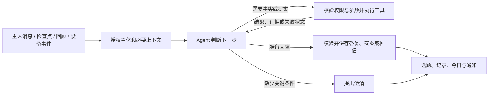

# PetSense Agent 产品设计 V11

2026-11-22 · 产品与实施基线，供评审和后续 spec 使用

PetSense 的伙伴是一个可以回答开放问题、持续照料本宠的 Agent。主人可以问任何主题，也可以讲述经历或交代未来的关注目标。模型根据当前问题、对话和可用能力，决定直接回答、查本宠数据、联网搜索、读写记忆、澄清或提出后续行动。跨天接续靠保存下来的事实、话题、目标和交付记录。

配套文档见[技术选型](./agent-technical-decisions.md)、[实现路线](./agent-implementation-roadmap.md)、[工作包与 spec 入口](./agent-implementation-work-packages.md)和[跨端契约](./agent-p00-contract.md)。实际交付证据见[第一阶段实施记录](./agent-phase-one.md)。

## 1. Agent 要替主人完成的事

主人想知道宠物过得怎样，可以先问一句，再沿着自己在意的事深入。Agent 有四个连续的职责：

- **弄清现在要解决的事。** 可以回答通用问题、陪聊、用项圈记录回答具体问题、结合已确认的生活背景，或只问一个会影响结果的澄清问题。
- **形成有依据的回答。** Agent 决定取哪些观测、记忆或外部资料。回答说明时间、覆盖和不确定性，主人可以点进同一段证据。
- **把关心变成可完成的目标。** 一句「这几天帮我留意」可以形成带截止时间和交付方式的提案。确认后，即使主人关掉 App，约定仍会推进并回信。
- **把同一件事接下去。** 主人可以追问上一次回信、改正一条记忆或接着观察两天。Agent 找回相应话题和当时的证据，并使用最新有效的资料版本。

陪伴感来自语气、记得住的细节和按时回应。爱宠承接陪伴交流，照料助手解释事实、整理信息和承接计划。两位角色共享同一个 Agent 的能力、事实、目标和记忆。

## 2. 一次跨天照料怎样发生

主人问：「昨晚叫得多吗？要是接下来三晚还是这样，帮我留意一下。」

1. Agent 理解「昨晚」和当前话题，自行决定是否查询声音、实际覆盖和个人参照。若覆盖只到凌晨一小段，就说清这一段记录了什么。基线未就绪时，可以给出事实与来源，并说明当前无法判断「比平时多」。
2. Agent 理解同一句话里的未来目标，生成一张可编辑的确认卡。卡片列出三个夜间的具体窗口、判断依据、提醒节奏和最终回信。基线不足时，主人可以确认先做事实观察，或等相关基线就绪再开始。
3. 主人确认后，服务端保存计划版本并安排检查。每个检查点给 Agent 一个有边界的当次任务和新数据。Agent 可以安静继续、提出有依据的阶段提醒，或在到期时完成回信。
4. 回信归入原话题。点来源可以打开相应时段的记录，返回后仍在这封回信。以后说「再帮我看两天」，Agent 找回原计划、已观察范围和最新结果，再提出新的截止时间供确认。

这个场景跨越聊天、记录、后台任务和通知。它们通过同一个 Agent 的运行、工具结果和持久对象衔接，主人只需表达关心的事。

## 3. Agent 的状态、运行和决策权

### 3.1 持续状态

| 状态 | 作用 | 生命周期 |
| --- | --- | --- |
| 会话、回合与话题 | 记录谁说了什么、在回复谁、关联哪件事和哪些来源 | 跨 App 重开保存，服务端分页读取 |
| 工作上下文 | 当前消息、显式指向、相关历史、必要的宠物事实与目标摘要、当轮工具结果 | 每次运行组装，模型可按需检索更多 |
| 运行进度 | 可信触发、调用状态、已验证的结果引用、失败及恢复位置 | 运行期间更新，必要时用于重启恢复 |
| 长期记忆与资料 | 已确认事实、经历、日周回顾、修订版本和支持证据 | 按类型保存、修订与撤销 |
| 活跃目标与交付 | 经确认的计划、检查点、阶段提醒、最终回信和已读状态 | 独立于 App 生命周期，结案后可回查 |

工作上下文保留发言者和证据身份。主人陈述、模型之前的话、已确认资料和工具结果有各自的来源和可信级别。Agent 根据问题选择要补查的历史和事实，整理过的对话上下文仍保留可回查的原记录。

### 3.2 一轮运行

模型在循环内选择直接回答、提问、调用一个或多个工具，或结束。比如「查昨晚再和上周对比」可以发起多个观测查询。用户原话的词汇、正则命中和问句形式不得决定代码里的意图、能力、日期或答案模板。显式选择的宠物、角色、回复对象、确认操作和调度触发以结构化输入进入运行。

每轮有模型调用、工具调用、耗时和资源预算。交付状态能说明完成、需要澄清、部分有证据、能力待开放或执行失败。模型或工具失败时保留原话、已验证结果和实际状态。已完成的业务操作按原回执恢复，未完成的只读查询可在预算内重试。

### 3.3 四种触发，共用同一循环

| 触发 | Agent 面对的问题 | 可能的交付 |
| --- | --- | --- |
| 主人消息 | 这次想知道或完成什么 | 回复、一个必要的澄清、来源或确认提案 |
| 委托检查点到期 | 观察窗口内出现了什么，怎样兑现约定 | 安静继续、阶段提醒、到期回信 |
| 周期回顾 | 近期有什么值得整理、延续或提醒 | 回顾摘要、同一主题更新、值得知道的一件事 |
| 设备事实事件 | 低电或失联事实与已有问题有什么关系 | 状态说明、设备入口、按偏好交付的提示 |

调度器持久保存检查时间、补跑规则和去重键。遥测先聚合为观测事实，约定的检查点、汇总点和事件才触发 Agent。低电、失联和有效覆盖由设备状态和时间判断产生，Agent 根据这些事实、近期提醒和主人偏好整理表达。既有设备告警沿用其约定的交付语义。

## 4. Agent 的工具、权限与来源

| 能力 | 模型决定的内容 | 服务端提供的结果 |
| --- | --- | --- |
| 观测、区域历史和个人参照 | 查哪个维度、哪个窗口，是否需要继续查 | 当前宠物的事实、覆盖、版本、粒度和可定位证据；区域历史或基线未就绪时提供明确状态 |
| 档案、设定、记忆与目标读取 | 哪段背景与当前问题相关 | 经授权的结构化事实和版本，可回查旧经历 |
| 资料与记忆写入、计划提案 | 要保存或修改的内容、目标记录和需要澄清的信息 | 已授权写入的回执，或经过校验的可编辑确认卡 |
| 联网搜索和阅读 | 何时需要外部资料，查什么问题 | 搜索结果、可追溯 URL、核对时间和读取状态 |
| 回顾与交付 | 说明哪些事实、是否值得提醒、怎样承接原话题 | 主题、结果、允许操作和通知状态，带稳定标识 |

工具以结构化契约注册。授权主体和宠物由服务端注入；每次调用前验证运行类型、能力开放状态、权限、参数、预算和确认记录。模型意图和简短理由可供解释与评测。网页、图片、历史消息和工具文本都按外部数据处理，其中的指令没有提升权限的效力。

P05 的首个工具复用现有 `query_observations(start, end)`。例如，Agent 可把「18 日下午」明确为当日 12:00 到 18:00 的上海时间区间。服务端校验窗口，以已授权的宠物和设备执行预定义的 SQLAlchemy 查询，返回动作累计、声音事件、有效体征及覆盖。模型只提供结构化时间参数。新增场景通过注册工具、触发或交付对象进入同一 Agent。资料写入、任务启动、外部搜索和图片理解按各自 spec 核验开放。

### 4.1 数值和来源

- 支持数据结论的指标、时间、覆盖和版本来自实际取得的工具结果。当前运行可以查新数据，也可取回已验证的历史证据，说明它来自哪个话题和时段。
- 来源卡由应用依据真实工具记录及校验过的引用生成。结构化数据块的数值由可信字段填入，Agent 组织解释。旧回复文本只作为对话背景，能独立验证的引用才进入新的事实交付。
- 声音事件总数与返回明细数分别展示。无有效体征、设备离线、窗口无覆盖和观测到零活动分别表达。历史缺版本时标为未知。声音分类与情绪判断保持证据边界。
- 自然日有明确时区，首版沿用 Asia/Shanghai。查询用左闭右开区间和带时区边界。分钟统计按可用粒度表达；区域与个体比较以相应能力和证据开放状态为准。

### 4.2 开放提问与按需用工具

伙伴接受任意主题的问题。模型在同一运行中决定用已有知识直接回答、查询本宠事实、搜索并阅读网页、找回或修改相关记忆，或在缺少关键条件时澄清。P05 去除旧的独立意图预判，以及系统提示里的养宠话题白名单。同一个问题需要多种证据时，模型可以组合工具。

例如，「帮我解释一下为什么月亮看起来会变大」可直接回答；「查一下这周末附近有哪些活动，再根据它平时的活动量推荐一个」可先查实时网页，再查本宠的可比记录。与本宠无关的问题直接回答或按需搜索，具体宠物档案、观测和记忆按相关性取用。搜索未开放、证据缺失或工具失败时，回复说明实际能核实的内容。外部操作和业务写入使用已注册工具、有效授权与执行回执。

## 5. 它怎样随着时间记得住

### 5.1 三层业务记忆

- **事实与资料。** 生日、带日期的体重等以宠物业务档案为准。助手名称、语气、详略、关注点和主动程度属于角色设置。两位角色读取同一版本。
- **生活经历。** 主人确认的讲述、根据真实记录生成的日周回顾、重要变化和委托回信，带支持快照，可按话题或日期找回。聊天的拟人表达保存为发言内容。
- **个人认识。** 习惯候选、已确认偏好和版本化统计参照分别保留确认状态及依据。参照数值与就绪状态可以复算。

每条可用记忆至少能追到主体、发生时间、记录时间、类型、来源、确认状态和修订版本。重要结论留最小支持快照。主人纠正后新回答使用生效值，旧回信保留当时证据并能追溯修订。撤销的内容退出正常检索和上下文，按数据处理策略传播到相关摘要和索引。

### 5.2 何时保存、怎样取回

普通讲述先作为当前交流背景。Agent 可以提取值得保存的候选，经确认后进入业务存储。明确、无歧义的「记住／更新」可对已开放的低风险字段直接调用写入工具。例如「以后回答简短点」在对应权限和字段开放时可保存偏好，并按回执告诉主人结果。纠正已有事实时，模型先定位当前条目，再更新或提出确认。业务服务校验字段、主体、日期、权限和版本；需要额外确认的内容绑定对象、变更提案和版本。假设、否定、其他宠物和发生时间未知的信息保留原意。

Agent 可组合宠物、日期、话题、目标和类型检索。例如「上次下午声音的事」先定位原话题或任务，再读回信和支持摘要。近期历史、运行检查点和长期记忆各有用途；对话背景可以压缩，可信事实与访问权限继续读业务存储。

保留建议是分钟及事件明细 90 天、日汇总一年、周汇总和重要经历长期。对应 spec 核对表留存、如何在裁剪前生成摘要、可重算范围及纠正或删除的传播路径。超出明细保留期的回答按仍有证据的粒度呈现。

## 6. 它怎样持续行动

### 6.1 照料目标与委托

首批委托覆盖**事实观察、相对个人参照的变化、定时回顾**。Agent 提出的计划包含关注目标、可用观测、具体开始与截止、重复窗口、判断条件、提醒或回信频率，以及数据不足时怎样交付。时段默认可使用上午 06:00–12:00、下午 12:00–18:00、晚间 18:00–24:00、夜间 00:00–06:00，实际日期、时区和边界显示在确认卡上。

主人确认指定版本后启动。调度器按时间和数据物化窗口、保存游标与交付键。明确条件可以结构化，例如「这个窗口确认记录到三次叫声」。需要综合判断的目标由检查点 Agent 结合已确认标准、覆盖和基线解释。评估可以决定继续、提醒或交付；计划修改和续期需要确认新版本。

进展属于原话题，日常片段可以安静积累。主人看到「正在留意」「回信到了」「已暂停」「已结束」，以及实际观测、下次回信时间或未完成原因。暂停保留原截止，恢复从当前时间继续，漏掉的窗口标为未观察。取消停止后续任务交付，保留已有结果。到期时，服务端先保存实际结果与缺口。模型暂不可用时，已核验的事实或明确的失败状态也能交付，之后可重试整理表达。数据不足和比较条件未满足也是有效结果。

### 6.2 主动回顾

即使主人从未建过委托，日周回顾也会让 Agent 检查近期统计、覆盖、学习变化和已有话题。可比基线就绪后，它可以发现值得追问的变化。缺测、设备事件和行为变化各自带证据，行为变化用实际观测描述。Agent 可保持安静、更新已有变化主题，或整理值得知道的一件事。依据、重复抑制与已读状态可检查。通过今日、伙伴或铃铛呈现时引用同一结果。系统回顾和设备事件独立于主人的委托簿。

### 6.3 个人基线与冷启动

动作、声音、区域分别按时段和版本学习。初始需要 **7 个可非连续的有效日**；每维度当日累计约 6 小时且覆盖至少两个日内时段是现有工程初值。可比历史可核验后计入，缺数据不清零，模型或区域版本变化时重学对应维度。仅在该维度、时段和版本有可比参照时开放「比平时」。P10 细化初始基线快照与最近 28 天有效历史的更新。

学习期仍提供陪聊、事实问答、明确观察和定时回信。两段事实可以并列展示，注明各自覆盖。伙伴学习卡和今日使用同一进度，区域晚接入时可继续使用已经就绪的其他维度。

## 7. 主人在 App 里怎样操作

- **伙伴**是唯一自然语言入口。主人、爱宠和助手共用一条消息流与输入区，带显式指向、回复、同题聚焦、来源和确认卡。每轮先验证一位主要回应者，目标体验允许第二位补充，一轮最多两位有序发言。角色消息自身不触发新回合，改名后沿用原角色标识。成员详情可查看身份和设定，主人可以调整助手的名称、语气、详略、关注点和主动程度。活跃委托从当前会话进入，展开后定位原计划、观察片段和回信。
- **今日**默认显示宠物、体征与活动。Agent 有合适结果时可以显示一条摘要。**位置**保留明确的室内和室外场景，**社区、我的**沿用各自入口。
- **记录**为根路由 `/records`。来源链接定位具体宠物和时段，支持原窗口、日和周之间切换。往返恢复原话题、草稿和滚动位置。打开已保存的回信、资料或依据时读取相应对象。
- **铃铛与推送**指向同一持久结果。已读在各入口同步，设备告警恢复使用独立状态。通知进入能定位的主题或回信，点击后的恢复按目标原生平台验收。
- **陪伴表达**体现为被接住、被记住、按时回信。等待时展示实际进度，数据中断时说明仍知道什么；主人追问提醒原因时，可以回到具体证据。

## 8. 当前实现与迁移接缝

| 能力 | 目前的证据 | 迁移方向 |
| --- | --- | --- |
| 会话与来源 | 阶段 1 首切片已部署。生产 iOS 模拟器跑通真实历史数值、来源下钻和重开恢复。扩测暴露意图错判、来源遗漏、角色错配及主题重试缺陷 | 保留历史、请求标识、已读、来源和页面；P05 更换编排并校验交付 |
| 模型与上下文 | 主分支有 MiniMax 适配、独立 `decide()` 分类、最近 12 个已完成回合与有限的只读工具循环 | P05 移除前置分流和养宠话题白名单；验证开放问答、模型选工具、上下文组装和恢复 |
| 观测与学习 | 分钟聚合、声音事件、版本化有效日累计可用。区域历史、个人参照和长期记忆各有后续依赖 | 注册现有观测服务，P10 复用学习证据，P09 建立可修订的业务记忆 |
| 提案、委托和回顾 | 当前交付集中于聊天和只读历史 | 先做确认协议与记忆，再做可恢复的执行与通知 |
| 试验与代码状态 | 2026-11-22 核对主线 `0010f5a`。PR #19 是未合并草稿；真实 MiniMax 加合成观测已完成 LangChain 两轮隔离探针 | P05 用项目契约验证候选的生产接入条件 |

P05 首轮保持 App 会话 API 和轮询契约，旧客户端可以读取主要文本和可打开的来源。新运行和交付结构做兼容扩展，按可信发布配置固定一次运行的执行版本。迁移与回退时保护宠物归属、会话、引用、学习累计和已经完成的操作。

## 9. 验收看一次照料是否真正完成

1. **能理解并选动作。** 用通用问题、实时信息查询、本宠问题和跨两者的混合请求，覆盖未见过的改写和否定。核对是否直接作答、调用适当工具、查对范围或提出必要澄清。通用问题验证能自然回答，以及工具访问与问题实际相关。
2. **事实和交付可核对。** 用单日、跨日、相对日期、空窗口、声音明细截断和话题追问检查工具与返回值。App 的角色和正文一致，来源打开对应时段，往返与重开可恢复。
3. **能记得和纠正。** 明确指令按授权触发相应的写入或确认，普通讲述保留事实语义。跨会话能找回确认过的信息，纠正后新回答使用生效版本，写入状态有可核验回执。
4. **交代的事能兑现。** App 关闭、服务中断或没有足够数据后，确认过的委托可恢复、交付去重、到期仍有可解释回信。
5. **权限与失败能定位。** 使用脱敏运行事件核对调用、拒绝、引用、错误和交付；按权限和保留期访问记录。

从 P00 契约和 P05 内核开始，之后逐包交付工具、记忆与持续行动。每包先写 spec，确定需要产品确认的决策、接入点、输入输出、验收样本和兼容策略。
