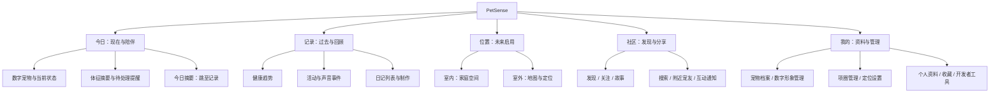
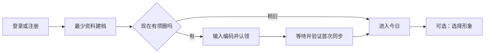

# PetSense 功能盘点与交互重规划

日期：2026-10-28。性质：产品评审稿；导航方案已按用户确认实施，功能交付状态仍以代码与模拟器验收为准。

## 1. 结论与规划依据

PetSense 已具备账号、宠物档案、项圈归属、遥测观察、数字形象展示、运动日记任务和较完整的社区能力。当前最主要的问题是：**功能按开发模块排列，用户却需要跨模块完成任务**。健康、数字形象、设备、社交和实验采集缺少清楚的层级。

用户明确的产品方向是「日常健康管理 + 数字宠物陪伴」。用户同时明确：位置尚未实现，但未来包含室内定位、室外定位，应作为正式产品模块规划。

建议主线：**认识宠物 → 连接项圈 → 看见真实状态与数字形象 → 回顾记录 → 必要时处理问题 → 自愿分享**。

已确认并实施的导航：**今日 / 记录 / 位置 / 社区 / 我的**。数字宠物是「今日」的核心，不另造只有动画的陪伴空页；「位置」内部预留室内、室外两种能力，不各占一个 Tab。

位置 Tab 保留既有的真实测距状态与项圈能力入口，并以「筹备中」标签说明室内/室外定位尚未交付；不展示估算位置、地图或演示轨迹。

本文不把「存在文件或 API」等同于「用户已能顺畅使用」。状态标记：

| 标记 | 含义 |
|---|---|
| 已接通 | 客户端存在入口，服务端或真实数据源有对应实现；不代表每种场景均经过本次实测 |
| 条件可用 | 依赖项圈、有效测量、个人数字形象或外部服务 |
| 入口缺失/断链 | 有部分组件、接口，但普通用户不能完成整条流程 |
| 工程能力 | 面向调试、实验、采集，不能直接当作消费级功能 |
| 未来规划 | 尚无可交付的用户流程 |

## 2. 本次核查范围与限制

代码依据包括 `app/src/app/` 的五个 Tab、独立路由、服务层、告警规则、数字形象组件，以及 `server/petsense/` 的各域 API、遥测聚合和任务处理。没有以旧设计文档代替现状判断。

模拟器：iPhone 17 Pro，iOS 26.5，Expo Go；本地当前工作区代码通过 8082 端口加载，REST 指向现有腾讯云服务。已看到 Metro 的 `iOS Bundled`。开始时缺少 `expo-location`，用锁文件执行 `npm ci --ignore-scripts` 恢复依赖后启动成功。

使用既有 petsense 账号查看真实数据，没有保存宠物/个人资料修改，没有发帖、评论、关注、上传照片、解绑项圈或启动硬件采集。本次设备没有新鲜遥测，因此**在线状态切换、实时有效测量、告警触发、定位、AI 生成成功链路不属于实测通过范围**。历史 7 天趋势实测读到有效数据。

本次未逐个执行所有写操作，也未开展 Android/Web 端到端验证。以下把实走、代码核查、规划建议分开表述。

## 3. 已实现功能枚举与拆解

### 3.1 账号与会话

| 子功能 | 用户操作/行为 | 状态与边界 |
|---|---|---|
| 注册 | 用户名、密码、展示名、表情头像 | 已接通；注册与登录共用弹层 |
| 登录 | 用户名密码登录、错误反馈 | 已接通，本次实走成功 |
| 登录保持 | 本地保存 session token，启动时读取用户 | 已接通 |
| 退出 | 确认后清理会话 | 已接通，本次未执行 |
| 访客模式 | 查看首页登录引导、浏览公开社区；写操作要求登录 | 已接通；各入口分别处理登录 |
| 公开个人资料 | 编辑展示名、表情头像、简介；读取公开主页 | 已接通，与宠物资料属于不同对象 |

依据：`hooks/use-auth.tsx`、`services/api.ts`、`login.tsx`、`profile-edit.tsx`、服务端 `auth/routes.py`、`social/routes.py`。

未发现完整的密码找回、更改密码、账号注销用户流程，不能列作已实现功能。

### 3.2 宠物档案与首次引导

| 子功能 | 详细拆解 | 状态与边界 |
|---|---|---|
| 建立档案 | 名字、物种（狗/猫/兔）、品种、表情头像 | 已接通；服务端当前每账号只允许一份宠物档案 |
| 首次设置 | 建档 → 输入项圈编码 → 完成；读取现有进度后继续 | 已接通；建档成功但绑定失败时无需重新建档 |
| 暂不绑定 | 档案可以先建立，稍后连接项圈 | 已接通；没有项圈时不能得到自动观测 |
| 查看档案 | 基本资料、关联项圈编码/状态/电量 | 已接通，本次实走 |
| 修改资料 | 字段校验、保存、取消、未保存离开保护 | 已接通，本次进入编辑后取消，没有改动资料 |
| 宠物照片 | 相册选择、裁剪/规范化、上传；也可选默认表情头像 | 已接通；最大 10MB，JPG/PNG/WebP |
| 首页动画选择 | 从服务端预设目录选择形象或不使用预设 | 条件可用；改变首页表示，不等同于上传照片或生成个人数字形象 |
| 页面刷新同步 | 修改档案后通知首页、我的、相关页面刷新 | 已接通 |

依据：`setup.tsx`、`pet.tsx`、`pet-profile-form.tsx`、`avatar-template-picker.tsx`、`pets/routes.py`、`pets/profile.py`。

当前不是完整医疗档案：未见生日/体重管理、疫苗、就医、用药等成套用户流程。也不是多宠管理产品，界面列表和部分接口参数不能证明支持多宠切换。

### 3.3 项圈绑定与设备管理

| 子功能 | 详细拆解 | 状态与边界 |
|---|---|---|
| 认领项圈 | 输入编码、格式校验、归属校验、关联宠物 | 已接通；是编码认领，不是蓝牙扫描配对或 Wi-Fi 配网 |
| 一人一设备 | 限制重复归属；认领后建立宠物关联 | 已接通 |
| 设备卡 | 编码、在线状态、最近电量、守护的宠物 | 已接通；历史电量需要补充采集时间说明 |
| 继续设置 | 已认领但关联未完成时继续 setup | 已接通 |
| 解绑 | 二次确认，移除绑定，保留宠物档案 | 已接通，本次未执行 |
| 按归属订阅 | WebSocket 需登录，只接收当前用户名下设备帧；归属变化刷新范围 | 已接通，属于关键基础能力 |

依据：`device-card.tsx`、`devices/routes.py`、`telemetry/realtime.py`。

### 3.4 实时观察与健康体征

| 子功能 | 详细拆解 | 状态与边界 |
|---|---|---|
| 实时传输 | MQTT 接入、服务端存储、WS 分发、客户端自动重连 | 已实现基础链路；真实显示依赖设备上报 |
| 状态判断 | 实时、新近同步、历史快照、等待首次观测、回放 | 已接通；首页用新鲜度判断实时显示 |
| 当前体征 | 心率、血氧、传感器温度 | 条件可用；只展示有效且适用的数据，无有效值显示「—」或说明 |
| 测量说明 | 温度来自项圈传感器，不等同于宠物体温 | 已接通 |
| 端侧动作识别 | 展示项圈报告的动作、置信度；当前 edge 映射为站立、坐着、趴着、走动 | 条件可用；不能凭动画资源推断已实现睡眠/进食/奔跑识别 |
| 端侧声音识别 | 当前声音标签、置信度、实验性标记 | 条件可用；模型识别结果不是录音 |
| 回放模式 | 循环读取真实实验数据集，显式标识回放，不计入今日记录 | 已实现开发模式；不是用户可任意选日期回放录像的功能 |

依据：`telemetry-service.ts`、`use-telemetry.ts`、`index.tsx`、`pet-avatar.ts`、`monitor.tsx`、`mqtt_ingest.py`。

遥测类型包含呼吸、HRV、血压等字段，但字段声明不是有效测量承诺。当前诊断页按上报情况展示部分技术字段，不能把它们包装成已完成的健康功能。

### 3.5 历史观察、统计与声音记录

| 子功能 | 详细拆解 | 状态与边界 |
|---|---|---|
| 今日记录 | 已观测时长、走动时长、静止时长 | 已接通；统计的是实际观测覆盖，不是全天完整行为 |
| 体征趋势 | 24 小时 / 7 天 / 30 天；心率 / 血氧 / 传感器温度 | 已接通；当前藏在首页折叠卡中 |
| 统计详情 | 均值、最低、最高、有效样本数；上一/下一时段 | 已接通，本次切换 7 天读取到历史心率数据 |
| 缺失处理 | 无有效读数保持缺口，图表断线 | 已接通，需保留 |
| 声音事件 | 合并相邻识别事件、显示标签及起止时间、更多/收起 | 已接通；当前接口返回今日最近事件（最多 20 条），不是任意日期完整音频库 |
| 服务端聚合 | 最新快照、分钟桶、声音事件、24h/7d/30d查询，保留策略 90 天 | 已实现；客户端不是每次拉取全量原始帧 |

依据：`observations.ts`、`observation-view.ts`、`sound-timeline.tsx`、`trend-panel.tsx`、`telemetry/observations.py`。仓库还存在 `/trends` 接口，不能因此在产品里再做第二套重复趋势入口。

「静止」当前聚合站立、坐着、趴着等非走动动作，不能解释为睡眠；未观测时长不能解释为静止；没有现成自动步数/里程/睡眠评分闭环。

### 3.6 异常提醒

已有客户端告警状态机：连续越界触发、连续回稳解除、滞回防抖、严重程度排序、折叠；规则覆盖心率高低、温度高低、低血氧、长期无效佩戴、低电量和数据中断。首页铃铛打开当前活跃告警。仓库有独立状态环组件，但当前 `PetHero` 外环只按数据新鲜度着色，未接入告警严重程度，不能把告警状态环算作当前首页已有行为。

限制：这是客户端活跃告警，不是已实现的服务端全天后台监控、系统推送或可追溯告警档案；关闭 App 后持续告警能力没有在本次代码核查中得到支持。

明确的不一致：首页把 `bodyTemp` 命名为传感器温度，而告警规则仍有 `Fever` / `Low body temperature` 等标签，并直接使用该字段。需要先统一测量含义和展示措辞；本文不提供或认可医学阈值建议。当前通知标题也较泛，且告警英文与中文主界面不统一。

依据：`constants/alerts.ts`、`alert-engine.ts`、`use-alerts.ts`、`notification-center.tsx`、`status-ring.tsx`。

### 3.7 数字宠物形象与陪伴

| 子功能 | 详细拆解 | 状态与边界 |
|---|---|---|
| 首页数字形象 | 个人形象/预设动画/宠物照片/默认头像等资源选择与回退 | 已接通；加载失败可重试 |
| 真实动作映射 | 新鲜、匹配设备且足够置信度的动作驱动展示 | 条件可用；没有上报不推断状态 |
| 预设动作预览 | 无新鲜数据时可轻点形象切换预设动作，长按编辑档案 | 已接通，本次看到入口；交互含义需要重做 |
| 个人 AI 角色卡 | 上传照片、调用 PetGIF、绑定个人形象、设为头像的组件和后端 | **入口缺失/断链**：`CharacterCardModal` 未被页面引用，组件选照片按钮还被 `false &&` 隐藏 |
| 形象身份归属 | 服务端记录个人生成形象的归属、绑定校验 | 已有基础能力；不代表客户端入口完整 |

依据：`pet-hero.tsx`、`pet-avatar.ts`、`character-card-modal.tsx`、`petgif.ts`、`petgif/proxy.py`。

当前没有完整的喂食/抚摸/对话/成长养成系统。数字宠物的现有价值是表达宠物真实状态和可选动画展示。增加虚拟陪伴玩法属于新增产品工作，不应在本次重排中悄悄扩展范围。

### 3.8 运动日记与内容生成

已有输入表单：运动时长、手动估计步数、地点、备注、照片；可用今日走动分钟预填时长。后台任务有 queued/running/completed/failed/unknown 状态、持久化历史、请求幂等、重新查询、结果海报与分享到社区功能。

限制：需要绑定个人 PetGIF 形象。预设动画只用于首页展示，不能生成个人日记。由于个人形象创建入口断链，新用户不能靠正常现有导航完成「创建个人形象 → 生成日记」闭环。本次 Marni 账号点日记只看到不可用说明和空历史。

现有分享按钮直接调用创建社区帖接口，缺少统一的发布预览和可见范围确认步骤。规划应改为先生成私有记录，再由用户明确选择分享。

依据：`diary-modal.tsx`、`diary-validation.ts`、`petgif.ts`、`diary_jobs.py`、`petgif/proxy.py`。

### 3.9 社区浏览与发布

| 子功能 | 详细拆解 | 状态与边界 |
|---|---|---|
| 内容流 | 发现/关注、下拉刷新、分页加载、失败重试 | 已接通，本次实走公开内容与帖子详情 |
| 普通发帖 | 文字、多图、关联宠物、手填地点、公开/粉丝可见 | 已接通；地点名称不等于实时坐标 |
| 草稿 | 保存文字、图片、可见范围；用户隔离；文件丢失提示 | 已接通；原生图片持久化与 Web 行为有区别 |
| 帖子详情 | 查看全文、图片、作者、发布时间、互动 | 已接通 |
| 编辑/删除自己的帖子 | 修改文案、地点、可见范围；版本检查；删除确认 | 已接通；不等于任意更换原帖媒体 |
| 点赞/收藏 | 设置/取消，收藏列表 | 已接通，本次未触发写入 |
| 评论与回复 | 评论列表、发送、楼中楼回复、上下文定位、删除权限 | 已接通，本次打开空评论弹层，未发送 |
| 个人主页与关注 | 展示作者、宠物公开资料、帖子、关注/粉丝列表、关注/取消 | 已接通 |
| 搜索 | 用户、帖子、地点及分类结果 | 已接通 |

依据：`community.tsx`、`create.tsx`、`post.tsx`、`post-edit.tsx`、`user.tsx`、`community-search.tsx`、`bookmarks.tsx`、`social/routes.py`。

### 3.10 故事、附近发现与社交通知

| 子功能 | 详细拆解 | 状态与边界 |
|---|---|---|
| 24 小时故事 | 相册/拍照、短文案、可见范围、故事环、观看状态、查看观看者、删除自己的故事 | 已接通；不是永久健康记录，也不是视频故事功能承诺 |
| 附近宠友 | 获取手机定位，按 1/5/10/20km 查询附近用户或帖子 | 条件可用，需用户主动授权与发起 |
| 可被发现 | 与查询附近分开控制；粗粒度位置保存、有效期与关闭 | 已接通；保存的是社交发现位置 |
| 互动通知 | 点赞、关注、评论/回复等事件，未读数、单条已读、全部已读、跳回目标 | 已接通；不是私信聊天系统 |

「附近」使用手机位置寻找宠友；**与未来宠物项圈室外定位完全不同**，不能共用名称、开关或默认上传行为。

### 3.11 研发采集与诊断

已有普通「我的」页直接入口：录像标注与校准、设备诊断（工程师视图）。

- 诊断展示最近收包、电量电压、动作/声音置信度、传感器有效性；展开后显示模型、RMS、推理耗时、SD 卡、实验和 UWB 等参数。
- 采集页支持连接校时、开始/停止项圈采集、手机录像、动作标签、晃动同步标记、视频分块上传与重试、画面对齐、质量查询及标注数据。
- 服务端还有音频录制开关、WAV 重组/存储/列表、实验录制及事件文件等 API；这些是工程能力，不等于用户可在 App 中随时远程听宠物声音。
- 服务端 `actions/` 保留动作分类相关能力；当前端侧观察链路主要使用项圈上报的模型结果。

依据：`collect.tsx`、`collection.ts`、`monitor.tsx`、`collection/api.py`、`telemetry/commands.py`、`telemetry/audio.py`、`experiments/recorder.py`。

### 3.12 定位：已有基础代码，用户模块尚未实现

存在 UWB 数据帧、最新测距接口、三边定位算法、户型图组件与锚点常量。但当前位置 Tab 没有运行可用的室内地图定位流程，只说明缺少有效坐标/标定。**不能把算法文件或旧户型组件视为已交付室内定位。**

室外定位：本次未发现宠物项圈定位源、室外地图、轨迹查询、围栏、走失找回等完整链路。`expo-location` 的社区用途不能填补这些能力。

依据：`tracking.tsx`、`use-uwb.ts`、`uwb-position.ts`、`floor-plan.tsx`、`uwb-map.ts`、`pets/routes.py`。用户已明确将室内/室外列为未来模块。

## 4. 实际交互审计

| 路径 | 本次实走结果 | 问题与影响 |
|---|---|---|
| 访客首页 → 登录 → 首页 | 可完成；显示 Marni、真实账号绑定信息 | 登录回到来源页，但新用户建档完成链路仅做代码核查 |
| 首页首屏 | 大尺寸形象、问候、声音状态、设备状态、体征，底部已有今日记录 | 大形象有陪伴价值，但状态信息散落、标题与上方留白较大；应让陪伴与状态共用同一区域 |
| 首页状态 → 项圈诊断 → 返回 | 可完成；看到历史时间、电量、无效体征 | 普通用户的「为什么没数据」被送入工程参数页，缺少用户化排障步骤 |
| 首页 → 展开趋势 → 7 天 | 可读到 10/25 的历史心率和 1240 个有效读数 | 长期查看历史要向下找折叠卡；有数据却不易发现 |
| 首页 → 运动日记 | 打开受限说明，无可继续操作的形象创建入口 | 解释依赖但没有完成依赖的路径，是闭环断点 |
| 位置 Tab | 显示当前无法确定位置，提供项圈能力入口 | 产品愿景有独立价值，当前实现尚不能支持一级入口的日常使用 |
| 社区 → 帖子详情 → 评论 | 可查看；空评论弹层能打开 | 本次未发评论；评论关闭过程遇到模拟器工具截图映射异常，不能据此断言 App 卡死 |
| 我的 → 宠物档案 → 编辑 → 取消 → 返回 | 可完成；看到照片、默认头像、预设动画选项 | 多种「形象」混在资料编辑中，概念理解成本高 |
| 我的 → 全局＋ | 进入新帖子；分段项另一侧是宠物档案 | 「发内容」与「管理对象」并非同类任务，却共用创建入口 |
| 我的页面扫描 | 社交统计、项圈卡、通知、收藏、采集、宠物档案、工程诊断 | 社交、业务管理、研发工具交错，缺少面向用户的分组 |

截图：[首页](2026-10-28-interaction-audit/01-home.png)、[我的](2026-10-28-interaction-audit/02-profile.png)。截图是当次真实状态，不是规划稿。

## 5. 信息架构选择与取舍

| 方案 | 结构 | 优点 | 代价/判断 |
|---|---|---|---|
| A. 已选并实施 | 今日 / 记录 / 位置 / 社区 / 我的；数字陪伴与今日状态结合 | 给室内/室外定位明确归属；不重复展现相同宠物 | 需要把今日与记录边界定义清楚；位置未交付时保持诚实空状态 |
| B. 独立陪伴 Tab | 今日 / 陪伴 / 位置 / 我的，社区下沉 | 陪伴定位醒目，目标版保持四 Tab | 当前陪伴缺少足够独立操作；历史记录还要挤回今日，不适合现阶段 |
| C. 维持现有四 Tab | 今日 / 位置 / 社区 / 我的，仅调整卡片 | 改动最少 | 趋势和记录仍藏首页，未实现的位置仍占固定入口，难解决核心问题 |

本文按 A 展开。用户已确认产品双主线、室内/室外定位方向和保留位置 Tab；已完成相应客户端导航与页面改造。

目标信息架构：



规则：同一功能可以有多个快捷入口，但只有一个主页面和一套状态。例如首页电量、档案项圈、我的项圈都进入同一项圈详情，不能分别实现三套管理。

## 6. 页面与布局重规划

### 6.1 今日：先看见它，再知道是否需要处理

按以下顺序组成，不把所有详情铺在首页：

1. **紧凑页头**：宠物名、日期、健康与设备提醒入口；宠物资料有显式入口。当前只支持一宠，不做虚假的切换器。
2. **数字宠物主区域**：形象、当前识别动作、最近更新时间。保留足够视觉面积，但不让问候/留白/形象把数据全部挤出首屏。
3. **异常行动卡（有需要才出现）**：优先展示需要处理的问题和一个下一步按钮。离线时写「检查项圈连接」，不是让用户直接理解模型参数。
4. **体征摘要**：心率、血氧、传感器温度；点击指标进入记录的相应趋势。无有效值不填 0，不用绿色表达健康正常。
5. **今日生活摘要**：观测时长、走动/静止、声音事件概况；「查看今日记录」进入记录。
6. **最近日记入口**：有结果显示最近结果；具备能力可制作；缺少个人形象时给可达的形象设置入口。未接通前不放死胡同按钮。

位置交付后：在主区域下方增加紧凑位置摘要「室内 · 最近房间 / 室外 · 最近位置 / 位置暂未更新」，点击进入位置页；不在首页再复制完整地图。

概念线框（内容为结构占位，实际产品只使用真实数据）：

```text
┌────────────────────────────┐
│ Marni · 今日       提醒     │
│                            │
│      数字宠物主视觉        │
│ 识别状态 · 数据更新时间    │
│ [预览动作]    [管理形象]    │
├────────────────────────────┤
│ 有问题时：说明 + 下一步     │
├────────────────────────────┤
│ 心率    血氧    传感器温度 │
│ 每项可进入对应历史趋势     │
├────────────────────────────┤
│ 今日摘要      查看记录 ›   │
│ 观测覆盖 / 走动 / 声音事件│
├────────────────────────────┤
│ 最近日记 / 制作日记        │
└────────────────────────────┘
```

形象交互固定含义：点主形象进入陪伴详情或展开形象操作；编辑资料用显式按钮。「预览动作」必须单独标记，实时识别标签与用户预览标签分开。不能出现离线时看似正在站立、实际只是预设静态图的误解。未实现聊天/抚摸等能力前不加相关按钮。

### 6.2 记录：给历史一个稳定入口

页面上层为三个明确分类：**健康 / 活动与声音 / 日记**，避免把所有统计再做成长页。

- 健康：24 小时/7 天/30 天；指标切换；趋势、缺口、统计、有效样本和解释。复用现有数据口径。
- 活动与声音：先展示今日覆盖、走动与静止，再展示声音事件；声音详情显示识别时间范围和可用说明，当前不展示播放按钮。
- 日记：最近日记列表、任务状态、查看结果、制作入口；已完成的记录可再次打开。先复用当前最近 20 个任务，不承诺无限历史。

**接口边界**：当前观察接口只有固定时间窗口，活动摘要与声音事件仍固定为今日。第一阶段不能只增加日期选择器就假装支持历史逐日活动/声音。任意日期、全量分页、统一活动事件流应在后端新增相应查询后再开放。

日记不是健康测量证据：手动步数写明「手动填写」，观测预填时长写明来源；编辑值要标明用户确认。以后若自动计步，再扩展来源字段。

### 6.3 我的：管理对象按用户理解分组

顺序建议：

| 分组 | 内容 |
|---|---|
| 宠物与设备 | 宠物档案、数字形象、我的项圈；未来定位设置 |
| 我的内容 | 公开主页、我的帖子、收藏；粉丝/关注纳入公开主页或精简统计 |
| 账号与偏好 | 公开资料、退出登录；只呈现实际支持的设置 |
| 开发者工具 | 项圈诊断、录像标注与校准 |

把采集和工程参数移入「开发者工具」，普通用户先看到项圈详情中的连接、最近同步、电量、佩戴状态与解决步骤。开发者工具的可见权限需实际实现；仅把入口藏深不构成服务端权限控制。

「宠物照片」「首页预设动画」「个人数字形象」归入同一个形象管理说明，但保留各自作用：照片用于档案身份、预设用于展示、个人形象用于个性化资产与日记能力。选择预设不应暗示完成个人数字形象创建。

### 6.4 社区：在社区里完成分享任务

- 保留发现/关注、搜索、故事、附近宠友、互动通知。
- 发布按钮只属于社区页面或内容结果页，不在健康、位置、我的上长期悬浮。
- 「发动态」与「发故事」组成社区发布选择；宠物建档从发布面板移除。
- 运动日记分享也进入同一发布预览，展示图片、文案、宠物、可见范围后确认发布。
- 「附近的人」建议命名为「附近宠友」，避免与宠物定位混淆。
- 通知分清：「健康与设备提醒」在今日；「互动通知」在社区，当前不把两种数据强行合并成一个混杂列表。

## 7. 关键任务流程

### 7.1 新用户：先得到一个可用的宠物首页



建档只强制名字与必要身份字段；照片、品种、数字形象可稍后完善。配对完成要区分「绑定成功」与「已收到有效数据」。没有有效数据时进入正常首页，显示下一步佩戴/连接检查，不显示健康正常。登录完成回到发起操作位置，避免中断发帖等原任务。

### 7.2 每日查看与健康问题处理

打开今日 → 看形象和数据时效 → 有提醒则查看问题原因 → 按引导检查连接/佩戴 → 查看相应指标历史 → 返回今日。

提醒详情应包括：发生了什么、何时采集、当前是否仍存在、数据是否可靠、下一步操作。工程参数放在详情底部「高级诊断」。服务端持久提醒历史与后台推送属于后续新增能力，当前不得在文案中承诺全天守护推送。

### 7.3 个性形象与陪伴

今日「管理形象」或我的「数字形象」 → 看清当前使用的是照片/预设/个人形象 → 选择可用预设或进入个人形象创建 → 上传照片 → 任务状态 → 结果预览 → 用户选择应用。

个人形象创建必须先补齐入口、状态恢复与失败反馈。现有角色卡组件没有完整的跨页面任务恢复，而且同步生成超时返回后缺少可靠的用户续查流程；不能直接把旧组件挂上就宣告闭环完成。第一阶段可以只交付明确的预设管理，个人生成作为下一阶段真实开发。

### 7.4 制作并分享日记

记录 → 日记 → 制作 → 检查个人形象条件 → 确认时长与手填内容 → 提交任务 → 可离开页面 → 在日记列表继续查看 → 完成后先私有保存 → 可选分享预览 → 发布成功后进入自己的帖子详情。

如果未有个人形象，只有在「创建个人形象」已可用时才提供跳转；否则显示清楚的能力边界，允许返回记录。失败保留输入；状态未知先查询原任务；重复点击复用任务号；分享失败不能丢失已完成海报。

### 7.5 管理项圈

我的 → 我的项圈 → 状态/最近同步/电量 → 连接或佩戴排查 → 高级诊断。解绑位于详情页底部危险操作区，明确解绑后果并二次确认。不能把红色解绑作为用户看到离线时最显眼的解决方法。

## 8. 未来位置模块：室内 + 室外

### 8.1 页面归属与入口

位置是独立任务：「它在哪、位置是否可信、我该怎么找到它」。目标版保留独立 Tab。一级页面上方提供 **室内 / 室外** 切换；默认打开上次视图，可给出当前可用来源提示。MVP 不做基于未验证数据的自动切换，也不把室内失联自动判定为到了室外。

```text
位置                         定位设置
[ 室内 ] [ 室外 ]
当前来源 · 数据时间 · 精度/可信状态
┌─────────────────────────────┐
│ 室内：真实标定后的空间图    │
│ 室外：真实坐标对应的地图    │
└─────────────────────────────┘
当前位置摘要 / 最后有效位置
历史轨迹（能力交付后开放）
定位异常说明与下一步
```

### 8.2 室内定位规划

| 阶段 | 用户流程 | 必须解决的依赖 |
|---|---|---|
| 首次配置 | 我的项圈 → 室内定位设置 → 配置空间/锚点 → 校准 → 验证定位可用 | 设备锚点身份、坐标单位、户型尺度、标定保存、质量判定 |
| 日常查看 | 位置 → 室内 → 看当前点位及更新时间 | 足够真实测距、有效几何条件、误差/不确定性处理 |
| 房间显示 | 校准空间中划分房间后显示房间归属 | 房间边界与坐标系匹配；没有边界不猜房间 |
| 无法定位 | 区分未配置/锚点缺失/测距异常/数据过期 | 可执行排障，不展示沿用旧位置的实时动画 |
| 后续轨迹 | 选择时间段查看室内移动 | 历史坐标存储、查询与隐私策略，现有测距接口不足 |

首版可先交付一个家庭空间的当前位置；多家庭、多楼层、跨空间切换属于扩展。户型图片导入、手动画图或简化坐标配置的具体方案需由定位硬件与标定验证决定，本文不预设所有硬件已支持。

### 8.3 室外定位规划

| 能力 | 用户体验 | 实施前提 |
|---|---|---|
| 当前位置 MVP | 显示项圈真实坐标、定位时间、误差范围；可查看最后有效位置 | 先确认项圈的室外定位源与独立上报能力；手机位置不等于宠物位置 |
| 刷新位置 | 请求更新并展示请求中/成功/失败及实际时间 | 只有设备支持定位指令与回执后才显示按钮 |
| 主人位置对照 | 用户主动授权后显示本人位置与宠物位置 | 与社区附近发现权限目的分开说明 |
| 历史轨迹 | 时间范围、实际采样点、断点显示 | 定位历史、分页查询、精度过滤、留存政策 |
| 找回辅助 | 查看最后定位、前往位置等 | 地图/导航服务与真实定位可用，不能承诺实时追踪 |
| 安全区域提醒（后续） | 设置区域，进入/离开提醒 | 持续位置源、服务端判定、抖动策略、后台推送；当前均不能视为现有能力 |

位置过期后仍可显示「最后位置」，但样式和文案必须明确历史性质。只收到手机 GPS 时只能表达「我的位置」，不能表达「宠物在这里」。室内房间与室外经纬度允许独立不可用，不能以一种数据填补另一种。

### 8.4 位置模块的发布门槛

至少有一种真实定位模式完成设置、显示、过期处理和故障引导后，才启用目标版位置 Tab；另一种模式可作为明确的待支持分区，不做可点击假地图。若两种均未完成，维持当前四 Tab 和能力说明入口。

用户明确了室内/室外方向，尚未确定硬件方案、地图服务、刷新频率、精度、历史留存与后台定位策略。这些是定位实施前需要完成的技术/产品决策，不是本次信息架构规划的阻塞条件。

## 9. 所有页面共用的状态规则

| 状态 | 应显示 | 主行动 |
|---|---|---|
| 未登录 | 哪类功能需要账号，公开内容仍可浏览 | 登录并回到来源 |
| 未建档 | 建档价值和最少步骤 | 建立档案 |
| 有档案无项圈 | 形象与档案可用，自动观察暂不可用 | 连接项圈 |
| 已绑定未见数据 | 绑定成功，尚待首次同步 | 检查项圈与佩戴 |
| 数据过期 | 最近有效时间，历史数据显示历史样式 | 查看项圈状态 |
| 有上报但体征无效 | 设备在线，测量不可用 | 检查佩戴/测量说明 |
| 无置信识别 | 尚无可靠动作/声音 | 等待识别，不填默认动作 |
| 无记录 | 是尚未观测、无有效值还是当前范围为空 | 给真实可完成的下一步 |
| 网络失败 | 保留可用缓存并标记过期，错误与空记录分开 | 重试 |
| 预览/实验回放 | 显式标注，不驱动真实健康结论 | 退出预览/回放 |
| 外部生成排队/失败 | 任务进度、最近状态、保留输入 | 查询原任务或重试 |
| 定位未配置/不可用 | 分室内/室外说明原因与最后时间 | 配置或排查 |

电量旁的历史时间应跨天带日期。本次在凌晨看到「最近更新 20:20」，对用户而言难判断是哪一天；建议「昨天 20:20」或完整日期。

## 10. 现有入口迁移表

| 当前 | 建议主归属 | 首页是否保留快捷入口 |
|---|---|---|
| 首页完整健康趋势 | 记录 → 健康 | 指标卡进入对应趋势 |
| 首页声音列表 | 记录 → 活动与声音 | 最新摘要/数量 |
| 首页日记弹层 | 记录 → 日记 | 最近结果或制作入口 |
| 首页声音 → monitor | 声音记录详情 | 有关测量质量时才进入诊断 |
| 首页项圈状态 → monitor | 我的项圈详情 | 保留状态快捷入口 |
| 预设长按编辑档案 | 我的 → 档案；独立管理形象入口 | 显式按钮代替隐藏手势 |
| 全局＋ → 新帖子/宠物档案 | 社区发布；宠物建档归 setup | 移除全局悬浮按钮 |
| 我的：采集/诊断 | 我的 → 开发者工具 | 不保留 |
| 位置 Tab | 保留真实测距状态与项圈能力入口；显示室内/室外待支持标签 | 定位交付后显示真实位置摘要 |
| 社区附近的人 | 社区 → 附近宠友 | 不放进宠物位置页 |
| 今日铃铛与社区铃铛 | 分别命名为健康与设备提醒、互动通知 | 健康提醒保留首页 |

## 11. 分阶段落地与验收

### 阶段一：重新归类，复用真实能力

调整导航为五 Tab、抽出记录页、取消全局＋、整理我的分组、增加用户化项圈详情、统一状态与时间措辞。预设展示可保留，明确预览与真实识别。位置 Tab 保留真实状态与诊断入口，并用筹备标签限定其能力范围。

主要复用现有接口和数据；新增页面、路由和信息整合，不要求重写遥测采集。活动/声音先保留今日范围。告警测量含义必须同步核对，不只是改视觉。

验收：新用户能找到建档和连接；用户从首页一次进入对应趋势；首页常规操作不直接进入工程参数；全局＋消失；所有可点击功能有真实去向；无数据不显示正常；数字形象不能伪装实时动作。

### 阶段二：完成数字陪伴与日记闭环

补齐独立形象管理与个人生成任务恢复，建立日记列表、结果详情和统一分享预览。区分照片、预设、个人形象；保留私有结果，失败可恢复。

验收：普通新账号能从可见入口创建/应用个人形象；离开后能续查；生成日记失败不丢输入；重复提交不产生重复任务；分享前可预览且由用户确认；不依赖手工写 `petgif_id`。

### 阶段三：室内定位 MVP

先完成真实测距到配置、校准、当前位置与失效处理的完整链路；根据结果在现有位置 Tab 启用室内视图。室外分区显示实际支持状态。保留定位与健康/声音的独立性。

验收：没有完成标定不显示房间；点位来自真实测量；过期位置有明显标记；锚点异常有原因与可完成排障；社区位置无法冒充项圈位置。

### 阶段四：室外定位与后续能力

先确认硬件定位和通信，再建设地图、位置历史及找回辅助。安全区域/后台提醒应单独交付和验证，不随地图页面一起默认承诺。

### 实施涉及的主要代码范围

客户端：Tab 布局、`index.tsx`、新增记录与项圈/形象详情页面、`profile.tsx`、`create.tsx`、`diary-modal.tsx`、`tracking.tsx`、共用状态组件。保持解析集中在 `telemetry-service.ts`，颜色来自主题文件，保持现有真实数据约束。

后端：阶段一优先复用 dashboard/observations/device；逐日记录、告警档案、数字形象持久任务、定位配置/历史/指令等按阶段增补。新域路由按现有 blueprint 组织。实施前阅读 Expo SDK 57 对应版本文档。

开发验收按仓库规定运行客户端 lint/typecheck/format:check/test；涉及服务端则运行 unittest。另用模拟器验证游客、有档案无项圈、离线、有无有效读数、历史趋势、生成失败与返回路径。本次仅文档交付，没有运行这些代码改动测试，也没有宣称功能修复。

## 12. 评审时需要确认的决定

已确认：日常健康管理与数字宠物陪伴双主线；位置未来包含室内/室外；保留位置 Tab 但不填充未实现功能。

本文建议、尚未确认：实验采集下沉开发者工具的最终权限策略；先完善数字形象与记录闭环，再按硬件条件落地定位。具体卡片尺寸、图标、页面组件拆分交给实施设计，不能由此改变数据含义或新增未授权的产品范围。

本次包含客户端导航与交互改造；不包含部署、对外发布或生产资料修改。
