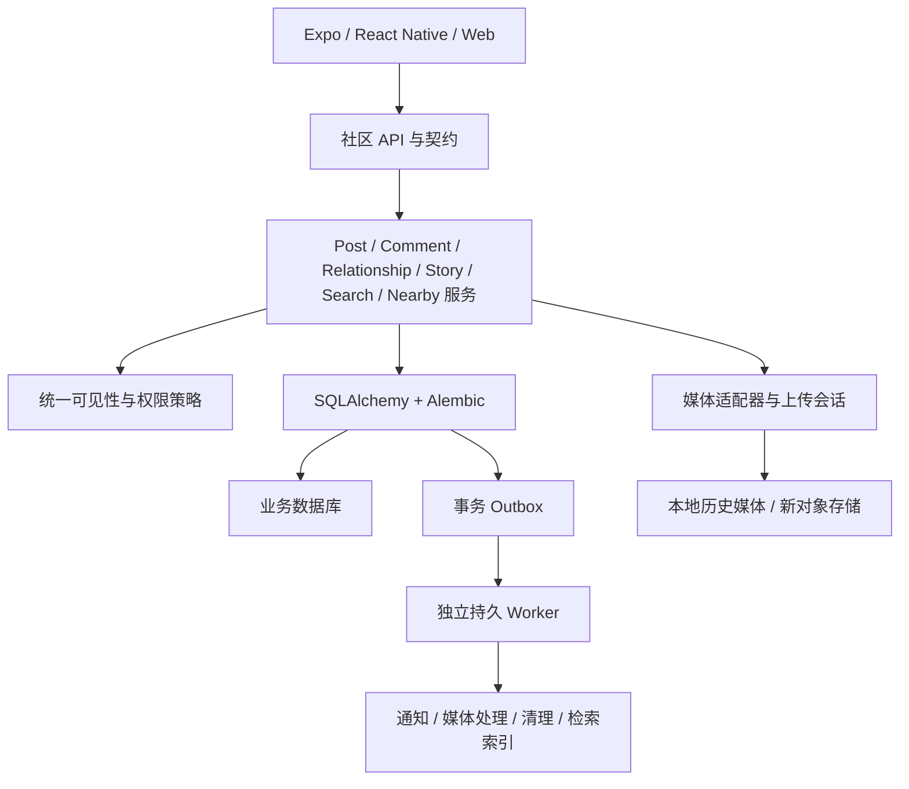

# PetSense 宠物社区改造升级设计方案

日期：2026-10-26。文档性质：基于现有代码的审计与建议设计，供评审和后续开发使用；本次没有修改产品代码、数据库或线上服务。

## 1. 结论与分析边界

当前社区已经有真实的帖子、点赞、评论、关注和用户主页接口，也有 SQLAlchemy 模型、事务和 Alembic 迁移。准确定位是：**有基础 CRUD 的早期社区，页面之间缺乏统一业务规则，核心能力与异常闭环不完整。** 因此可以沿现有技术栈升级，不需要从零重写。

用户列出的十项问题基本成立，其中两项需要细化：Feed 不是无限全量返回，而是固定返回最近 60 条、没有下一页；评论时间戳服务端已有，只是客户端未展示。粉丝/关注列表不是完全没做，而是“我的”页没有接入口，已有列表也缺分页和可靠状态同步。

本轮社区升级应形成四条闭环：

1. 生产：编辑内容 → 保存草稿 → 上传处理 → 发布确认 → 编辑/删除。
2. 消费：发现/关注/搜索/附近/故事 → 内容详情 → 图片或视频查看 → 返回保留浏览位置。
3. 关系：发现宠友 → 主页 → 关注/回关 → 关注流 → 互动通知。
4. 互动：点赞/收藏/评论/回复 → 可靠确认 → 跨页面一致 → 按互动类型生成通知（收藏不逐人通知）。

用户已确认：本轮先完善公开社区，一对一私信和群聊后续再做。公开社区范围包括内容、关注关系、互动通知、故事与附近发现的完整生命周期。用户随后明确：本轮不做社区治理，举报、内容审核、处罚/封禁、申诉、治理后台及本方案原归入治理的用户拉黑/屏蔽/静音均移出范围；不为这些能力预建表、接口或工作流。登录鉴权、作者权限、受众校验、媒体有效性校验、用户主动删除和注销后的数据清理仍保留，作为正常功能与数据一致性规则。交易、直播、复杂社群和广告系统也建议作为后续独立项目，尚未单独确认。原有宠物健康数据、AI 日记和数字形象只在用户主动发布时进入社区。

### 1.1 核查对象

| 对象 | 核查基线 | 说明 |
|---|---|---|
| 主工作区 | `/Users/yangenhui/code/petsense/petsense_app`，`main@773d457e9a4f5e7384a8460b1c6b9ab378a86b62` | 本文当前实现与行号以此为准 |
| 已有修复分支 | `fix/social-review-issues@4d2851bc4465841933a4cdecdad9090551af2872` | 独立工作树，仅查看差异，没有修改 |
| 客户端 | Expo SDK 57、React Native 0.86、expo-router、TypeScript | 复用现有主题和路由体系 |
| 服务端 | Flask、SQLAlchemy、Alembic；默认 SQLite，已有 PostgreSQL 方言支持 | “支持方言”不等于已完成生产数据迁移 |

核查方法包括代码与路由检查、现有社区单元测试、隔离数据库探针。本次没有重新操作模拟器、没有调用线上账号或生产接口，也未核实 App 当前安装包及云端部署的具体版本。因此，代码结论与接口复现有证据，设备上的最终表现仍需三端验收。

主工作区原先已有 `HANDOFF.md` 删除和 `gui-test-screenshots/` 未跟踪内容；本次没有改变它们。

### 1.2 现有修复分支的差异

该分支修正了“我的帖子”跳转、用户页加载失败状态、退出确认等；同时移除了发帖位置字段、举报和分享入口。它没有补上服务端搜索、故事、分页、帖子详情、评论回复、评论幂等或“我的”页粉丝关注入口。因此应当在确定开发基线时逐项合并有价值的修正，不能直接将这个分支视为社区升级完成版。

## 2. 用户提出的十项问题：逐项核实

| # | 当前事实与证据 | 根因 | 目标行为 |
|---|---|---|---|
| 1 | `profile.tsx:127–128` 的粉丝/关注没有 `onPress`；引入了 `FollowListModal`，声明了状态，但没有渲染弹窗。`user.tsx:180` 起则已接通 | 页面拼装未完成，关系状态分散 | 自己与他人主页共享关系列表；列表能进主页、关注/取关、分页、重试，并同步统计 |
| 2 | `comment-sheet.tsx:45、62` 吞掉读取与发送异常；访客也能打开输入框，写入收到 401 后无解释 | 没有区分加载、写入、刷新及登录状态 | 区分读失败/写失败/结果未知；提示原因，保留草稿，支持可靠重试 |
| 3 | `community.tsx:107` 直接删除；卡片菜单只有“删除帖子”项。`user.tsx:102` 则有确认框 | 删除业务在两个页面重复实现 | 所有入口调用统一删除流程；确认、等待、失败恢复与删除后缓存清理一致 |
| 4 | `community.tsx:117–124` 只在客户端过滤已拉到的帖子；没有用户结果和服务端搜索；故事环独立渲染 | 没有独立搜索能力和结果模型 | 搜索独立页面/模式，按帖子、宠友、地点分类，服务端检索与分页；隐藏 Feed 故事环 |
| 5 | `create.tsx:139` 只有相册；`259` 无图片即禁用。页面有“选择一张照片”的空态，但没有明确禁用原因或相机入口 | 发布规则与编辑器状态未形成契约 | 建议支持纯文字与图文；如果采用图片必选，须有持续提示和校验，不能只置灰 |
| 6 | 社区没有附近接口、经纬度模型或地理索引；当前 `location_text` 是自由文本 | 未实现 LBS。设备页的 UWB 与社区地理发现不是同一能力 | 手机前台定位 + 自愿被发现 + 有时效的位置 + 附近人/附近帖查询 |
| 7 | `community.tsx:126–137` 从 Feed 作者拼故事环，`203–205` 跳发帖/用户页 | 复用头像样式模拟了不存在的内容类型 | 独立故事实体、24 小时生命周期、分组列表、全屏查看器和已读状态 |
| 8 | `api.ts:259` 无分页参数；`social/routes.py:51` 固定 `limit(60)`；客户端 `ScrollView + map` | 服务端和视图都没有分页模型 | 稳定游标 + 首次/刷新/加载更多独立状态 + 虚拟列表 |
| 9 | 路由没有帖子详情；卡片大图和截断文案未绑定详情动作；`GET /posts/:id` 不存在 | 缺独立内容资源入口 | 从 Feed、搜索、通知、分享链接均能打开同一详情；全屏查看媒体 |
| 10 | `Comment` 只有 body/author/post/time；GET 已返回 `created_at`，UI 未展示；没有删除或回复接口；固定最多 200 条 | 评论只实现一级新增与读取 | 时间、作者跳转、删除自己的评论、楼中楼回复、分页、定位到通知对应评论 |

### 2.1 十项之外必须处理的缺口

| 问题 | 当前证据与影响 | 改造要求 |
|---|---|---|
| 写成功后刷新失败会被误当发送失败 | 评论先 POST 再 GET；任一步失败都保留草稿。重试可能重复写入 | POST 返回完整评论；写确认与读刷新分开；持久幂等标识 |
| 点赞/关注是 toggle | 同一请求重试会反向操作；列表关注失败不回滚 | 改成设置目标状态的幂等接口；实体级串行与错误恢复 |
| 关系列表“假空态” | `follow-list-modal.tsx:39` 读失败设为空数组；切换列表不重设加载态；行不可进入主页 | 错误与空数据分开，按 user/kind/viewer 管理请求，头像与昵称可导航 |
| 举报假成功（历史事实） | 主分支 `community.tsx:113` 只弹“已收到”，没有写记录；修复分支直接删除入口 | 按本轮范围移除该假成功入口，不新增举报流程 |
| 分享没有回访能力 | 主分支卡片只分享文案，失败静默；修复分支移除分享 | 帖子详情 + 稳定 HTTPS 链接 + App 深链/网页兜底 + 真实失败提示 |
| 内容状态模型不足 | Post 无草稿、编辑版本、可见范围或软删除状态；pet_id 无外键 | 引入清晰状态及约束，复用现有表渐进迁移 |
| 图片入库校验过浅 | 只按少量 magic bytes 判断；整文件读入后检查 10MB；损坏 PNG 也能发布 | 请求大小上限、完整解码、像素限制、方向纠正、缩略图和元数据处理 |
| 媒体展示契约不一致 | 卡片只有 gif 分支会使用 mediaUrl，其他类型走 imageUrl；类型却声明 video | 统一 media 数组和渲染策略；没有实际播放器的类型不能宣称支持 |
| 多个入口直接造 Post | 普通发帖和 `petgif/proxy.py:250` 的日记发布各自创建数据 | 所有入口调用同一 PostService，幂等、可见性和通知规则一致 |
| 公开主页携带设备字段 | `pets/routes.py:62–74` 的 public 序列化仍包含 device_id、电量与在线状态 | 建立独立 PublicPet DTO，社区仅返回展示需要的公开资料 |
| Web 删除会遇到跨域限制 | `app.py:67` 的允许方法无 DELETE；将来 PUT 与新请求头也未列入 | 在实际允许的来源上验证 OPTIONS 和实际请求，补方法和请求头 |
| 社区通知未形成 | 现有 NotificationCenter 是健康告警视图，没有社区通知实体 | 新建持久互动通知，视觉入口可以共享，数据和优先级分别管理 |

### 2.2 隔离验证结果

已有 `server/tests/test_social.py` 两条测试通过。它们覆盖正常发帖/点赞/评论/关注及部分基本错误，不代表完整社区可用。

额外探针使用临时数据库和本次工作目录下的上传目录，结果如下：

| 场景 | 实际结果 |
|---|---|
| 插入 65 帖后读取 Feed | 只返回 60 条，最早返回 ID 为 6；没有 nextCursor/hasMore |
| 相同评论连续发送两次 | 两次 201，数据库出现两条；写入响应只有 success，无评论实体 |
| 相同关注请求连续发送两次 | 第一次 following=true，第二次 following=false |
| 点赞不存在的帖子 | 500，响应不是 JSON；外键避免孤儿记录，但业务未转成规范错误 |
| 读取不存在帖子的评论 | 200 + 空列表，无法区分资源不存在和无评论 |
| 匿名读取用户宠物公开字段 | 包含 device_id、batteryPercent、online |
| 上传只有 PNG 前缀的损坏文件 | 201，损坏媒体进入帖子 |

## 3. 升级路线与范围决策

| 路线 | 能解决什么 | 代价/局限 | 建议 |
|---|---|---|---|
| A：逐项修页面 | 快速补按钮、提示和确认 | 一致性、写重试、生命周期和通知仍分散 | 只作为止血阶段 |
| B：沿现有技术栈做领域升级 | 保留可用代码，建立统一规则，逐步补全产品 | 需要前后端、媒体和后台任务一起推进 | 推荐 |
| C：整体重写并拆微服务 | 大规模时有独立扩容空间 | 当前没有规模证据，迁移和运维负担大，无法自动解决产品规则 | 当前不采用 |

以下采用 B 作为建议方案，属于设计者建议，等待整体评审后进入实施；并不表示已经获得技术选型或开发授权。

**目标：** 内容真实、操作可恢复、关系可持续、发现有来源、异常有解释、功能状态一致。

**首个正式版本包含：** 帖子完整生命周期、文字/图片发布、分页 Feed 与详情、可靠点赞/收藏/关注、两层评论、服务端搜索、互动通知、真实故事、附近人/附近帖。社区治理不在本轮设计与实施范围。

**后续独立能力：** 私信/群聊、私密账号与关注审批、直播、交易、复杂勋章积分、商业推荐系统。话题聚合可以早于推荐算法交付。

## 4. 信息架构与主要入口

```text
社区 tab
  ├─ 发现：公开帖子，初期按时间排序
  ├─ 关注：已关注作者 + 自己的可见帖子
  ├─ 附近：附近动态 / 附近宠友；授权、位置更新时间与退出发现入口
  ├─ 故事环：独立故事列表；搜索模式不展示
  ├─ 搜索：帖子 / 宠友 / 地点，后续增加话题
  ├─ 互动通知：评论与回复 / 点赞聚合 / 新粉丝 / 系统处理
  └─ 发布：新帖子 / 新故事；AI 日记分享进入同一发布预览

帖子详情
  ├─ 作者、完整内容、宠物、媒体、地点/话题
  ├─ 点赞、收藏、分享、更多菜单
  └─ 评论区、回复、排序、定位与输入框

用户主页
  ├─ 公开资料、公开宠物、帖子、故事入口；本人可编辑自己的公开资料
  ├─ 粉丝 / 关注列表、关注/回关
  └─ 本人的公开资料编辑入口

我的 tab
  ├─ 我的帖子 → 自己的社区主页
  ├─ 粉丝 / 关注 → 同一关系列表
  ├─ 我的收藏 / 草稿箱 / 发布失败任务
  └─ 社区设置：被发现、通知、故事归档
```

用户是账号与互动主体，宠物是内容关联对象；不为每只宠物虚构独立登录账号。当前业务倾向一用户一宠物，UI 按现有模型展示，但帖子关联仍使用 petId，为以后调整保留兼容。

## 5. 帖子、发布、媒体与详情

### 5.1 发布内容与规则

建议支持三种内容：纯文字、1–9 张图片、一段短视频。先交付文字与图片，视频在媒体处理流水线齐备后开放；视频不能只加类型或 UI 开关。

规则建议：

- 文字与可用媒体至少一项非空；纯图片允许不写文案，纯文字允许无图片。
- 首版文案保持现有 500 字限制，前后端统一 Unicode 计数规则；不得只由客户端 maxLength 判断。只有空白/不可见字符不视为有效内容。
- 图片最多 9 张，单张原文件上限先沿用 10MB；另设总请求、解码像素及账号上传配额。编辑器支持排序、删除、替换与封面选择。
- 相册、拍照分别可达；拍照拒绝后解释并提供设置入口，用户取消选择不报错。Web 不支持的能力给可用文件选择路径。
- 拍照复用现有 expo-image-picker 能力，校正当前只描述校准录像的权限文案。Android 选择器导致 Activity 重建也需恢复选图结果。[Expo 57 ImagePicker 文档](https://docs.expo.dev/versions/v57.0.0/sdk/imagepicker/)
- 短视频建议最多 60 秒、100MB；故事视频另限 30 秒。参数是建议初值，需以目标机与上传成本验收后冻结。
- gif、video 与静态图片分别渲染；一期不开放多种媒体混排。保留历史 GIF 的动效，并对降低动态效果设置提供静态封面。
- 关联宠物可选，不能因为用户尚未建档而禁止发帖。提交时宠物被删除/不属于用户，返回明确字段错误，保留草稿，不能静默取消关联。
- 用户主动选择公开或仅粉丝可见，默认公开；修改受众必须明确说明。草稿始终仅自己可见。
- 不默认附带位置、健康体征或设备身份。AI 日记内容发布前可编辑和确认，不能自动把诊断或轨迹带入社区。

如果最终产品决定继续强制图片，则应采用另一套明确规则：编辑器常驻“至少添加一张照片”，按钮附近解释不能发布的原因，无媒体提交返回字段错误。这个选择需要统一修改客户端与接口；不是仅删除一个 disabled。

### 5.2 编辑器状态与可靠发布

本地编辑状态：`editing → validating → uploading → processing → submitting → published`；失败分别落到可识别的阶段。网络断开时“发送失败”和“服务器可能已经收到、正在确认结果”必须区分。

1. 草稿按 userId + draftId 保存文字、媒体顺序、宠物与受众；媒体复制到受控草稿目录，不能依赖系统临时 URI 永久有效。
2. 每个上传和发布动作建立稳定 clientMutationId，页面重建/应用重启仍能复用。
3. 媒体先上传并得到 assetId，处理就绪后发布；选择编辑器退出时提供继续编辑、保存草稿、放弃。上传中退出说明任务是否继续。
4. 每个媒体显示进度、失败与单独重试；不得因为第 7 张失败而重新上传前 6 张。
5. 发布响应返回规范 Post 对象；所有列表通过同一实体缓存接收结果。只有数据库确认发布成功的内容才进入正式列表；上传/处理中的内容留在作者任务区，不能伪装成已发布。
6. 客户端超时后先按 clientMutationId 查询结果；重试复用同一 ID。已有发布结果时不得再次创建帖子。
7. 草稿只在发布结果确认、实体已接收后清理。退出账号时隔离草稿；删除账号时清理账号草稿及待处理任务。

### 5.3 媒体服务

统一 MediaAsset 模型：owner、kind、size、width、height、duration、checksum、storageKey、source、processingState、createdAt、expiresAt。

处理链：上传会话 → 临时存储 → 校验大小与完整解码 → 方向纠正/移除 EXIF 定位 → 缩略图/封面/视频转码 → `ready` 或 `failed`。只允许把本人有权使用且 ready 的资产关联到帖子/故事。

图片完整解码可复用服务端现有 Pillow 能力和宠物头像校验的经验；不能继续以 PNG/RIFF 前缀等同于有效图片。上传大小须在代理、Flask 和流式读取三个边界一致执行。

建议引入对象存储承载新社区媒体，存储适配器兼容现有本地 uploads。临时资源、失败资源、无引用资源通过可重试的清理任务处理；数据库提交失败也有回收路径。共享资产按引用关系清理，不能删除帖子就直接删除所有引用者共同使用的图片。

公开与受限媒体的授权必须和内容受众一致。现有 `/uploads/...` 是公开静态读取，不能直接用于仅粉丝内容或作者归档。需要媒体网关/短时签名地址与引用校验；对已发出的签名链接明确最长有效窗口。限时或受限内容不能直接把外部永久公开的 GIF/视频地址作为访问凭证，须经授权导入受控资产，不向读者返回原始地址；已经公开过的源文件本身无法通过本次引用权限撤回。产品删除立即让资源在业务层不可见，并触发存储/CDN 清理，不能承诺已下载副本可以收回。

### 5.4 详情、编辑和删除

- 新增 `GET /posts/:id` 及稳定详情路由。卡片图、正文和“展开”进入详情；图的查看动作可直接进入全屏媒体查看器，并支持返回详情。
- 图片轮播、页码、缩放、双击放大、加载/失败重试；文字长内容完整展示。视频进入视口再播放，离开暂停，同屏限制一个播放器。
- 从通知进入时带 commentId，服务端返回评论所属楼层/锚点，不能依赖顺序拉到第 N 页。
- 自己的帖子支持修改文案、地点、宠物和受众，显示“已编辑”。一期已发布帖不替换媒体，控制首期媒体替换与资源回收复杂度；需要换媒体时重新发布。
- PATCH 使用 version/If-Match 处理多设备同时编辑，冲突时提示重新载入并保留本地文字。
- 编辑在同一事务内校验作者、当前版本、关联宠物与受众，保存后递增 version 并返回最新 Post。通过结构与字段校验后立即生效，不设置审核队列或审核状态，也不引入仅为审核服务的 PostRevision 表。
- 缩小受众和删除立即影响后续访问、分享和通知预览；列表缓存与详情按服务端新版本校准，旧编辑响应不能覆盖较新版本。
- 删除统一进入确认框，说明影响；等待中防止重复提交。采用软删除，立即从 Feed、搜索、主页、收藏和通知目标可见内容中移除。
- 重复删除本人已删资源返回成功终态；无权删除仍拒绝。资源删除与互动并发时，服务端事务判断状态，不能留下新互动或返回数据库异常。
- 打开已删内容显示“内容已删除”；无访问权限显示不可见页；网络失败显示重试，三者不能共用“无内容”。
- 删除宠物后保留原帖，petId 设空，保留受控的名称/头像展示快照；不得悬空 join 导致整条帖子消失。账号注销则按统一账号生命周期处理作者展示与内容，不由每个页面自行猜测。

## 6. Feed 与列表统一设计

### 6.1 Feed 语义

发现流首版按发布时间倒序，关注流包含当前关注作者和自己的可见内容。新账号关注流为空时引导关注或去发现，不能悄悄混成发现流。尚无行为数据时不把时间流叫作个性化推荐；首版不建设内容精选后台。

可见性判断统一包括：发布状态、受众、作者是否注销与内容删除。Feed、详情、搜索、分享网页和通知都调用同一策略。发布状态限定为 draft/published/deleted，媒体处理中和网络确认中属于任务状态，不等同于内容已经发布。

### 6.2 游标与并发刷新

建议默认 20 条，最大 50 条。时间流按 `(publishedAt DESC, id DESC)` 排序；游标含首屏高水位、上一条排序键、过滤条件摘要及版本，不把 offset 作为连续滑动依据。

```json
{
  "items": [],
  "page": {"nextCursor": "opaque-cursor", "hasMore": true},
  "meta": {"serverTime": "2026-10-26T07:00:00.000Z", "snapshot": "opaque-snapshot"}
}
```

- 同一浏览会话固定高水位，翻页期间的新帖通过“有新动态”提示或主动刷新进入，避免列表跳动。
- 高水位约束已发布资源；随后改变受众的帖子允许在下一次刷新出现，不承诺严格数据库快照。
- 删除/撤回受众即时生效，即使游标会话还未结束也要再次过滤；服务端扫描补足到本页可见条数或真正结束，不能把“过滤后空页”误判成没有更多。
- 游标不能复用于其他 query、tab、user、位置查询或权限上下文；格式非法返回明确错误，过期返回可恢复错误并重开首屏。
- 客户端按 postId 去重；刷新首屏与旧加载更多竞争时，以代次号阻止旧响应污染新列表。
- 首次失败显示整页重试；加载更多失败显示页尾重试，保留已有内容；刷新失败保留内容并显示非阻断提示。

客户端使用 `FlatList`，Stories 放 ListHeaderComponent；不能在同方向 ScrollView 内继续用 map 实现主 Feed。虚拟列表的状态要保存在实体缓存中，避免滚出屏幕后丢失。[React Native FlatList 文档](https://reactnative.dev/docs/flatlist)

浏览返回保留列表项锚点和滚动位置，切 tab 各自保留。图片按视口和尺寸预取，失败占位保留比例；头像、缩略图、详情原图分别取合适尺寸。实际性能须在目标中低端设备测量。

## 7. 评论、回复和点赞

### 7.1 两层评论模型

采用“一级评论 + 展开的回复列表”，不做无限层级缩进。回复可指向楼内任一有效评论，但展示始终两层。

新增 rootId、replyToCommentId、replyToUserId、status、deletedAt、clientMutationId 等。根评论 rootId=null，回复 rootId 指向根；replyToCommentId 记录被回复对象。服务端验证所有指向属于同一帖子及同一楼层，根不能指向自己。使用可落地的组合外键和应用事务校验，而不是仅接受客户端传来的 ID。

列表规则：

- 一级评论默认时间正序，20 条一页；每层默认预览 2 条回复，展开后独立分页。以后增加热门排序时使用单独快照，不能复用时间游标。
- 帖子 commentCount = 当前对访问者可见、未删除的根评论与回复数之和；占位墓碑不计数。根列表条数不等于评论总数。
- 根评论删除但仍有可见回复时保留“原评论已删除”占位；删除正文不可在引用预览中继续泄漏。最后一条有效回复也被删除后，整个空楼可以隐藏。
- 可以继续回复楼内仍有效的回复；直接回复已经删除的对象则返回明确错误，保留输入并允许改为评论帖子。
- 普通用户只可删自己的评论，帖主不获得删除他人评论的权限；本轮不提供处理他人评论的治理入口。删除帖子时其整条评论区一并不可见。
- 显示相对时间，详情可看绝对时间；头像/昵称可进入用户主页，回复对象清晰标注。
- 游客可读，输入区明确“登录后评论”；登录回来恢复帖子和草稿。

### 7.2 发送状态与幂等

发送项状态：`pending / confirming / failed / sent`。输入框有发送中反馈，失败项可重试和取消；文字保留到服务器确认。离开页面或切账号后，异步回包不能改写其他帖子的输入框。

POST 评论直接返回完整 Comment、最新可见 commentCount 和 clientMutationId。客户端用该实体替换临时项，后续刷新只是校准读取状态。**已确认创建成功后，列表刷新失败不能让写入重新变成失败。**

Post/Comment 持久保存 `(authorId, clientMutationId)` 唯一约束；相同 ID、相同请求重放返回原实体，不重复建行。相同 ID、不同内容返回 409。删除后的旧请求重放返回原资源的删除终态，不能复活。幂等缓存即使过期，这个业务唯一标识仍保留。

点赞与关注采用目标状态 API，例如 `PUT .../like {liked:true}`；取消可用 DELETE。重复请求不反转。客户端每实体一次在途操作，后续意图排队合并，旧响应不覆盖新意图；不同设备以服务端最终提交结果为准。失败回滚本次乐观变化并显示提示，结果未知先读取确认。

## 8. 主页、关注关系、收藏与分享

### 8.1 关系闭环

自己/他人主页使用同一 ProfileStats 和 RelationshipList；“我的帖子”进入自己的内容页。粉丝/关注列表均分页、可进主页、可关注/回关，有独立 loading/error/empty 状态。

公开账号关注立即生效；本期不引入关注申请或私密账号。自己不能关注自己；目标已注销时返回明确业务结果。关注计数只计算有效关系；注销后的关系清理与计数需统一维护。

列表内关注成功同步当前行、目标主页、本人 followingCount 和关注流；成功取关后当前列表可即时移除或以已取关状态保留到刷新，选择一种全局一致的方式。建议当前“关注列表”即时移除，并短时提供重新关注入口。

### 8.2 公开资料编辑

本人可编辑展示名、头像与简介，用户名首版保持不变。建议展示名1–40字、简介0–300字，公开头像复用资产校验与缩略图，移除照片时回退用户选择的emoji。保存有等待、失败重试、版本冲突和离开未保存提示；成功后主页、评论作者和关系列表使用同一用户实体更新。

公开资料通过字段长度、资产归属、媒体有效性和版本校验后立即保存，不进入审核流程。社区页面只展示公开字段，编辑接口不得接受设备、健康数据或账号权限等无关字段。

### 8.3 收藏与回访

收藏是私人关系，不公开谁收藏，也不默认向作者暴露收藏者。作者可看到聚合收藏数的能力可在后续版本加入，首版通知中心不逐人发送收藏通知。收藏列表使用游标分页，删除/不可见的原帖显示不可用占位并允许移除，不保留原内容副本。

分享采用稳定 HTTPS 地址，已安装 App 可打开详情，未安装可看受权限约束的网页/登录引导。首版可以复用 Flask 提供轻量分享页，不必先重写为 SSR 网站；公开页面输出对应元数据。只有确实可公开的内容才附预览，受限内容不在页面元数据泄漏。

Web 支持系统分享则使用，取消是正常结果；不支持时提供复制链接。复制失败提示重试。深链参数只标识内容及评论，不携带 token。登录后回到原目标，资源不可见时给确定终态。

## 9. 服务端搜索与地点

搜索采用独立页面或明确模式，包含清除、取消、键盘搜索、最近搜索可删除、加载、错误重试和无结果。进入搜索隐藏故事环，取消后恢复原 Feed 位置。

### 9.1 检索契约

- 分类为帖子、宠友、地点；综合页各返回少量预览和“查看更多”，每类独立游标，不能共用一个 nextCursor。
- 帖子覆盖正文、明确关联的宠物名、话题和地点名；宠友覆盖用户名、展示名和公开宠物名；地点覆盖正规地点目录与其别名。
- 范围是服务端所有当前有权查看的有效内容，不是最近 60 条。删除/注销/受众规则在返回结果时再次检查。
- 查询词去首尾空格、统一大小写和必要 Unicode 归一化；LIKE 特殊字符按普通文字处理，使用参数化查询，不直接暴露数据库查询语法。
- 建议首版关键词 2–50 个可见字符，单字符输入明确提示“再输入一个字”，不要给假的空结果。用户名精确查找可以单独允许 1 字符。
- 输入约 300ms 防抖；中文输入法组合过程中不发中间检索；取消旧请求并校验响应代次。分类/词/排序变化后重置游标。
- 默认按稳定相关性分档（名称精确、前缀、内容包含）再按发布时间/ID 排序，创建查询会话固定候选顺序；会话过期可重搜。首版不承诺拼音、语义理解或自动纠错。

### 9.2 实现选择与中文短词

先定义 SearchService，首版可以对服务端可见全集做正确的 contains/prefix 查询，配合可用索引和查询超时；不能为了性能悄悄只搜最近一批帖子。

SQLite FTS5 的 trigram 全文查询对不足 3 个 Unicode 字符的子串不匹配，直接拿来承诺“柯基”“年糕”等中文短词可搜会有缺口。需要单独的两字查询路径及测试语料。[SQLite FTS5 文档](https://www.sqlite.org/fts5.html)

生产迁移 PostgreSQL 后可评估 pg_trgm 对相似度和 LIKE/ILIKE 的索引支持，但索引是否生效取决于查询，不能等同于完整中文分词。两字词仍保留正确性优先的查询路径，以真实数据压测；达到上限后引入经中文词/短子串验证的索引或专用引擎，而不是无依据先上独立搜索集群。[PostgreSQL pg_trgm 文档](https://www.postgresql.org/docs/current/pgtrgm.html)

索引需要版本、构建进度、重建和失败重试机制。帖子编辑、删除及账号注销要可靠同步；即使索引暂时滞后，返回前也必须通过主数据库校验可见性。

### 9.3 地点不是自由文案

现有 location_text 只能保留为历史地点标签，不能据此生成经纬度。同名“滨江公园”也不能直接合并成一个地点。

新增 Place：placeId、name、aliases、cityCode、addressDisplay、经纬度/坐标系、来源和有效状态。首版可用维护过的真实地点目录，不依赖尚未选定的地图商业 API；外部 POI 接入后通过 providerId 映射并保留来源。

发帖可选择正规地点，或填写明确标为“自定义地点”的文字。自定义文本参与帖子关键词检索，但不冒充正规 POI、不给附近排序或距离。地点结果进入地点详情/帖子列表；无经纬度的历史标签只进入标签聚合页。

## 10. 真实故事：24 小时内容与查看器

故事使用独立实体，绝不从普通 Feed 作者推导。StoryGroup 是读取投影，StoryItem 才是发布资源；两者不能混成仅有头像的数组。

### 10.1 发布和生命周期

- 单条一张图片或一段不超过 30 秒的视频，支持简短文字。复用 MediaAsset，不复用 Post 表伪装限时帖子。
- 上传/处理完成且确认发布后由服务端写 publishedAt，expiresAt=publishedAt+24 小时；处理时间不消耗曝光期。
- 首版默认仅粉丝可见，可主动改为公开；不引入密友名单。查看和已读接口都验证受众。
- 作者可随时删除；期满立即不可浏览，不能依赖清理定时任务是否运行。客户端也按 expiresAt 隐藏，但以服务端时间与再次请求为准。
- 作者归档默认关闭；主动开启后可在私人归档查看，公开访问依然 24 小时过期。建议归档保留 180 天，清理政策在开启处说明。
- 普通过期故事媒体在业务过期后进入回收队列，目标 24 小时内完成物理清理；已开启私人归档的资源按归档保留策略回收。

### 10.2 故事环

只展示当前存在、未过期、可见的故事作者；未读在前，已读样式明确。“我的故事”有内容时打开自己的查看器，独立加号用于新增；没有故事时明确新增，不把两种动作混淆。

关注流显示自己与已关注作者的故事；发现页可展示公开故事，推荐来源明确；作者重复项合并，并显示未读计数。查询失败不退化为随机 Feed 作者头像。

### 10.3 查看器与边界

全屏查看器包含分段进度、左右点击切换、长按暂停、下滑退出、作者资料入口、视频静音控制、作者删除菜单。首版故事回应通过独立 reaction 或跳入作者主页，暂不创造隐含私信收件箱。

图片默认展示 5 秒，视频按实际时长；解码完成后才计时。缓冲、App 后台、查看菜单、权限弹窗或长按时暂停；恢复时先检查过期和权限。支持降低动态效果。

真正可见并稳定展示达到建议 1 秒后才提交已读；预加载、请求成功和滑过未渲染内容都不能算已读。`(storyId, viewerId)` 唯一，服务端记 firstSeenAt，重复回执不累加。作者不能给自己虚增阅读人数。

打开时固定可见故事 ID 序列，但逐项加载仍复查权限和过期。中途删除/过期的内容跳过并解释；网络失败提供重试，不能把“加载失败”当“已看完”。全部失效则返回来源页。查看者列表仅作者可看并分页，非作者不能枚举观看记录。

## 11. 附近人/附近帖子：位置、授权与查询

### 11.1 产品语义

“附近动态”指带正规地理位置的可见帖子；“附近宠友”指主动开启被发现且最近公开过有效位置的用户。这两个入口都不等于宠物项圈实时追踪。

默认不向他人展示本人位置；用户可以仅用自己的位置浏览附近内容，也可以单独开启“允许附近宠友发现我”。退出发现后立即从后续结果消失。未授权时可以手动选城市浏览同城内容，但必须标为“同城”，不能声称精确附近。

新增 expo-location，并仅在访问相关功能时申请前台权限；不要求常驻后台定位。[Expo 57 Location 文档](https://docs.expo.dev/versions/v57.0.0/sdk/location/)

### 11.2 数据和时效

建议初值：查询默认 5km，可选 1/5/10/20km；位置有效期 24 小时，过期后不进入附近人。距上次更新时间明显偏久时，界面显示“最近公开的位置”，不称“当前就在附近”。前台进入附近页时按用户意图刷新，定位失败保留可解释的上次位置或同城模式。

服务端将用户坐标降到约 1km 网格中心后再持久保存与计算附近人；原始精确坐标不写业务历史和普通日志。保存 source、accuracyMeters、observedAt、expiresAt、gridVersion。返回距离档位，例如“1km 内 / 1–3km / 3–5km”，不返回他人坐标、网格 ID、具体门牌和移动轨迹。

地点坐标与手机坐标必须统一坐标系；客户端 GPS 与第三方国内 POI 若来源不同，需要明确转换，不能直接混算。无可靠坐标的文本地点不参与地理排序。

### 11.3 查询和技术路径

首期少量内测可使用带边界框的计算实现正确性；正式附近功能建议在 PostgreSQL + PostGIS 上交付，用 geography 表示统一地理坐标，GiST 索引和 ST_DWithin 做半径过滤，再按距离/ID 排序。geography 的距离单位是米；geometry 单位则取决于空间参考系。[PostGIS ST_DWithin 文档](https://postgis.net/docs/ST_DWithin.html)

创建一次附近查询会话，冻结查询中心、半径、排序版本和候选 ID 顺序；分页时重新排除注销、关闭发现和过期位置。更新自己的位置后开启新会话，不能让旧游标夹带新中心。有效位置不足时真实显示少量或空结果，不能悄悄放宽半径。

附近人结果稀疏、反复查询同一目标等场景要避免精确定位推断：只用降精度位置和距离档位、限制查询频率，不提供任意指定他人为圆心的接口。帖子 POI 可以是公开商圈/公园，不默认展示家庭住址或原始拍摄点。

### 11.4 必测边界

拒绝权限、永久拒绝、定位服务关闭、超时、低精度、模拟器无坐标、近海/边界坐标、城市切换、跨坐标系、旧位置、位置刚过期、用户关闭发现、范围内无结果、快速移动后旧响应返回。无法取得精确位置时必须有明确可用路径。

## 12. 互动通知与社区冷启动

### 12.1 持久互动通知

新增社区通知表，区分评论/回复、新粉丝和点赞聚合。健康告警继续使用自己的领域与优先级，可以共享顶部收件入口，但不能把临时健康状态当持久社区消息。

业务写入与 outbox 事件放同一事务；worker 至少一次消费，通知用 eventId/recipient/type 唯一去重。通知服务故障不会回滚已经成功的评论，也不能永久漏掉通知。

- 评论与回复通知指向可定位的 commentId；通知作者和被回复者是同一人时只发一份；不给自己发送自己的互动通知。
- 点赞按帖子和时间窗聚合，重复点赞/取消/重试不刷屏；收藏默认私密，不展示具体收藏人。
- 单条已读、全部已读和跨设备未读数有服务端状态；“全部已读”按服务端高水位确认，不能覆盖随后新来的通知。
- 写入时校验收件人，展示和推送前再次检查内容受众、作者注销和删除状态；已删除目标显示不可用终态，不展示被撤回正文。
- 首版 App 内拉取/回前台同步即可，推送后续通过 Expo 原生通知接入；推送不是通知数据库的替代。设备 token 更换、失效和退出账号均要处理。[Expo 57 Notifications 文档](https://docs.expo.dev/versions/v57.0.0/sdk/notifications/)

### 12.2 社区生态与冷启动

生态建设保留内容发现和真实互动，不依赖本轮不做的治理系统：

- 首次进入按真实宠物种类、明确选择的兴趣与城市引导关注；无宠物、拒绝定位也能跳过。
- 话题如遛弯、训练、日常记录、经验求助，使用规范 topicId 与话题页，不仅把 # 当正文装饰。
- 冷启动采用真实种子内容和真实用户；无内容时提供真实空态，不填充假用户、假粉丝或假互动。本轮不建设运营精选或内容管理后台。
- 作者有发布记录、评论回应和基础内容表现数据；首版不做积分排行榜或商业推荐。
- 私信和群聊后续独立规划，本轮不新增会话入口或隐含消息收件箱。

## 13. 统一技术架构



保留模块化单体，社区服务与采集/遥测在代码域和后台任务上分开，不在请求中同步转码、推送或构建搜索索引。worker 使用数据库任务与租约重试，初期不强制引入 Redis、Kafka 或专门微服务。

建议组织：

```text
app/src/features/community/
  api/ types/ query-keys/ entities/ mutations/
  feed/ post-detail/ composer/ comments/ profiles/
  relationships/ search/ stories/ nearby/ inbox/

server/petsense/social/
  routes_v2.py        # 参数、身份、HTTP 输出
  dto.py             # PublicUser/PublicPet/Post 等序列化
  policy.py          # 受众、作者归属、发布/删除/注销状态统一判断
  posts.py comments.py relationships.py stories.py
  search.py nearby.py notifications.py
  media.py jobs.py
```

不要求一次搬完文件。先抽出写操作和策略服务，再逐页面迁移；旧路径薄代理到新服务。普通发帖、AI 日记发布和数字形象分享调用相同服务，保留 source/sourceRef 作来源及去重依据。

客户端建议采用明确的服务端状态层，可选已验证适配当前 RN 的查询库或小型自有缓存；选型由实施者做兼容性验证，不凭空把新库当必需。无论选什么，都必须具备：

- 查询键包括 viewerId/sessionEpoch、资源、tab、过滤词、排序、游标或位置会话。
- Post/Comment/User/Relationship 以 ID 共享；列表存有序 ID 和分页状态，防止详情与 Feed 各自维护相反值。
- mutation 有 pending、rollback、reconcile；计数由服务端规范结果校准，不靠各页面随意 +1。
- 退出登录取消旧请求、切换 sessionEpoch、清理私有缓存与通知；旧账号异步响应不能写进新账号。
- 请求有合理超时、取消和错误分类。GET 可有限退避重试；写操作只有具备幂等语义才可自动重试。

## 14. 数据模型、约束和查询设计

| 实体 | 核心字段/约束 | 作用 |
|---|---|---|
| Post 扩展 | authorId、petId、caption、publicationState、audience、publishedAt、updatedAt、deletedAt、version、clientMutationId、source/sourceRef | draft/published/deleted 状态、乐观并发版本、作者幂等键唯一；不含审核模型 |
| PostMedia | postId、assetId、sortOrder；序号唯一、资产引用约束 | 多图、封面与生命周期 |
| MediaAsset / UploadSession | 所有者、处理状态、校验和、存储键、派生资源、租约/过期 | 可恢复上传及资源清理 |
| Comment 扩展 | postId、rootId、replyToCommentId、authorId、body、状态、createdAt、deletedAt、clientMutationId | 两层回复、墓碑、幂等 |
| Like / Bookmark | `(userId, postId)` 唯一 | 设置目标状态不重复累加 |
| Follow | `(followerId, followeeId)` 唯一，禁止 self | 复用原表，补有效状态/索引 |
| StoryItem / StoryView | authorId、assetId、audience、publishedAt、expiresAt、状态；view 的 `(storyId, viewerId)` 唯一 | 故事与独立已读 |
| UserDiscoveryLocation | userId 唯一、降精度 geography、precision、observedAt、expiresAt、enabled | 附近发现，不保存移动轨迹 |
| Place / Topic / PostTopic | 稳定实体 ID、名称、来源；关联唯一 | 地点、话题聚合和搜索 |
| Notification | recipient、actor、type、target、dedupKey、createdAt、readAt | 持久收件箱与跨设备未读 |
| Outbox / Job | eventId、类型、payloadVersion、状态、重试、leaseUntil | 可靠副作用与后台处理 |
| DiscoveryQuerySession | owner/访客会话、查询类型与哈希、排序版本、候选序列、位置快照引用、expiresAt | 搜索/附近稳定翻页；建议10分钟过期，支持重查与清理 |
| IdempotencyRecord | actor、operation、key、requestHash、resourceId、结果 | 写入重放结果；业务唯一键另保留 |

核心索引建议：

- posts：有效状态与 `(publishedAt DESC, id DESC)`，以及 `(authorId, publishedAt DESC, id DESC)`。
- comments：`(postId, rootId, createdAt, id)`；根/回复分别按实际查询计划设置索引。
- follows：`(followerId, createdAt DESC, followeeId)` 和反向 `(followeeId, createdAt DESC, followerId)`。
- stories：`(authorId, expiresAt, publishedAt)`，读取必须同时检查有效状态和 expiry。
- notifications：`(recipientId, createdAt DESC, id DESC)`，未读查询用适当的条件索引/等价实现。
- outbox/jobs：`(state, nextAttemptAt)`，去重约束防止重复执行副作用。
- nearby：PostGIS geography 的 GiST；真实查询用 EXPLAIN 验证，不只创建一个索引名。

已有 Like/Follow 主键和多数外键应保留，不误写成“当前完全没有约束”。新增 pet 外键前清理无效 petId，采用 ON DELETE SET NULL 或显式事务策略。约束、索引和迁移同时提供 SQLite 开发路径及 PostgreSQL 集成验证；PostGIS 相关路径需要真正的 PG 环境，不能以 SQLite 测试替代。

计数第一阶段按有索引的真实关系查询或按页聚合；不要未经测量就到处加缓存。需要冗余计数时，在同一事务里只对真实状态转换增减，定时校准并监测漂移。并发点赞/取关/删除后计数不得为负。

## 15. API 合约建议

建议新增 `/api/app/v2`，v1 在过渡期保留；所有路径只是建议合约，正式开发先冻结 schema 与错误码。现有认证头可沿用，不借升级任务重做整套认证。

| 领域 | API | 关键语义 |
|---|---|---|
| 能力协商 | `GET /capabilities` | 支持的 schema、编辑器媒体类型、故事/附近等开关 |
| Feed | `GET /feed?scope=discover|following&cursor=&limit=` | 游标、范围与快照，不混淆关注空态 |
| 用户帖子 | `GET /users/:id/posts` | 同一分页与可见性模型 |
| 帖子 | `POST /posts`、`GET/PATCH/DELETE /posts/:id` | 创建返回实体，编辑版本检查，删除幂等 |
| 操作恢复 | `GET /mutations/:clientMutationId` | 当前用户写操作结果确认，不能查他人操作 |
| 上传 | `POST /uploads`、`GET /uploads/:id`、`POST /uploads/:id/complete`、`DELETE /uploads/:id` | 上传会话、状态与取消，完成可重放 |
| 点赞/收藏 | `PUT/DELETE /posts/:id/like`、`PUT/DELETE /posts/:id/bookmark` | 设置状态，存在性与权限校验 |
| 评论 | `GET/POST /posts/:id/comments` | 根评论分页，创建支持 rootId/replyToCommentId |
| 楼内回复 | `GET /comments/:rootId/replies` | 独立分页、墓碑规则 |
| 评论定位/删除 | `GET /comments/:id/context`、`DELETE /comments/:id` | 通知锚点及仅评论作者可删除 |
| 用户/关系 | `GET /users/:id`、`GET /users/:id/followers|following`、`PUT/DELETE /users/:id/follow` | Public DTO、稳定列表与幂等 |
| 本人公开资料 | `GET/PATCH /me/public-profile` | 展示名/头像/简介、字段与版本校验，不更改登录凭据 |
| 搜索 | `GET /search?q=&type=&cursor=` | 按类别独立游标，查询会话版本 |
| 地点/话题 | `GET /places|topics`、`GET /places|topics/:id/posts` | 正规实体与标签语义分开 |
| 故事 | `GET /stories/tray`、`POST /stories`、`GET/DELETE /stories/:id`、`GET /users/:id/stories` | 有效受众与过期实时判断 |
| 故事已读 | `PUT /stories/:id/view`、`GET /stories/:id/viewers` | 幂等、仅作者可看阅读者 |
| 附近偏好/位置 | `PUT/DELETE /me/discovery-location` | 默认关闭、TTL 与降精度 |
| 附近查询 | `POST /nearby/queries`、`GET /nearby/users|posts?queryId=&cursor=` | 冻结中心，分页实时复查资格 |
| 通知 | `GET /notifications`、`PUT /notifications/:id/read`、`PUT /notifications/read-through` | 持久状态，高水位全读 |
| 社区设置 | `GET/PATCH /me/community-settings` | 通知/归档/发现偏好及版本 |

用户内容列表统一使用专门的用户帖子接口，避免重复实现不同规则。上表中的 `followers|following` 等是文档缩写，不是实际 URL 的字面字符。

成功返回 `data`、必要 `meta`，分页统一 `items/page`。错误采用统一结构：

```json
{
  "error": {
    "code": "POST_NOT_AVAILABLE",
    "message": "内容已删除或不可见",
    "fieldErrors": {},
    "retryable": false
  },
  "requestId": "opaque-request-id"
}
```

400 参数/游标格式错误；401 需登录；403 禁止操作；404 目标对访问者不可用；409 编辑/幂等键冲突；410 已确认本人资源过期/删除或查询会话过期；413 大小限制；422 字段校验；429 限流带 Retry-After；5xx 为可重试系统失败。对外人不可用与不存在可合并表达，资源作者可获更具体状态。

请求封装增加超时、AbortSignal、结构校验与 requestId；必须处理网络错误、非 JSON 和 `success:false` 等历史响应。CORS 同时补 GET/POST/PUT/PATCH/DELETE/OPTIONS 和使用到的 Idempotency-Key/If-Match 请求头；不能只在手机端验证成功。

## 16. 基础权限与账号数据生命周期

本节仅定义正常功能所需的身份、作者归属、受众和用户主动注销规则，不引入管理员角色、处罚或内容审核体系。

| 行为 | 访客 | 登录普通用户 | 作者 |
|---|---|---|---|
| 公开 Feed/详情/搜索 | 可读 | 可读 | 可读 |
| 仅粉丝内容 | 不可读 | 仅当前有效粉丝 | 可读 |
| 评论/点赞/关注 | 引导登录并恢复上下文 | 目标存在且可见时可操作 | 同样规则，不能关注自己 |
| 编辑/删除帖子 | 不可 | 不可编辑他人 | 可编辑/删除自己 |
| 删除评论 | 不可 | 仅自己 | 帖主不获得他人评论删除权 |
| 看故事查看者 | 不可 | 不可 | 仅自己故事 |
| 看附近人 | 建议登录后开放 | 定位或明确同城模式 | 同登录用户 |
| 被附近发现 | 不可 | 主动开启且位置有效 | 同登录用户 |
| 草稿/收藏/私人归档 | 不可 | 仅自己 | 仅自己 |

内容删除、受众修改、取关和作者注销的效果必须覆盖详情、列表、搜索、故事、媒体、分享页、通知及缓存。不能只隐藏 Feed 卡片。公开内容允许游客访问，用户需要限制受众时选择仅粉丝可见。

### 16.1 用户主动注销的建议契约

当前仓库没有完整注销生命周期，不能把它当成已存在依赖。本轮只补齐与社区关联的数据规则和处理服务；注销入口可由账号设置承接。登录凭据找回等独立账号功能不在此扩展。

| 账号状态 | 登录与读取 | 社区写入 | 已有内容/关系 | 恢复规则 |
|---|---|---|---|---|
| active | 正常 | 正常 | 按受众可见 | 不适用 |
| deletion_requested | 撤销现有会话，仅允许重新验证身份后取消注销 | 禁止普通写入 | 立即隐藏所有社区内容与资料、撤销位置及推送；进入删除队列 | 建议7天冷静期内可取消，重新认证后恢复未被用户另行删除的内容 |
| deleted | 禁止登录 | 禁止 | 身份去标识化，帖子/故事/评论不再对外显示；关系/点赞/收藏/草稿/归档清理 | 不恢复原账号；幂等墓碑禁止旧请求复活 |

注销完成后，评论根仍有他人有效回复时保留无正文的“账号已注销”占位，其他用户的回复继续按帖子权限展示；若整条帖子属于注销作者，则帖子整体不可见。用户名不自动复用，避免旧链接或通知指向新身份。

建议7天冷静期结束后执行物理清理，目标30天内完成在线存储与派生缓存的清理；备份按备份周期自然淘汰，恢复备份时重放删除清单。以上为产品保留策略建议，不是现有能力或法律期限结论。

注销状态变化通过统一账号服务触发事务事件；公共查询同时检查账号状态，不能等待清理任务才隐藏。取消注销不重发历史互动通知、不恢复另行删除的内容、不重开附近发现；用户需要重新选择开启位置公开。硬删除前保留必要ID墓碑或完成去标识化，不能直接删User行触发不受控级联。

## 17. 迁移、兼容和灰度发布

### 17.1 渐进迁移

1. 上线前统计真实帖子/评论/关系/媒体数量、无效 petId、损坏媒体和现有客户端版本分布；当前审计没有拿生产数据估算。
2. 增量添加新字段、表和索引，先允许新字段为空或有安全默认，不先移除旧列。
3. 对有效旧帖子回填 public/published、publishedAt=createdAt、version=1，标记 legacy 来源；不增加审核状态。
4. 为旧 image_path/media_url 建立资产引用，先检查文件与格式；不能直接把所有旧资源标为 ready。无效资源显示可解释占位并进入处理队列。
5. 现有评论迁移为根评论，保留 ID 与时间，不生成虚假的回复关系；旧关注与点赞保留真实关系。
6. v1 和 v2 写入都通过同一服务层，避免两条写路径规则不同。旧客户端无法表示新类型/受众时，通过能力协商和最低兼容版本阻止不支持的操作；不在旧 Feed 暴露会破坏权限的内容。
7. 新客户端先内部开关，再小比例用户启用，最后打开新入口。每阶段验证失败率、幂等重放、计数差异和数据清理。
8. 保留旧列与旧 API 的稳定窗口，经过版本覆盖与数据核对后再移除，迁移前备份并演练恢复。

### 17.2 PostgreSQL 切换

S0 与基础能力可以继续在现有 SQLite 上开发/内测；附近正式上线前建议完成 PostgreSQL + PostGIS 验证。不要同时双写两个权威数据库。

建议小规模系统采用预告的短暂写入维护窗口：备份 SQLite → 导出/导入 → 补齐 sequence/外键/索引与扩展 → 校验各表数量、关系、抽样媒体及关键查询 → 切 DATABASE_URL → 验证后恢复写入。迁移时长根据实际数据演练决定，不能预先保证无停机。

回滚区分时间点：尚未在 PG 接受新写入可以切回原库；已经接受写入后必须反向同步或前向修复，不能直接指回旧 SQLite 丢掉新内容。每次发布前保存恢复点，先回滚应用开关而不急于破坏性降级 schema。

### 17.3 原生版本与 Web

expo-location、新通知能力及权限配置变更可能要求新的原生构建，不能只发 OTA 假定所有能力生效；正式上线使用当前 SDK 57 版本文档和开发构建验证。新入口必须检查 capabilities 与客户端版本，不支持时给解释和升级路径。

Web 需要单独验证相机/定位支持、HTTPS、上传、跨域写请求、分享降级、深链回跳和静态导出下的直接访问。分享页与 App 静态路由分清由哪一端提供，避免复制链接能点、刷新即 404。

## 18. 分阶段交付与完成门槛

以下是功能包与依赖，不是未经评审即可执行的代码任务清单。每阶段都要交付前端、API、数据约束、异常状态和验收结果。

| 阶段 | 交付范围 | 依赖 | 放行标准 | 粗估投入 |
|---|---|---|---|---|
| S0：止血与基线 | 粉丝关注入口、我的帖子、删除统一确认、评论读写错误与登录提示、POST 成功/刷新失败拆分、Web 删除、移除假成功 | 确定 main 与修复分支合并基线 | 所列止血修复全部验证；未完成功能有准确入口和提示，高风险误操作与静默失败有终态 | 4–7 人日 |
| S1：基础社区闭环 | v2 契约、幂等和可见性服务、详情/图片查看、游标 Feed、可靠点赞关注、两层评论、文字/多图/拍照/草稿、基本资产处理 | S0；数据库增量迁移 | 正常、断网、重试、并发、删除、切账号均通过；所有创建入口统一 | 15–22 人日 |
| S2：搜索、关系与通知闭环 | 服务端搜索、正规地点/话题、收藏与分享、持久通知、生产数据库迁移 | S1；存储部署与迁移演练 | 所有入口受众与作者权限一致；通知可恢复；搜索覆盖服务端全集 | 9–14 人日 |
| S3：真实故事 | 图片/短视频处理、24h 过期、查看器、已读/查看者、作者归档与清理 | S1 媒体与状态服务；共享受众与注销规则 | 前后台切换、加载失败、过期/删除/权限变化均不误计已读 | 10–16 人日 |
| S4：附近与上线收敛 | 附近人/附近帖、定位偏好、PostGIS 查询、坐标校验、三端与性能/恢复演练 | S2 地点/PG/关系服务；可在人员允许时与 S3 部分并行 | 拒绝定位可用；退出发现即时生效；距离和游标语义明确 | 10–16 人日 |

移除社区治理后，总计约 **48–75 人日**，是基于范围的粗估，尚未根据现有生产数据、UI 完成度和测试环境做排期承诺。按 2 名熟悉项目的全栈开发、共享测试与设计资源，约 6–10 个自然周是可讨论的起点；单人约 10–15 个工作周。若加入私信群聊、复杂推荐或更重的视频编辑，需要重新估算。

S0 可以先发修复版本，但不能把它称为成熟社区上线。S1/S2 构成基础社区可用闭环；用户要求的真实故事与附近能力，需要 S3/S4 完成后才算这次完整目标兑现。

## 19. 验收、监测与上线门槛

### 19.1 必须覆盖的场景

| 领域 | 最少验收场景 | 期望结果 |
|---|---|---|
| 我的/关系 | 自己/他人、空列表、200+关系、快速切列表、进入用户页、关注失败 | 入口正确、可翻页、无旧列表闪回或假空态 |
| 发布 | 空内容、纯文字、多图、无宠物、照片取消、拒绝权限 | 规则明确，无静默禁用或无故阻断 |
| 媒体 | 10MB边界、超大像素、损坏图、旋转图、HEIC等目标机常见格式、未知类型 | 支持格式正确转换或明确拒绝，不创建损坏内容 |
| 上传恢复 | 第N张失败、应用重启、Android选择器进程重建、临时URI失效 | 已成功文件复用，草稿可恢复或解释需重选 |
| 发布幂等 | 服务端提交后回包丢失、并发同键、同键不同body | 只有一个资源；冲突可解释 |
| AI发布 | 普通发帖与日记/形象分享、重复来源请求 | 相同服务规则，来源清晰，无重复帖子 |
| 删除 | 社区/主页/详情统一确认，取消，404，重复删除，删除同时点赞 | 无误删；终态一致；无500或悬空互动 |
| Feed | 0/1/20/21/65/1000帖，翻页间新帖/删除、重复回包 | 无正常条件下漏页/重复，新增等待刷新，旧响应不污染 |
| 详情 | 长正文、多图、图片失败、视频暂停、返回、外部深链 | 内容完整、可恢复、滚动位置保留 |
| 评论读取 | 初次加载失败、分页失败、200+评论、加载时切帖 | error/empty分开，已有内容保留 |
| 评论写入 | POST成功GET失败、401、超时未知、重复点击/重试 | 一次写入，登录可回跳，草稿与结果状态准确 |
| 回复 | 跨帖ID、跨楼ID、回复对象删除、根删但回复仍在 | 拒绝无效指向，墓碑与可继续回复规则一致 |
| 评论删除 | 仅自己、删除根/回复、删后通知定位、计数 | 无越权，正文被清除，数量不漂移 |
| 点赞关注 | 连点、两设备相反操作、重试、目标刚被删/注销 | 不因重试反转，最终以服务端状态校准 |
| 搜索 | 未加载旧帖、两字中文、emoji、大小写、特殊字符、中文输入法 | 按契约检索，无60条限制与乱序结果 |
| 搜索模式 | 清除、取消、分类切换、无结果、失败、索引滞后 | 无故事环干扰，空态真实，可回原Feed |
| 地点 | 同名异地、仅文本地点、无坐标、失效地点 | 不造坐标或错误合并，不误进附近 |
| 故事 | 无故事、自己多条、已读未读、缓冲、长按、切后台 | 入口语义一致，暂停与阅读回执正确 |
| 故事过期 | 客户端改时钟、恰好24h、定时任务停机、中途删除 | 服务端仍拒绝过期内容，不误当网络失败 |
| 故事权限 | 非粉丝、取关、作者归档、查看者分页 | 无旁路读取和查看记录泄漏 |
| 附近 | 无权限、永久拒绝、服务关闭、低精度、超时、无坐标 | 明确说明与同城兜底，无假距离 |
| 附近数据 | TTL、同半径边界、坐标系、位置切换、会话过期 | 半径和时效正确，不混用旧游标 |
| 附近退出 | 用户关闭发现/注销发生在分页间 | 立即不再返回，缓存主动失效 |
| 收藏分享 | 原帖删/转受限、复制失败、用户取消分享、网页直开刷新 | 不保留受限副本，有明确终态 |
| 通知 | worker重试、重复事件、自己回复自己、全读后新通知 | 无重复，未读准确，新通知不被误读 |
| 账号生命周期 | 注销冷静期、取消/完成注销、备份恢复 | 状态矩阵生效，无被删内容/位置复活或误级联 |
| 内容受众 | 游客、粉丝、取关后访问、作者缩小受众 | 公开内容可匿名访问；仅粉丝内容在所有入口按当前关系校验 |
| 账号切换 | 旧请求慢返回、旧草稿、收藏/通知/关系、退出后深链 | 无跨账号状态串用 |
| 公开DTO | 用户主页与分享页 | 无设备ID、电量、健康体征或非公开字段 |
| Web | OPTIONS/PUT/DELETE、新请求头、权限与路由刷新 | 与原生接口语义一致 |
| 后台恢复 | worker进程重启、租约超时、存储失败、通知推送失败 | 任务可重放、业务已确认结果不丢 |
| 迁移回滚 | 历史媒体异常、无效petId、PG切换前后、旧客户端 | 不丢数据；可验证恢复；兼容路径可解释 |

### 19.2 测试层次

先补关键状态机与契约测试，再做数据库集成、客户端场景和三端端到端。新增测试应验证业务规则与故障结果，不以读取源码字符串代替真实行为。

- 服务端：真实临时 SQLite 与 PostgreSQL；PostGIS 查询、并发删除/互动、唯一约束/幂等重放、worker至少一次消费。
- 客户端：评论确认和草稿、请求竞态、分页刷新、实体缓存同步、切账号与恢复导航。
- 三端：iOS、Android、Web；相册/相机/定位/权限/分享/输入法需要设备或相应真实环境验收。
- 存量回归：宠物管理、健康数据页、AI日记与设备遥测，确保媒体/社区负载不会拖慢采集链路。

按仓库约定，实施后客户端执行 lint、typecheck、format:check、npm test；服务端执行 unittest discover。没有改代码的本次审计只运行了两条现有社区测试和隔离探针，不能写成全仓回归通过。

### 19.3 性能与产品指标

以下是待压测确认的初始验收目标，不是当前测量结果：10万帖子/100万评论、50 QPS 混合社区请求，Feed API p95 <500ms、搜索/附近 p95 <800ms，排除媒体二进制传输；系统错误率 <0.5%。必须记录机器、索引、并发、数据分布和遥测并行负载。低于这个数据量也不能省略目标手机长列表和媒体内存测试。

监测至少包括：发布/评论成功率与未知结果比例、重复创建、点赞关注失败及回滚、分页错误、搜索无结果/超时、媒体处理失败/孤儿资源、故事播放失败/过期访问、定位授权与查询失败、通知延迟/未读漂移、worker重试与死信。

产品指标记录：新用户完成首次关注/首帖、首帖获得真实回复、搜索后进入详情、关注流回访和作者回复率。只对真实行为计数，不将接口成功或头像曝光等同于有效阅读。

正式上线必须有：故障可观测、数据备份/恢复演练、任务回收机制、兼容与回滚方案、明确功能开关。功能开关关闭故事/附近时，入口和占位也必须合理收敛。

## 20. 评审时需要确认的产品选择

已确认范围：本轮完善公开社区，私信和群聊后续独立规划；用户明确排除社区治理，不包含举报、审核、处罚/封禁、申诉、治理后台及用户拉黑/屏蔽/静音。该确认仅确定本轮范围，不等于整份设计或实施已获批准。

其余默认建议用于开发评估，仍需在设计评审时确认：

1. 公开社区覆盖内容、关注关系、互动通知、故事与附近发现，按S0–S4分阶段交付；具体阶段安排仍是建议。
2. 帖子允许纯文字与多图，媒体与文字至少其一；保留500字规则；图片优先于普通视频上线。
3. 账号默认公开，帖子可选公开/仅粉丝；本期无私密账号与关注审批。
4. 评论两层展示，普通用户只删自己评论，帖主无删除他人评论的权限；删除整帖会使整条评论区不可见。
5. 故事24小时、默认粉丝可见，私人归档须主动开启；故事回应首版不含私信。
6. 附近被发现默认关闭，只使用前台定位，持久位置降精度且24小时过期。
7. 初期按时间流与话题聚合交付发现，不承诺个性化推荐；中文两字搜索作为必测能力。
8. 正式附近功能采用 PostgreSQL + PostGIS，新媒体使用对象存储；切换先演练，再按实际数据定窗口。

若这些选择变化，应修改产品规则、数据契约、排期和验收，而不是仅调整页面文案。最终开发自由度包括具体查询缓存库、列表细节、存储厂商、worker进程管理方式；这些必须服从本文的业务语义和验收结果。

## 附录 A：主要源码证据

以下链接是本次读取的真实本地源码，行号对应本文主工作区基线；未来代码变更后请按提交重新核对。

- [社区页面：Feed、删除、搜索与装饰故事环](/Users/yangenhui/code/petsense/petsense_app/app/src/app/(tabs)/community.tsx:47)
- [我的页面：未绑定的粉丝/关注](/Users/yangenhui/code/petsense/petsense_app/app/src/app/(tabs)/profile.tsx:120)
- [用户主页：已有关系列表和删除确认](/Users/yangenhui/code/petsense/petsense_app/app/src/app/user.tsx:92)
- [帖子卡片：大图、菜单和分享](/Users/yangenhui/code/petsense/petsense_app/app/src/components/social/post-card.tsx:40)
- [评论抽屉：写入与刷新混在一起](/Users/yangenhui/code/petsense/petsense_app/app/src/components/social/comment-sheet.tsx:38)
- [关注列表：失败假空态与乐观状态未校准](/Users/yangenhui/code/petsense/petsense_app/app/src/components/social/follow-list-modal.tsx:33)
- [编辑器：单图相册与禁用发布](/Users/yangenhui/code/petsense/petsense_app/app/src/app/create.tsx:139)
- [客户端社区 API](/Users/yangenhui/code/petsense/petsense_app/app/src/services/api.ts:257)
- [服务端：固定60条和发帖/互动接口](/Users/yangenhui/code/petsense/petsense_app/server/petsense/social/routes.py:37)
- [社区数据模型](/Users/yangenhui/code/petsense/petsense_app/server/petsense/db/models/social.py:1)
- [日记独立创建 Post 的路径](/Users/yangenhui/code/petsense/petsense_app/server/petsense/petgif/proxy.py:250)
- [公开宠物序列化](/Users/yangenhui/code/petsense/petsense_app/server/petsense/pets/routes.py:62)
- [公开上传读取](/Users/yangenhui/code/petsense/petsense_app/server/petsense/web/routes.py:10)
- [CORS 方法列表](/Users/yangenhui/code/petsense/petsense_app/server/petsense/app.py:59)
- [已有社区测试](/Users/yangenhui/code/petsense/petsense_app/server/tests/test_social.py:1)

